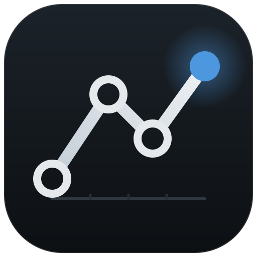

<p align="center">
  
</p>

<h1 align="center">agent-trace</h1>

<p align="center">
  <strong>See what your coding agent did — and what the model saw.</strong>
</p>

<p align="center">
  <a href="https://www.npmjs.com/package/@rivus/agent-trace"></a>
  <a href="https://nodejs.org"></a>
  <a href="LICENSE"></a>
</p>

`npx @rivus/agent-trace` starts a local server, indexes every Claude Code, Codex, and Grok session on this machine, and opens the session browser. Select a session to see its timeline, ledger, and token use; select a request to see what the model was shown.

The reconstruction is the product. A transcript browser tells you what the agent did; agent-trace shows what the model was working from at that point, including the events a compaction removed. Anything the log never recorded is marked `unavailable`; nothing is estimated.

## Features

- **Session browser.** Every session found on this machine, newest first and grouped by day. Each row carries the agent, title, project, turns, requests, tokens, duration, last activity, and flags for compaction, subagents, and failed tool calls. Filter by agent, project, or flag; search titles and your own prompts; a preview shows the selected session's context-over-time shape.
- **Session workspace.** A header with the session's numbers; a timeline with one bar per model request (height is input tokens), a lane per subagent, markers for prompts and failed tool calls, and a dashed rule at each compaction; a ledger of events grouped by turn; an inspector for the selected event.
- **Model saw.** For the selected request, the inspector rebuilds the context the model was given: system prompt, tools, messages, and the events dropped by compaction. Slots the log does not record stay `unavailable`.
- **Report.** A redacted copy of one session's workspace as a single `index.html` that opens from disk with no server.
- **MCP.** `agent-trace mcp <path>` serves a `reconstruct` tool over stdio.

Static mockups of both screens are in [`docs/design/`](docs/design/README.md).

## Quick start

Node.js 24 or later:

```sh
npx @rivus/agent-trace
```

It starts on `localhost` (port 7392 by default), opens the browser, and indexes the sessions of the supported agents. `--no-open` prints the URL instead; `--port 0` picks a free port.

To build from source, use Node.js 24.x; the built CLI runs on Node.js 24 or later:

```sh
pnpm install
pnpm build
node apps/cli/dist/bin.mjs
```

## Commands

```sh
npx @rivus/agent-trace [path] [--port <n>] [--host <host>] [--no-open] [--no-auth] [--pick] [--no-index]
npx @rivus/agent-trace build [path] [--out-dir <dir>]
npx @rivus/agent-trace mcp [path]
```

| Command | What it does |
|---|---|
| `agent-trace` | Session browser for this machine. |
| `agent-trace <path>` | Loads that session before the server listens (exit 1 with the reason if no agent adapter accepts it), then opens its workspace. |
| `agent-trace --pick` | Searchable session list in the terminal; Enter opens the chosen session. Needs an interactive terminal. |
| `agent-trace build <path> --out-dir <dir>` | Writes the report of one session to `<dir>/index.html` (default `dist-static`). |
| `agent-trace mcp <path>` | MCP server over stdio with a `reconstruct` tool for that session. Only protocol messages go to stdout. |

| Flag | Meaning |
|---|---|
| `--port <n>` | Port (default 7392; `0` picks a free one). |
| `--host <host>` | Bind address (default `localhost`). |
| `--no-open` | Print the URL; do not open a browser. |
| `--no-auth` | Turn off DevFrame's one-time-code gate. By default the opened URL carries the code. |
| `--pick` | Pick the session in the terminal. |
| `--no-index` | Do not read or write the session index; summaries are computed again on each launch and not stored. |

`AGENT_TRACE_PATH` is the default session path. `build` and `mcp` fall back to a bundled demo trace when no path is given. When output is not a terminal, or `NO_COLOR` is set, the CLI prints plain lines with no escape sequences.

## Supported agents

| Agent | Where sessions are found |
|---|---|
| Claude Code | `~/.claude/projects/` |
| Codex | `~/.codex/sessions/**/rollout-*.jsonl`, `~/.codex/archived_sessions/**/rollout-*.jsonl` |
| Grok | `~/.grok/sessions/<cwd>/<session-id>/` |

OpenCode and dsh are not supported.

- The agents' home overrides apply and replace the default home: `CLAUDE_CONFIG_DIR` for Claude Code, `CODEX_HOME` for Codex, `GROK_HOME` for Grok. With `CLAUDE_CONFIG_DIR` set, sessions only under `~/.claude` are not listed.
- An agent whose folder does not exist shows 0 sessions and the path it checked. A file the adapter cannot parse is listed as "could not read" with the file, line, and reason. A line inside a session that is not JSON is skipped and does not fail the session.
- Grok records token usage only per turn, so a Grok session has one request per turn, not one per model call.

## Privacy

- Everything runs on this machine. The server binds `localhost`, and nothing is sent anywhere.
- Session files are read, never written.
- The session index lives at `$XDG_CACHE_HOME/rivus-agent-trace/index.sqlite` (default `~/.cache/rivus-agent-trace/`), with mode 0600. It holds titles, paths, numbers, and the first 200 prompts the user typed (500 characters each) for search — not the text the agent injected or recorded itself. Deleting it is safe; it is rebuilt from the logs. `--no-index` runs without it.
- URLs carry opaque trace ids, never paths.
- The local server replaces the home directory with `~` and known credential patterns with placeholders; `AGENT_TRACE_REDACT=0` turns that off for the local server only.
- A report (`build`, or "Export report" in the workspace) is always redacted the same way, whatever `AGENT_TRACE_REDACT` says. **Session text and file contents remain in it, so read a report before you share it.** It holds the view of every event and the original records of the first 2,000 events or 20 MB, whichever is smaller; its header says when it holds fewer.

## Development

The repository is a pnpm workspace. The UI is Solid, Tailwind v4, and shadcn-solid; build, lint, format, and test run through Vite+ (`vp`).

- [Architecture](docs/architecture/overview.md): current behavior and the system shape.
- [Visual design](docs/design/README.md): screens, tokens, and the logo.
- [Development setup](docs/development/setup.md): local commands, the tarball, and the smoke and browser suites.
- [Contributing](CONTRIBUTING.md): workflow, change gates, and release intent.
- [Security](SECURITY.md): how to report a vulnerability.

```sh
pnpm install
pnpm lint
pnpm test
pnpm typecheck
pnpm build
```

## License

GPL-3.0-only. See [LICENSE](LICENSE).

---

_Not affiliated with [Cursor's Agent Trace](https://agent-trace.dev), a code-attribution format._
