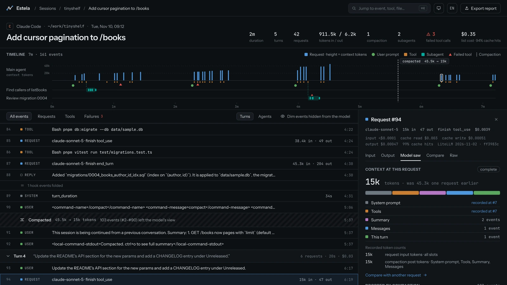

> 中文阅读版。以英文原文 README.md 为准。

<p align="center">
  <a href="README.md">English</a> · <strong>简体中文</strong>
</p>

<p align="center">
  
</p>

<h1 align="center">Estela</h1>

<p align="center">
  <strong>编程 Agent 会话的本地查看器：每个请求、模型看到的内容，以及花费。</strong>
</p>

<p align="center">
  <a href="https://www.npmjs.com/package/@rivus/estela"></a>
  <a href="https://nodejs.org"></a>
  <a href="LICENSE"></a>
</p>

<p align="center">
  
</p>

```sh
npx @rivus/estela
```

需要 Node.js 24 或更高版本。它列出本机编程 Agent 的会话，并在浏览器中打开。任何数据都不会离开本机。

## 用途

编程 Agent 会保存详细的日志，但日志很难读。Agent 出错时，需要知道它当时实际看到了什么。Estela 仅凭日志回答三个问题：

- **Agent 为什么这样做？** 对任意请求，Estela 重建模型收到的上下文：系统提示词、工具、之前的消息和当前轮次。
- **上下文压缩移除了什么？** 它显示压缩把哪些事件移出了模型的视野，并对比压缩前后的上下文。
- **Token 和钱花在哪里？** 它按请求、轮次、子 Agent 和会话显示记录的 Token 数及其标价。

日志未记录的内容显示为 `unavailable`，从不估算。

## 功能

- **会话浏览器。** 本机所有会话集中在一个列表中，最新的在前，显示轮次、请求、Token、时长，并标记上下文压缩、子 Agent 和失败的工具调用。可按 Agent、项目和标记过滤；可搜索标题和你自己输入的提示词。
- **时间线与事件列表。** 每个请求一根柱（高度为输入 Token），每个子 Agent 一行，上下文压缩处标出压缩前后的 Token；所有事件按顺序排列，可按轮次或按 Agent 分组。
- **Model saw。** 任意事件处的上下文，按槽位列出，附 Agent 记录的 Token 数和被压缩移除的事件。
- **Compare。** 并排对比两个请求的上下文：哪些事件进入了上下文、哪些被压缩隐藏，以及系统提示词或工具是否变化。
- **花费。** 按请求、轮次、子 Agent 和会话显示所记录 Token 的标价，以及缓存占比；不完整的合计会说明遗漏了多少个请求。
- **报告与导出。** 一个可分享的已脱敏 `index.html`，一个供 Harbor 使用的 ATIF v1.8 轨迹，一个供 Langfuse、LangSmith 或 Phoenix 使用的 OTLP/JSON trace。
- **MCP 工具。** `estela mcp` 让编程 Agent 找到之前的会话，并读取某个失败请求时模型看到的内容。

## 支持的 Agent

| Agent | 会话位置 |
|---|---|
| Claude Code | `~/.claude/projects/` |
| Codex | `~/.codex/sessions/`、`~/.codex/archived_sessions/` |
| DeepSeek Harness | `~/.dsh/sessions/` |
| Gemini CLI | `~/.gemini/tmp/` |
| Grok | `~/.grok/sessions/` |
| OpenCode | `~/.local/share/opencode/opencode.db` |
| Pi | `~/.pi/agent/sessions/` |

各 Agent 的 home 覆盖变量都会生效。各 Agent 日志记录的内容（系统提示词、工具定义、用量、子 Agent、上下文压缩）不同，见 [Supported agents](docs/guide/supported-agents.md)。

## 隐私

Estela 在本地运行，绑定 `localhost`，只读取会话日志。它在 `~/.cache/rivus-estela/` 中保存一份未脱敏的缓存，包含会话标题、路径、数字，以及每个会话最多 200 条你输入的提示词，可随时删除。脱敏会替换你的 home 目录和部分 token 形式，但不会覆盖所有密钥；报告中仍包含会话文本和文件内容：分享报告前请先阅读。详见 [Privacy and redaction](docs/guide/privacy.md)。

## 文档

- [User guide](docs/guide/README.md)：入门、概念、工作区、报告与导出、MCP 工具、故障排查。
- [Public interface](docs/reference/public-interface.md)：命令、选项、退出码、环境变量，以及 semver 覆盖的范围。
- [Export formats](docs/reference/export-formats.md)：ATIF 和 OTLP 的映射。
- [Architecture](docs/architecture/overview.md)、[development setup](docs/development/setup.md)、[visual design](docs/design/README.md)、[contributing](CONTRIBUTING.md) 和 [security](SECURITY.md)。

## 开发

本仓库是一个 pnpm workspace。从源码构建需要 Node.js `^26.13.1`；构建出的 CLI 在 Node.js 24 或更高版本上运行。

```sh
pnpm install
pnpm build
node apps/cli/dist/bin.mjs
```

[CONTRIBUTING.md](CONTRIBUTING.md) 中有首次贡献的步骤和检查。

## 许可证

GPL-3.0-only。见 [LICENSE](LICENSE)。_Estela_ 在西班牙语中指船驶过后留下的航迹。
