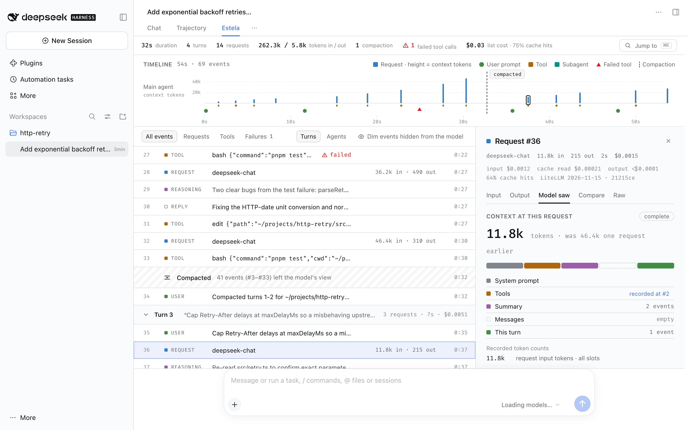
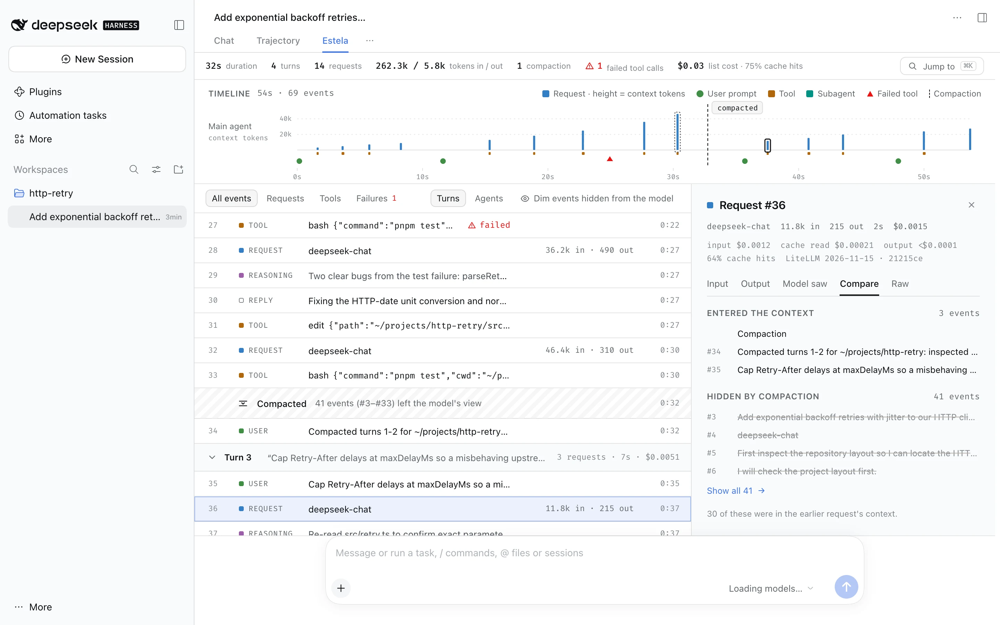
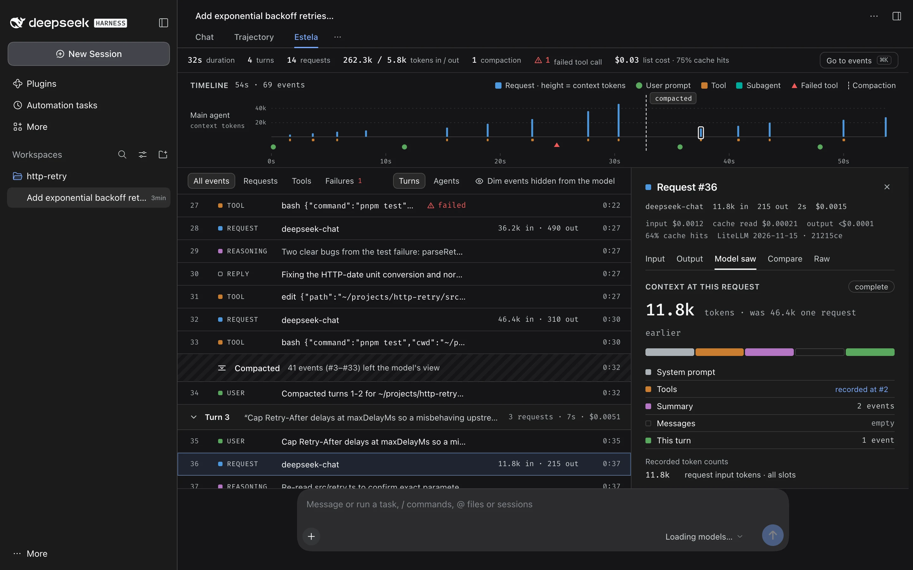

# @rivus/dsh-estela

Adds an **Estela** View tab beside Chat and Trajectory in DeepSeek Harness (`dsh web`) to inspect the current session's log from disk.



## What it shows

The Estela View renders the workspace for the active DeepSeek Harness session, computed in your browser from the session log on disk:

- **Model saw:** reconstructs the context the model received at any request (system prompt, tool schemas, compaction summary, earlier messages, and current turn) alongside recorded token counts.
- **Compare:** compares the context of two requests on the same lane, showing input token delta, per-slot event changes, events that entered the context, and events removed by a compaction between them.
- **Compaction visibility:** marks compactions on the timeline, lists events hidden by compaction in **Model saw** and **Compare**, and lets you dim shadowed events in the ledger.
- **Timeline and event ledger:** request bars whose height is the context tokens, one row per lane, failed tool markers, and an ordered event ledger grouped by turn or by agent, with filters for requests, tools, and failures.
- **List-price cost:** prices recorded tokens per request, turn, lane, and session (with cache hit rate) using the bundled LiteLLM model price snapshot; requests missing input/output tokens, a model name, or a snapshot price are left unpriced with the reason stated (`Cost unavailable: <reason>`) rather than priced as `$0` or estimated, while a request that records 0 tokens costs `$0`.
- **Raw:** loads the original log record on disk for any selected event.

Missing data is never estimated or invented.





## How it differs from Trajectory

`dsh`'s built-in **Trajectory** view follows a running session live, shows first-token latency and decode time, and renders `dsh`-specific content such as `run_code` source and live tool output. **Estela** sits beside Chat and Trajectory as a snapshot view read from the log on disk (including sessions created before the plugin was installed), adding the reconstructed context the model received at any request as far as the log records it (**Model saw**, marking missing parts as partial), context diffs between two requests including events removed by compaction (**Compare**), and list-price cost.

## Install

Requires DeepSeek Harness `>=0.2.2-rc.5 <0.3.0-0` (`engines.dsh`) and Node.js `>=24.9.0`. Only the `web` profile (`dsh web`) is supported; dsh Desktop and the TUI profile are not supported.

```sh
dsh plugin --profile web add @rivus/dsh-estela
```

The plugin has no configuration of its own.

## Usage

1. Start `dsh web` and open a session that has already started (or send a first prompt to start one).
2. Select the **Estela** tab beside Chat and Trajectory.
3. Click a request bar on the timeline or an event in the ledger to inspect **Input**, **Output**, **Model saw**, **Compare**, or **Raw**.
4. **Go to events** (`⌘K` / `Ctrl+K`) moves focus to the event ledger; the arrow keys then move between events.

The View follows `dsh`'s appearance setting (light, dark, or system) and language setting (Simplified Chinese for Chinese, English for every other language) live. Language changes translate only the interface; session text stays in its recorded language.

## Limits

- **Current DeepSeek Harness session only:** shows only the active conversation in `dsh web` and reads only DeepSeek Harness session logs.
- **Snapshot, not live follow:** displays a snapshot of the session log as it was on disk when the View loaded. Reload the `dsh web` page and open the Estela tab again to pick up new turns written while a session is running.
- **Blank sessions:** `dsh web` hides View tabs until a turn has started, so the Estela tab does not appear on a blank session.
- **No session browser or exports:** cross-agent session browsing, standalone HTML reports ("Export report"), ATIF and OTLP exports, and MCP tools are provided by the [`@rivus/estela`](https://www.npmjs.com/package/@rivus/estela) CLI rather than this plugin.
- **Large sessions:** follows the 12 MB view budget (shortening long text in the overview and loading full text when you select an event) and the 512 MB log decompression limit.

## Privacy

- Runs inside `dsh`'s own process: starts no extra process, listens on no extra port, and registers no HTTP route of its own.
- Read-only: writes nothing to disk (not to session logs, not to `dsh` files, and not to Estela's session index).
- Reads the session log from disk and serves session content over `dsh`'s existing connection, only to `dsh`'s admitted owner.
- Redaction is on by default across the View and error messages, replacing home directory paths and the token patterns listed in [Privacy and redaction](https://perfectpan.github.io/estela/docs/guide/privacy/#what-redaction-covers). Start `dsh` with `ESTELA_REDACT=0` to view recorded session text unredacted.

## Uninstall

```sh
dsh plugin --profile web remove @rivus/dsh-estela
```

While `dsh web` is running, the Estela tab disappears within a few seconds without restarting `dsh`, and calls to the plugin channel are refused.

## Incompatible `dsh` version

By default, if your `dsh` version is outside `engines.dsh` (`>=0.2.2-rc.5 <0.3.0-0`), `dsh` refuses to install the plugin or disables an installed copy on startup; a specific version pair exempted with `dsh plugin allow-version` can still be installed. See [Troubleshooting: dsh says the plugin is incompatible](https://perfectpan.github.io/estela/docs/guide/troubleshooting/#dsh-says-the-plugin-is-incompatible).

## Documentation

- [DeepSeek Harness plugin guide](https://perfectpan.github.io/estela/docs/guide/dsh-plugin/)
- [Estela documentation](https://perfectpan.github.io/estela/)
- [Source and issues](https://github.com/PerfectPan/estela)

## License

Licensed under `GPL-3.0-only` ([`LICENSE`](LICENSE)). Licenses of bundled third-party code are listed in `dist/THIRD-PARTY-NOTICES.txt`.
