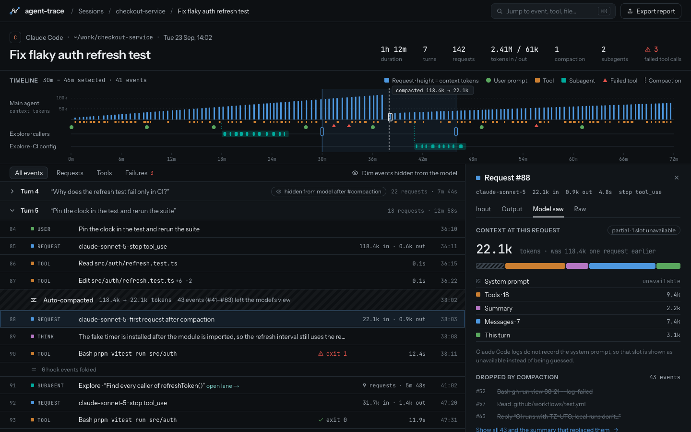

# DevTools visual design

Audience: someone implementing or reviewing the agent-trace UI.

This directory holds the chosen high-fidelity design (direction A, "Instrument") for the two screens in [Spec 0001](../../specs/0001-external-release.md). The HTML files are static mockups. Open them in a browser at 1440 × 900. All session content, paths, and numbers in them are sample data.

| Screen | Dark | Light |
|---|---|---|
| Session browser (home) | [HTML](session-browser-dark.html) · [PNG](session-browser-dark.png) | [HTML](session-browser-light.html) · [PNG](session-browser-light.png) |
| Session workspace | [HTML](session-workspace-dark.html) · [PNG](session-workspace-dark.png) | [HTML](session-workspace-light.html) · [PNG](session-workspace-light.png) |

## Screens

**Session browser.** `npx @rivus/agent-trace` opens here. Left rail: host and project filters, plus "has compaction", "has subagents", "has failed tools". Center: sessions grouped by day, with turns, requests, tokens, duration, and flag icons. Right: a preview of the selected session with its context-over-time shape, headline numbers, the first prompt, and "Open session".

**Session workspace.** Top to bottom:

1. Session header: host, working directory, start time, title, and seven numbers (duration, turns, requests, tokens in / out, compactions, subagents, failed tool calls).
2. Timeline: one lane for the main agent and one per subagent. The time range under the brush filters the ledger.
3. Ledger: events grouped by turn. Turns collapse. Hook events fold into one row. Events hidden from the model after a compaction can be dimmed.
4. Inspector: Input, Output, Model saw, Raw. "Model saw" shows the context composition for the selected request and the events dropped by compaction.

## Encoding rules

- **Request bar height is context size.** In the main lane each request is a bar whose height is the input tokens of that request. Growth and the drop at a compaction are visible without reading numbers.
- **Missing data is drawn as missing.** A slot the host log does not record (for example the Claude Code system prompt) is a hatched segment labeled "unavailable". It is never estimated.
- **Kind is a mark, not text color.** Each event kind has a colored square or bar. Labels and values stay in the text tokens.
- **Red is reserved.** Only failed tool calls use the error color, and always with the warning icon.
- **Compaction is a neutral dashed rule** with the before → after token count.

## Tokens

Both themes share one layout. Only these values change. The right column maps each token to the semantic name already used in `packages/devframe/src/client/styles.css`.

| Token | Dark | Light | Semantic name |
|---|---|---|---|
| bg | `#0d1013` | `#fbfaf8` | `--background` |
| panel | `#111519` | `#f4f3f0` | `--secondary` |
| raised | `#171c21` | `#ffffff` | `--muted` (inputs, active chips) |
| hover | `#1b2127` | `#efeeea` | `--accent` |
| line | `#222930` | `#e6e4df` | `--border` |
| line2 | `#2b333b` | `#d9d7d1` | `--input` |
| text 1 | `#e6e9ec` | `#17191c` | `--foreground` |
| text 2 | `#a3acb5` | `#555b62` | `--muted-foreground` |
| text 3 | `#6d7780` | `#858b92` | new: `--subtle-foreground` |
| error | `#e5534b` | `#c93a32` | `--destructive` |

Selection is the request hue at 10% (dark) or 8% (light) fill with a 55% / 50% ring.

## Event kind palette

Fixed order. Never cycled, never reassigned when a filter hides a kind.

| Kind | Dark | Light |
|---|---|---|
| Request | `#4d97de` | `#347ec4` |
| User prompt | `#5aa75e` | `#418e47` |
| Thinking | `#b576c3` | `#9c5eaa` |
| Tool | `#ca7e31` | `#b0660c` |
| Subagent | `#00ab9d` | `#009284` |

Each set is OKLCH with one lightness and chroma (dark L 0.66, light L 0.58, C 0.13) and hues 250, 145, 320, 62, 185. Both sets pass the dataviz palette validator on their surface: lightness band, chroma floor, adjacent-pair color-blind separation (worst ΔE 13.8 dark, 13.3 light), normal-vision floor, and 3:1 contrast.

Assistant replies use a neutral outlined square.

## Typography

- UI: Instrument Sans 400 / 500 / 600, fallback `"Helvetica Neue", Helvetica, Arial, sans-serif`.
- Data (ids, tokens, durations, paths, commands): JetBrains Mono 400 / 500, fallback `"SF Mono", Menlo, Consolas, monospace`.
- Sizes: session title 26 px / 600, section labels 12 px / 600 uppercase with 0.04em tracking, body 13 px, data 11.5–12 px.

## Not chosen

Two low-fidelity alternates were reviewed and not chosen: a light single-column reading layout, and a timeline-first layout with one lane per agent. The lane idea may return as a view toggle inside the workspace.
