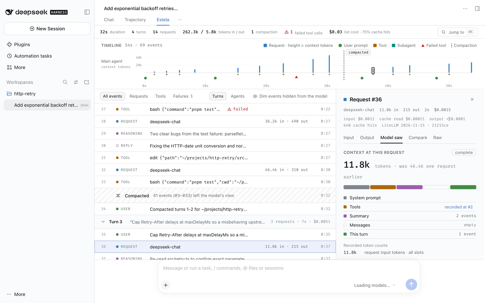

# DeepSeek Harness plugin

`@rivus/dsh-estela` embeds the Estela workspace directly inside DeepSeek Harness (`dsh web`) as a View tab beside Chat and Trajectory, so you can inspect the current session without leaving `dsh` or starting a separate CLI server.

## Install

Install the plugin into the `web` profile and start `dsh web`:

```sh
dsh plugin --profile web add @rivus/dsh-estela
```

The plugin has no configuration of its own. It runs inside `dsh`'s own process, starts no extra process, listens on no extra port, and registers no HTTP route of its own. It reads the session log from disk and serves session content over `dsh`'s existing connection, only to `dsh`'s admitted owner.

Only the `web` profile is supported; dsh Desktop and the TUI profile are not supported.

## What the View shows



When you select the **Estela** tab on a conversation in `dsh web`, the View shows the workspace for that session — the same content the `estela` command line shows for the same log file:

- One row of session numbers above the timeline: duration, turns, requests, tokens, and list-price cost, plus compactions, subagents, and failed tool calls when the session has any. `dsh` already shows the session title, so the View does not repeat it.
- A **Jump to** button (`⌘K` / `Ctrl+K`) that moves focus to the event ledger; the arrow keys then move between events.
- Timeline of requests, lanes, and compactions.
- Event ledger (by turn or by agent).
- Inspector with **Input**, **Output**, **Model saw** (the reconstructed context the model received), **Compare** (context diff between two requests of one lane, including events hidden by compaction), and **Raw**.

Missing data is never estimated or invented.

The View follows `dsh`'s appearance setting (light, dark, or system) and uses `dsh`'s fonts, background, text, and border colors, so it reads as part of `dsh web`. It also follows `dsh`'s language setting (Simplified Chinese for Chinese, English for every other language), updating live when you change them in `dsh`. Changing the language translates only the interface; session text stays in its original language.

Large sessions follow the same 12 MB view budget as the CLI: long text is shortened to fit, and selecting an event loads its full text. If the view still exceeds 12 MB even at the shortest text length, it still opens with a notice that the page may be slow, and selecting an event still loads its full text.

The plugin focuses on the active conversation: it does not include a session browser, "Export report", or ATIF and OTLP exports. Use the `@rivus/estela` CLI for those.

## A session must have started

In `dsh web`, a blank session (before a turn has started) shows no View tabs, so the **Estela** tab does not appear there. Start the session, or open a session that has already started in `dsh`'s session list, to see the Estela tab.

If a session has started but its log has not been written to disk yet, the View shows "This session has no log on disk yet." If a log cannot be read (missing, unreadable, unknown format generation, or over the 512 MB decompression limit) or a transport error occurs, the failure stays inside the Estela View with a "Try again" button while Chat, Trajectory, and `dsh web` keep working.

## Snapshots and running sessions

The Estela View shows a snapshot of the session log as it was on disk when the View loaded. It does not live-follow a running session.

To pick up new turns or events written while a session is running, reload the `dsh web` page and open the Estela tab again.

The plugin never mixes two states of a log: if an event can no longer be read back from the loaded snapshot because the log changed on disk, the View reloads the current log from disk instead of mixing old and new records. Up to three recently opened snapshots stay in memory inside the `dsh` process. If a tab stays open while other tabs open many snapshots, selecting an event in the older tab may fail; select "Try again" to reload the session.

## Redaction

Redaction is on by default. Home directory paths and the token patterns listed in [Privacy and redaction](privacy.md#what-redaction-covers) are replaced across the View and in error messages, the same way the `estela` dev server redacts them.

To inspect recorded session text unredacted, start `dsh` with `ESTELA_REDACT=0` in its environment.

The plugin is read-only and writes nothing to disk: not to the session log, not to `dsh` files, and not to Estela's session index.

## Uninstall

Remove the plugin from the `web` profile:

```sh
dsh plugin --profile web remove @rivus/dsh-estela
```

If `dsh web` is running, the Estela tab disappears within a few seconds without restarting `dsh`, calls to the plugin channel are refused, and no plugin tab, channel, process, port, `web` profile dependency or bundle entry (`package.json` and bundle config), or installed directory in `node_modules` remains. If you previously granted a version exemption with `dsh plugin allow-version`, that exemption is stored separately in the profile (`compatibility.json`) and removing the plugin does not revoke it.

## Version range

`@rivus/dsh-estela` declares its supported DeepSeek Harness range in `engines.dsh` (`>=0.2.2-rc.5 <0.3.0-0`) and requires Node.js `>=24.9.0`.

If your `dsh` version is outside `engines.dsh`, see [Troubleshooting](troubleshooting.md#dsh-says-the-plugin-is-incompatible).
