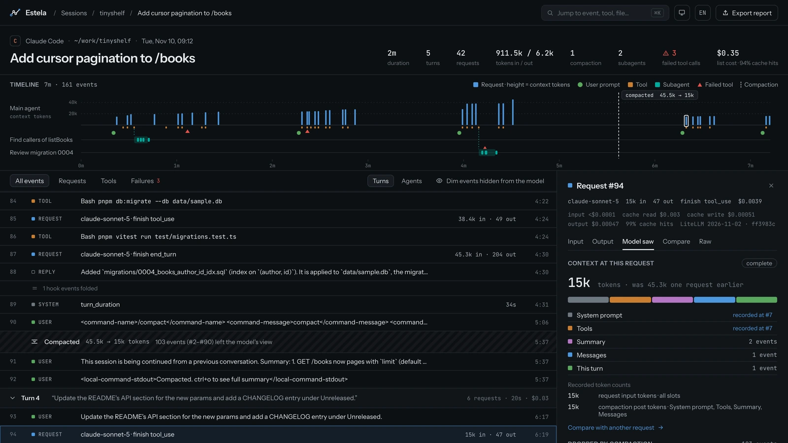

# The workspace

The workspace shows one session. From top to bottom: the session header, the timeline, the ledger (left), and the inspector (right). Everything on the page is computed in your browser from the loaded session, the same way on the local server and in a [static report](exports.md#report).

A large session loads with a progress bar (bytes read of the file size). To keep the page responsive, very long texts are shortened in the view; selecting such an event loads its full text. A notice says when this happened.

## Session header

The agent, working directory, start time, and title, then the session's numbers:

| Number | Meaning |
|---|---|
| duration | The recorded turn durations added up, or else the recorded request durations |
| turns | Prompts you typed on the main agent |
| requests | Request events |
| tokens in / out | Recorded input and output tokens added up over all requests, cache reads and writes included in "in" |
| compactions | Compaction events |
| subagents | Subagent lanes |
| failed tool calls | Tool results the log marks as errors |
| list cost | The [list cost](#cost) of the session |

A number the agent cannot record shows "—" (see [Concepts](concepts.md#capabilities)).

## Timeline

One row per lane: the main agent first, then each subagent. Each request is a bar whose height is its recorded input tokens, so the bars show the context growing and dropping. A request without recorded usage is a hollow bar. Dots mark your prompts and tool calls, triangles mark failed tool calls, and a dashed vertical rule marks a compaction, labeled with the tokens before and after it when recorded.

Drag across the timeline to select a time range; the ledger then shows only the events in it, and the header states the range and event count. The two range handles also move with the arrow keys (Shift for larger steps), Home, and End. Clicking a request bar, on the main lane or a subagent lane, selects that request. Shift-click on another bar of the selected request's lane picks it for [Compare](#compare); on another lane it selects that request instead.

## Ledger

The ledger lists the events. The chips at the top show all events, only requests, only tools, or only failures. Two layouts:

- **Turns** groups events under one header per turn, with the turn's prompt, request count, duration, and cost. A subagent's events sit behind one row at the tool call that started it; expand it to see them.
- **Agents** groups events under one header per lane, with that lane's cost.

"Dim events hidden from the model" greys out events a compaction removed. A compaction is its own row, with the tokens before and after it and how many events it removed.

## Inspector

Selecting an event opens it in the inspector. Its first line shows, for a request, the model, input and output tokens, finish reason, and cost; below it the cost split by token class (see [Cost](#cost)). The tabs:

| Tab | Shows |
|---|---|
| Input | The event's input fields, normalized across agents (for example a tool call's arguments) |
| Output | The event's output fields (for example a tool result's output) |
| Model saw | The context the model had at this event: the slots, the recorded token counts, and the events a compaction removed (see [Concepts](concepts.md#model-saw)) |
| Compare | The context of this request against another request of its lane (below) |
| Raw | The original log record the event came from |

## Compare

Compare shows what changed in the model's context between two requests of the same lane. Select a request and open the Compare tab, or use "Compare with another request" in Model saw.

The other request is, in order: the one you picked, while it is still another request of the same lane; else the previous request on the lane; for the first request of a lane, the next one. Pick another with the "Compared with" list (every other request of the lane with its input tokens), the "Previous request" and "Before the last compaction" shortcuts (the latter appears when a compaction precedes the selected request), or Shift-click on another bar of the same lane on the timeline; the timeline then draws the compared request with a dashed ring. The comparison always runs from the earlier request to the later one, and marks the selected one.

The tab shows:

- the two requests' recorded input tokens and the difference, only when both are recorded;
- each compaction between them, with its tokens before and after, or "not recorded";
- per slot: for the system prompt "same" or "changed"; for the tools "same", the tool names added and removed, or "changed · tool names not recorded" when a definition has no name; for summary, messages, and this turn, how many events were added, removed, and kept, and a status change such as `empty → present`;
- the events that entered the context, and the events a compaction between the two requests hid (struck through), each selectable.

A slot that either request's log does not record is hatched, marked `unavailable`, and not compared. Slot changes are counts of events, not tokens: agents record one input-token total per request, not a size per slot, and Estela does not estimate one. For the same reason there is no chart of token composition by slot over time; the timeline's bar heights are the recorded totals.

## Cost

Estela shows the list price of the tokens each request recorded, at the [LiteLLM](https://github.com/BerriAI/litellm) model prices bundled with the CLI. It is not the amount billed: plans, discounts, service tiers, and costs an agent logs itself are not applied, and Codex's priority-tier pricing is not either.

Where it appears: the session total in the header (with the cache hit rate), per turn in the turn header, per lane in the Agents layout (a subagent's cost also counts in the turn that started it), and per request in the inspector with its input, cache-read, cache-write, and output shares and its cache hit rate. The session browser shows no cost. The tooltip and the inspector name the price snapshot, for example `LiteLLM 2026-11-02 · ff3983c`; a newer Estela can bundle newer prices, so the same session can show a different cost after an upgrade.

The rules:

- A request is priced when it records input and output tokens, names a model, and that model has a price. When an agent splits one request's usage by model, every part must meet the same rule.
- Otherwise the request is unpriced, with the first reason that applies: no usage recorded; input or output tokens not recorded; no model recorded; no price for the named model. It shows "Cost unavailable: <reason>", never $0 and never an estimate.
- A request that records 0 input and 0 output tokens costs $0, whatever its model.
- A turn, lane, or session total adds the priced requests and says how many it leaves out: "1 of 4 requests unpriced", or "$0.07 · 1 unpriced" where space is short. When nothing is priced it shows the reasons and their counts.
- The cache hit rate is cache-read tokens over input tokens, across the requests that record both.
- Amounts are US dollars: two decimals from a cent up, two significant digits below a cent, and `<$0.0001` below that.

A report shows the same costs. The ATIF export carries them in ATIF's own cost fields ([Export formats](../reference/export-formats.md#metrics-and-cost)).

## Connection

If the local server stops while a page is open, the page says "Lost the connection to the Estela server" and offers Reload. A loaded workspace stays readable under that notice. Restart `estela` and reload.

## Theme and language

The theme follows your system's light or dark setting until you pick one; the choice is kept in the browser. The interface is in English or Simplified Chinese (Chinese when the browser's first language starts with `zh`), with a switch in the top bar. Session content is shown as recorded, never translated.
