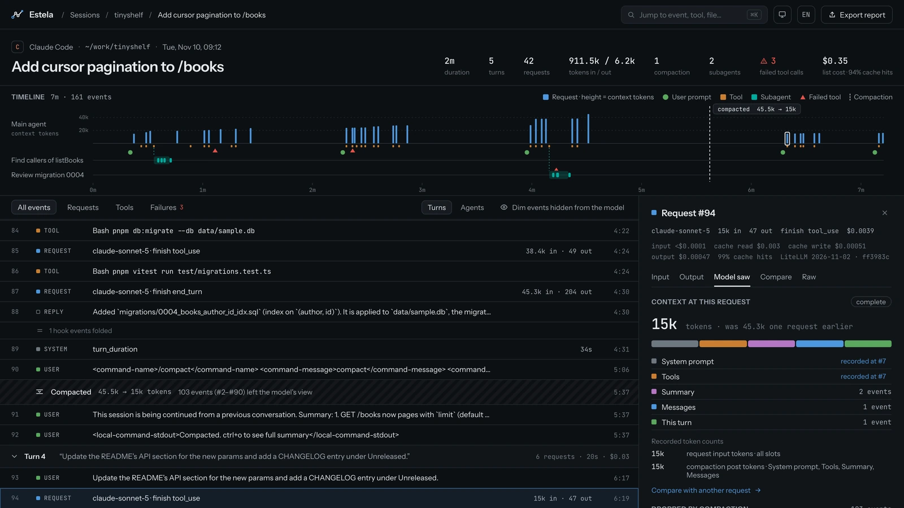

> 中文阅读版。以英文原文 docs/guide/workspace.md 为准。

# 工作区

工作区展示单个会话。从上到下依次为：会话页头、时间线、事件列表（左侧）和检查器（右侧）。页面上的全部内容均在你的浏览器中根据已加载会话计算得到，本地服务器与[静态报告](exports.zh-CN.md#报告)的计算方式完全一致。

大型会话在加载时会显示进度条（已读取字节数占文件大小的比例）。为保持页面响应，视图中的超长文本会被截短；选中这类事件即可加载其完整文本。发生截短时页面会显示提示。

## 会话页头

显示代理、工作目录、开始时间和标题，随后是会话的各项数字：

| 数字 | 含义 |
|---|---|
| 时长 | 已记录的各轮次时长之和，若未记录则为已记录的各请求时长之和 |
| 轮次 | 你在主代理输入的提示词数量 |
| 请求 | 请求事件数 |
| 输入 / 输出 Token | 所有请求记录的输入与输出 Token 总和，其中「输入」包含缓存读取与写入 |
| 上下文压缩 | 上下文压缩事件数 |
| 子代理 | 子代理泳道数 |
| 失败的工具调用 | 日志标记为错误的工具结果数 |
| 目录价费用 | 会话的[目录价费用](#费用) |

代理无法记录的数字显示为「—」（见[概念](concepts.zh-CN.md#能力)）。

## 时间线

每条泳道占一行：主代理在最前，随后是各个子代理。每个请求显示为一根柱条，其高度代表记录的输入 Token 数，因此柱条反映上下文的增长与回落。未记录用量的请求显示为空心柱条。圆点标记你的提示词和工具调用，三角形标记失败的工具调用，垂直虚线标记上下文压缩，并在有记录时标注压缩前后的 Token 数。

在时间线上拖动可选择时间范围；事件列表随后只显示该范围内的事件，页头也会说明所选范围和事件数量。两个范围手柄也可以用方向键（配合 Shift 键以更大步长移动）、Home 和 End 键移动。点击主泳道或子代理泳道上的请求柱条会选中该请求。按住 Shift 点击选中请求所在泳道的另一根柱条，会将其选入[对比](#对比)；按住 Shift 点击另一条泳道上的柱条，则会改为选中该请求。

## 事件列表

事件列表按顺序列出事件。顶部的筛选标签可切换显示全部事件、仅请求、仅工具或仅失败。提供两种布局：

- **轮次**将事件按每轮一个标题分组，附带该轮的提示词、请求数、时长和费用。子代理的事件收拢在启动它的工具调用所在行之后；展开即可查看。
- **代理**将事件按每条泳道一个标题分组，附带该泳道的费用。

勾选「淡化模型已看不到的事件」会置灰被上下文压缩移除的事件。每次上下文压缩各自占一行，标明压缩前后的 Token 数以及移除了多少事件。

## 检查器

选中一个事件会在检查器中打开它。对于请求，首行显示模型、输入和输出 Token、结束原因和费用；下方显示按 Token 类别拆分的费用（见[费用](#费用)）。各个标签页：

| 标签页 | 显示内容 |
|---|---|
| 输入 | 跨代理归一化后的事件输入字段（例如工具调用的参数） |
| 输出 | 事件的输出字段（例如工具结果的输出） |
| 模型所见 | 模型在该事件时看到的上下文：各个槽位、已记录的 Token 数以及被上下文压缩移除的事件（见[概念](concepts.zh-CN.md#模型所见)） |
| 对比 | 该请求与同一泳道另一请求的上下文比较（见下文） |
| 原始记录 | 该事件来源的原始日志记录 |

## 对比

「对比」展示同一泳道上两个请求之间模型上下文的变化。选中一个请求并打开「对比」标签页，或在「模型所见」中点击「与另一个请求对比」。

对比的另一请求按以下优先级确定：若你手动选过一个同泳道的不同请求，则保留该选择；否则取该泳道上的上一个请求；若是泳道的第一个请求，则取下一个请求。可通过「对比对象」列表（列出同泳道所有其他请求及其输入 Token 数）、「上一个请求」和「最近一次压缩之前」快捷按钮（后者在选中请求之前存在上下文压缩时出现）选择其他请求，或在时间线上按住 Shift 点击同一泳道的另一根柱条，此时时间线会用虚线框标出被对比的请求。对比总是从较早的请求指向较晚的请求，并标明当前选中的请求。

该标签页显示：

- 两个请求记录的输入 Token 数及其差值（仅当双方均已记录时显示）；
- 两者之间的每次上下文压缩，附带压缩前后的 Token 数或「未记录」；
- 各槽位的变化：系统提示词显示「相同」或「已变化」；工具显示「相同」、增减的工具名称，或在定义没有名称时显示「已变化 · 未记录工具名称」；摘要、消息和本轮显示新增、移除和保留的事件数量，以及如 `empty → present` 的状态变化；
- 进入上下文的事件，以及在两个请求之间被上下文压缩隐藏的事件（带删除线），每一条均可选中。

只要任一请求的日志未记录某个槽位，该槽位即以斜线底纹标记为 `unavailable`，且不进行比较。槽位变化以事件数为单位，而非 Token 数：代理每次请求只记录一个输入总 Token 数，不按槽位记录大小，Estela 也不对此做估算。出于同样原因，工作区不提供按槽位划分的 Token 构成随时间变化图；时间线柱条高度代表已记录的总数。

## 费用

Estela 按 CLI 内置的 [LiteLLM](https://github.com/BerriAI/litellm) 模型价格，计算每次请求所记录 Token 的目录价。它不是实际账单：订阅方案、折扣、服务等级和代理自己记录的费用均不应用，Codex 的优先服务等级定价也不应用。

费用显示位置：页头中的会话总计（附带缓存命中率）、轮次标题中的轮次费用、「代理」布局中的泳道费用（子代理的费用同时计入启动它的轮次），以及检查器中的单次请求费用（含输入、缓存读取、缓存写入和输出各分项及其缓存命中率）。会话浏览器不显示费用。悬停提示和检查器会注明价格快照，例如 `LiteLLM 2026-11-02 · ff3983c`；新版本的 Estela 可能内置更新的价格，因此升级后同一会话显示的费用可能发生变化。

计价规则：

- 当请求记录了输入和输出 Token、注明了模型且该模型有价格时，该请求才计价。当代理将单个请求的用量按模型拆分时，每一部分都必须满足相同规则。
- 否则该请求为未计价，并按顺序给出首个适用的原因：未记录用量、未记录输入或输出 Token、未记录模型、没有对应模型的价格。界面显示「费用不可用：<原因>」，绝不显示 $0，也绝不估算。
- 记录了 0 输入和 0 输出 Token 的请求，无论模型为何，费用均为 $0。
- 轮次、泳道或会话总计只累加已计价请求，并说明遗漏了多少请求：「4 个请求中有 1 个未计价」，或在空间较小时显示为「$0.07 · 1 个未计价」。当没有任何请求可计价时，显示各原因及其数量。
- 缓存命中率定义为在同时记录了缓存读取与输入 Token 的请求上，缓存读取 Token 占输入 Token 的比例。
- 金额单位为美元：一美分及以上保留两位小数，一美分以下保留两位有效数字，再小则显示为 `<$0.0001`。

报告显示相同的费用。ATIF 导出将费用写入 ATIF 自身的费用字段（见[导出格式](../reference/export-formats.zh-CN.md#指标与费用)）。

## 连接

如果本地服务器在页面打开期间停止，页面会显示「与 Estela 服务的连接已断开。」并提供「重新加载」按钮。在出现该提示时，已加载的工作区仍可继续阅读。重新启动 `estela` 后点击重新加载即可。

## 主题与语言

在手动选择之前，主题跟随系统的浅色或深色设置；选择结果保存在浏览器中。界面支持英文和简体中文（当浏览器首选语言以 `zh` 开头时使用中文），顶部栏设有切换开关。会话内容按日志记录原样展示，从不翻译。
