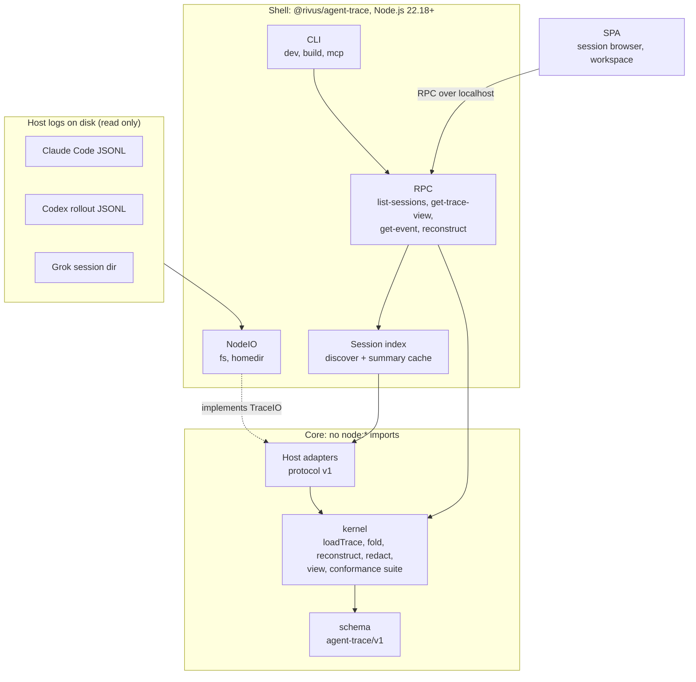
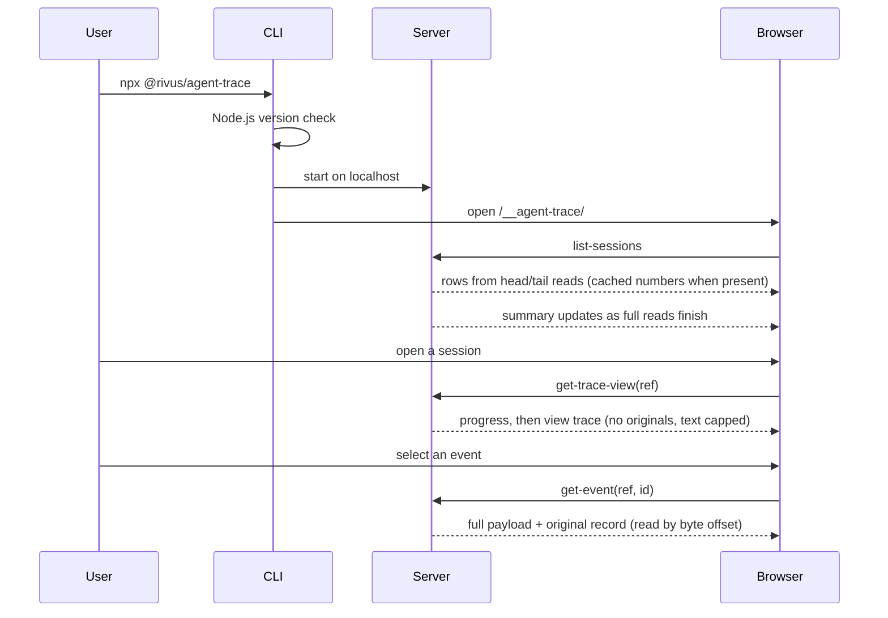
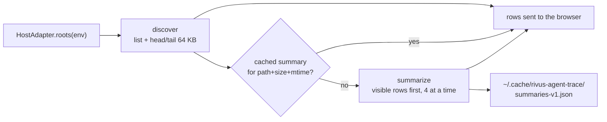
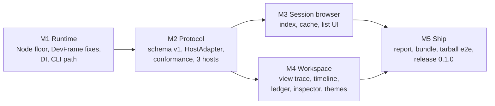

# agent-trace DevTools: host protocol, session browser, and workspace

- Status: draft
- Owner: unconfirmed
- Reviewer: unconfirmed
- Last updated: 2026-09-24
- Paired Spec: [`specs/0001-external-release.md`](../../specs/0001-external-release.md)
- Visual design: [`docs/design/`](../design/README.md)

This plan turns the MVP on `main` into `@rivus/agent-trace`: a local DevTools that `npx @rivus/agent-trace` opens in the browser. The user picks a session from Claude Code, Codex, or Grok and debugs it in one workspace. The plan defines the host protocol that those three hosts implement first, the canonical trace `agent-trace/v1`, how sessions are discovered and loaded at the sizes found on a real machine, the UI build against the chosen design, and packaging. ATIF export, OpenCode, and dsh are follow-ups on the same protocol.

## Contents

1. Background and goals
2. Outline
3. Detailed design
4. Rollout and stability
5. Verification
6. Delivery plan and effort
7. Risks, open questions, and follow-up
8. Appendix: measurements

## 1. Background and goals

### 1.1 Current behavior and constraints

Measured on `main` and on this machine on 2026-09-23 and 2026-09-24. Commands and raw output are in section 8.

**Entry points.** The dev server works on the demo fixture. `build` exits 1 (`Cannot destructure property 'eventId'`), because `reconstruct` is registered with `snapshot: true` and the static dump calls it without arguments. `mcp` exits 1 (`DF0079`, `@devframes/agentic` not installed). The session comes only from `AGENT_TRACE_PATH`; there is no session list.

**Runtime.** `rush.json` allows Node.js `>=20.11`. `bin.mjs` imports `.ts` directly and `adapter-opencode` imports `node:sqlite`. Both fail on 20.19 and 22.12 and work on 22.18. Node.js refuses to strip types under `node_modules`, so a published package needs compiled JavaScript.

**Current UI.** On a real 3,300-record Grok session the ledger renders 2,258 rows at once (14,066 DOM nodes). 1,294 of those rows (57%) are `UNKNOWN hook_execution`. There is no timeline, no turn collapse, and no virtualization.

**Adapter interface.** `Adapter = { id, detect(path), load(path) }`. It cannot list sessions, cannot say which fields a host provides, and reads files through `node:fs` directly. `adapter-dsh` and `adapter-claude-code` claim files and then throw.

**Host logs on this machine.** All three hosts record request boundaries, token usage, timing, compaction, and subagents, under different names:

| Need | Claude Code | Codex | Grok |
|---|---|---|---|
| Location | `~/.claude/projects/<cwd>/<id>.jsonl`, subagents in `<id>/subagents/agent-*.jsonl` | `~/.codex/sessions/YYYY/MM/DD/rollout-*.jsonl` | `~/.grok/sessions/<cwd>/<id>/updates.jsonl` plus `summary.json`, `system_prompt.txt`, `tool_definitions.json`, `subagents/` |
| Request boundary, model | `requestId`, `message.model` | `response_id`, `turn_context` | `_meta.modelId`, `_meta.promptIndex` |
| Tokens | `message.usage` | `token_usage_record` | `turn_completed.usage` |
| Timing | record `timestamp`, `system/turn_duration` | `started_at_ms`, `completed_at_ms` | `turn_completed.elapsed_ms` |
| Compaction | `system/compact_boundary` with `compactMetadata.{trigger, preTokens, postTokens, durationMs, preservedSegment}` | `compacted` | `auto_compact_started/completed`, `compaction_checkpoint` |
| Subagents | `isSidechain`, `subagents/*.jsonl` | `inter_agent_communication_metadata` | `subagent_spawned/finished`, `subagents/` |
| System prompt, tool schemas | not recorded | not recorded (unverified for all generations) | `system_prompt.txt`, `tool_definitions.json` |

**Log volume on this machine.**

| Host | Files | Total | Median | p95 | Max |
|---|---|---|---|---|---|
| Claude Code (main) | 225 | 550 MB | 146 KB | 8.6 MB | 81.6 MB |
| Claude Code (subagents) | 74 | 49 MB | 485 KB | 1.1 MB | 5.9 MB |
| Codex | 1,935 | 10.8 GB | 557 KB | 22 MB | 355 MB |
| Grok | 77 | 220 MB | 1.2 MB | 10 MB | 29 MB |

Only counting the lines of all Claude Code main files takes 2.35 s. The current Codex adapter loads the 355 MB file in 1.7 s into 16,652 events, but the serialized trace is 360 MB and the process peaks at 3.2 GB RSS. Without `original` the events are 21.3 MB; with long strings capped at 4 KB they are 9.5 MB.

**Community formats** (read from primary sources; section 8, A.7):

- ATIF v1.8 (Harbor, Apache-2.0) is a trajectory format of steps. It has tool call and result pairing by id, a written compaction boundary rule, and embedded subagent trajectories. Harbor ships converters for Claude Code, Codex, Grok, and OpenCode. Its unit is a step, roughly one model call. It does not keep the host record or say which individual events a compaction removed.
- OpenTelemetry GenAI semantic conventions define the widest vocabulary (`gen_ai.usage.*`, `gen_ai.request.model`, `gen_ai.response.id`, `gen_ai.tool.call.id`, `CompactionPart`). All of it is at Development stability, and it moved to its own repository in May 2026 with no release yet.
- ACP is a live client protocol. It is Grok's log format here, not a trace model.
- Cursor's "Agent Trace" (agent-trace.dev) is a code-attribution format with a near-identical name and no functional overlap.

**Publishing.** `@rivus/agent-trace` is unpublished. `PerfectPan/rivus-agent` is a private repository that publishes the `@rivus/*` packages from `.github/workflows/publish-npm.yml` on a GitHub release, with `id-token: write` and no npm token.

### 1.2 Problem

A developer cannot open the tool, pick a session, and see what happened. The shipped commands are half broken, there is no list of sessions, Claude Code (the host with the most local sessions and the richest compaction data) is not supported, and the data model cannot express request boundaries, context size, or subagent lanes, so the UI cannot draw them. At the log sizes above, sending one complete trace to the browser does not work for the largest sessions.

### 1.3 Goals and success criteria

- Every scenario in the Spec passes as listed under its Acceptance Evidence: in CI against the packed tarball, and for real sessions by a recorded local run.
- Claude Code, Codex, and Grok adapters implement host protocol v1 and pass the conformance suite on synthetic fixtures.
- The session browser shows rows within 2 s on this machine (2,300+ files, 11.6 GB) and within 300 ms on the second launch for the cached numbers.
- The 355 MB Codex session opens with at most 12 MB sent to the browser before the first event is selected.
- `schema`, `kernel`, and adapters import no `node:*` module outside tests.
- The two screens match `docs/design/` in both themes, reviewed side by side with the PNGs in the delivery PR.

### 1.4 Non-goals

- ATIF export, OTLP export (follow-ups, section 7).
- OpenCode and dsh in the session browser (follow-ups on protocol v1).
- Live follow of a running session.
- Search inside session content beyond title and first prompt.
- A stable library API for internal packages.
- Changing repository visibility.

## 2. Outline

### 2.1 Design principles

- The product is the DevTools screen. The CLI only starts it.
- Draw only what the host recorded. Missing is `unavailable`, never zero or an estimate.
- A host plugs in through one protocol with a declared capability list, and proves it with the same conformance suite as every other host.
- The browser receives a view of the trace sized for display. The full record is one request away.
- The core does not know where bytes come from. Files, SQLite, the environment, and the home directory are passed in.

### 2.2 Boundaries and responsibilities



| Piece | Owns | Change in this plan |
|---|---|---|
| `@agent-trace/schema` | `agent-trace/v1` types, v0 reader | New event kinds, request and compaction payloads, agents, capabilities, source pointers |
| `@agent-trace/kernel` | `TraceIO`, `HostAdapter`, `loadTrace`, `fold`, `reconstruct`, `redact`, `toView`, conformance suite | New protocol, view projection, conformance suite; no `node:*` |
| `adapter-claude-code` | Claude Code logs | New implementation |
| `adapter-codex`, `adapter-grok` | Their logs | Ported to protocol v1, extended to requests, usage, timing, compaction, subagents |
| `adapter-opencode`, `adapter-dsh` | Their logs | Not registered in this release |
| `@agent-trace/devframe` (published as `@rivus/agent-trace`) | NodeIO, session index, RPC, CLI, SPA | Most of the work |
| `docs/design/` | Visual contract | Implemented as tokens in `styles.css` |

### 2.3 Main path



With a path argument the CLI loads and checks that session before listening, then opens the workspace URL for it.

### 2.4 Design decisions

**D1. The product is a browser DevTools; the CLI is its launcher.**
Alternatives: a CLI-first tool (the previous draft of this plan), and a desktop app. A CLI cannot show a timeline or an inspector. A desktop app adds an installer and signing for no capability the browser lacks. DevFrame already provides the local server, the SPA shell, the static build, and MCP.

**D2. Host protocol v1 replaces `Adapter`.**
The current interface cannot list sessions or state which fields a host records, so the UI cannot tell "zero" from "not recorded". Protocol v1 adds `discover`, `summarize`, a capability list, and a conformance suite (3.2). Alternative: keep `Adapter` and add discovery in the shell per host. Rejected because each host's layout knowledge would then live in two places.

**D3. `agent-trace/v1` stays event-level; field meanings follow OTel GenAI; the structure stays mappable to ATIF.**
Events remain the canonical unit because `reconstruct` answers per event and the inspector shows per-event raw records. Alternatives: ATIF as storage (rejected: step granularity, no raw record, no per-event visibility), OTel spans as storage (rejected: Development stability, and a span tree has no place for per-event visibility). Usage, model, request, and tool fields take their meaning, units, and names from OTel GenAI, written in camelCase in TypeScript with a one-to-one table (3.3). Every v1 field that ATIF has must map to it without loss, so the ATIF export follow-up is a projection, not a redesign.

**D4. Claude Code, Codex, and Grok in this release.**
Claude Code has the most sessions and the fullest compaction record here. Codex and Grok already have adapters to port. OpenCode needs `SqliteIO` and is the next host on the same protocol; dsh needs zstd and its format catalog.

**D5. Core packages take I/O by injection.**
`TraceIO` (read text, read a byte range, list a directory, stat) and `homeDir` are passed in; the Node implementation lives in the shell. Enforced by oxlint `no-restricted-imports` on `node:*` outside tests, and by an `esbuild --platform=browser` bundle of kernel and adapters in CI. Both checks were run on `main` and fail today (A.5).

**D6. The browser receives a view trace; originals and full text load on demand.**
This changes two current rules in `AGENTS.md`: "canonical storage is `events[]` plus `original`" becomes "every event can return its original", and "`getTrace` is one snapshot blob" becomes "`get-trace-view` is one snapshot blob; `get-event` returns one event in full". Measured on the 355 MB session: 360 MB full, 21.3 MB without originals, 9.5 MB with strings capped at 4 KB (A.6). Alternatives: paging events (rejected: the timeline and the ledger need every event's shape, and `reconstruct` needs the whole sequence), and compressing the full blob (rejected: the server would still hold 3.2 GB). The server keeps each event's source pointer (file, byte offset, length) and reads the line again when `get-event` asks for it. `AGENTS.md` is updated in the same change.

**D7. Session discovery reads heads and tails; full summaries are computed lazily and cached on disk.**
A full parse of 11.6 GB at launch is not possible. `discover` lists files and reads the first and last 64 KB of each to fill title, project, start and last activity, and size. `summarize` parses one file fully for turns, requests, tokens, duration, and flags. The shell runs `summarize` for visible rows first, with a concurrency limit of 4, and stores results in `~/.cache/rivus-agent-trace/summaries-v1.json` keyed by path, size, and mtime. Alternative: an SQLite index. Rejected for now; revisit if the JSON cache exceeds 5 MB or the first screen misses 2 s.

**D8. RPC shape and the static report.**
Queries: `list-sessions` (not a snapshot), `get-trace-view(ref)`, `get-event(ref, id)`, `reconstruct(ref, eventId)` (for MCP; `snapshot: true` removed, the measured cause of the `build` failure). DevFrame's static dump only bakes argument-free snapshot queries, so `build <path>` registers one extra argument-free query, `report-trace`, bound to that session, and the SPA starts in report mode when it finds it. A report includes the view trace and the original records of at most the first 2,000 events or 20 MB, whichever is smaller, and says so in the report header when it truncates.

**D9. UI stack and design contract.**
Solid, Tailwind v4, and shadcn-solid stay. Tokens, palette, type, and encoding rules come from `docs/design/README.md` and become CSS variables in `styles.css` under `data-theme="dark|light"`. The ledger uses `@tanstack/solid-virtual` 3.13. The timeline and preview shape are SVG drawn from kernel projections; no chart library.

**D10. Redaction.**
`redact(trace, { homeDir })` replaces the home directory with `~` in every string and replaces the known token patterns. The report path always redacts. `AGENT_TRACE_REDACT=0` affects only the local server.

**D11. One bundled package, `@rivus/agent-trace`.**
esbuild bundles the shell and all workspace packages into `dist/cli.mjs` with `devframe`, `@devframes/agentic`, and `cac` as runtime dependencies. `dist/bin.mjs` checks Node.js `>=22.18` before a dynamic import, because a static import would load `node:sqlite` first. `devframe` and `@devframes/agentic` are pinned to `1.0.0`, since `@devframes/agentic@1.0.0` declares `peerDependencies: { devframe: "1.0.0" }`. A packing probe of this approach installed into an empty directory ran `build` and `mcp` successfully (A.4).

**D12. Release through GitHub release and npm trusted publishing, like `rivus-agent`.**
A workflow on `release: published` runs the gates, then publishes with `id-token: write`. The repository can stay private. Whether npm provenance is attached for a private repository is not asserted here.

## 3. Detailed design

### 3.1 Entry points

```
npx @rivus/agent-trace [path] [--port] [--host] [--no-open] [--no-auth]
npx @rivus/agent-trace build <path> [--out-dir report]
npx @rivus/agent-trace mcp <path>
```

- No path: open `/__agent-trace/` (session browser).
- Path: load it once through `loadTrace`; on failure exit 1 with the message before listening; on success open `/__agent-trace/#/s/<ref>`.
- `ref` is an opaque id the index assigns (a hash of host and path). The absolute path never appears in a URL.
- `AGENT_TRACE_PATH` is used when no path argument is given.

### 3.2 Host protocol v1

Exported from `@agent-trace/kernel`:

```ts
export interface TraceIO {
  readText: (path: string) => Promise<string>
  /** `end` is exclusive. */
  readBytes: (path: string, range?: { start: number, end: number }) => Promise<Uint8Array>
  list: (dir: string) => Promise<{ name: string, kind: 'file' | 'dir' }[]>
  /** `null` when the path does not exist. */
  stat: (path: string) => Promise<{ kind: 'file' | 'dir', size: number, mtimeMs: number } | null>
  /** Iterate lines with their byte offsets; used to build source pointers. */
  lines: (path: string, opts?: { signal?: AbortSignal }) => AsyncIterable<{ text: string, offset: number, length: number, line: number }>
}

export interface HostEnv {
  homeDir: string
  env: Readonly<Record<string, string | undefined>>
}

export type Capability =
  | 'requests' | 'usage' | 'durations' | 'thinking'
  | 'compaction' | 'compactionTokens' | 'subagents'
  | 'systemPrompt' | 'toolSchemas' | 'hooks'

export interface SessionRef { host: string, path: string, sessionId?: string }

export interface SessionHead {
  ref: SessionRef
  title?: string
  cwd?: string
  startedAt?: number
  lastActiveAt: number
  sizeBytes: number
  firstPrompt?: string
}

export interface SessionSummary {
  turns?: number
  requests?: number
  tokensIn?: number
  tokensOut?: number
  durationMs?: number
  compactions?: number
  subagents?: number
  failedTools?: number
  /** Input tokens per request in order, downsampled to at most 120 points, for the preview shape. */
  contextShape?: number[]
}

export interface HostAdapter {
  id: string
  displayName: string
  protocol: 1
  capabilities: readonly Capability[]
  /** Default locations for this host, for example `<home>/.claude/projects`. */
  roots: (env: HostEnv) => string[]
  /** Cheap: list files and read at most 64 KB from each end. */
  discover: (root: string, io: TraceIO, opts: { signal?: AbortSignal }) => AsyncIterable<SessionHead | { ref: SessionRef, error: string }>
  detect: (ref: SessionRef, io: TraceIO) => Promise<boolean>
  load: (ref: SessionRef, io: TraceIO, opts: { signal?: AbortSignal, onProgress?: (bytes: number) => void }) => Promise<Trace>
  /** Defaults to `fold(await load(...))`; a host may override it with a faster pass. */
  summarize?: (ref: SessionRef, io: TraceIO, opts: { signal?: AbortSignal }) => Promise<SessionSummary>
}
```

Rules:

- An adapter reads only through `TraceIO` and writes nothing.
- A field the host can record is declared in `capabilities`. A declared field that is missing from one record is `undefined` for that record, never zero.
- `load` must account for every input record: it becomes one or more events, or one `skipped` entry with a reason and line number.
- An unknown record type becomes an `unknown` event with `payload.type` set to the host's type name. An unknown format generation fails `load` with the line number.
- Event ids are derived from host ids when the host has them, otherwise from file and line, so a second load gives the same ids.

**Conformance suite.** `@agent-trace/kernel/conformance` exports `describeHostConformance(adapter, fixtures)` for Vitest. Every registered adapter runs it on its synthetic fixtures. It checks:

1. `discover` returns every fixture session and reads no more than 128 KB per file.
2. `load` twice gives identical event ids and order.
3. Records in = events + skipped, per the fixture's record count.
4. Every `tool_result.callId` matches an earlier `tool_call.callId` in the same agent, or the result is flagged `orphan`.
5. Every `shadowedBy` points to an earlier `compaction` event.
6. Every event has a source pointer that reads back the same record.
7. Each declared capability appears at least once in the fixture that claims it; an undeclared one never appears.
8. `summarize` equals `fold(load())` for the fixture.
9. No `node:*` import is reachable from the adapter entry.

### 3.3 Canonical trace `agent-trace/v1`

```ts
export type EventKind =
  | 'user' | 'assistant' | 'thinking' | 'tool_call' | 'tool_result'
  | 'request' | 'system' | 'compaction' | 'hook' | 'unknown'

export interface SourcePointer { file: string, offset: number, length: number, line: number }

export interface TraceEvent {
  id: string
  /** Order within the trace; ties in `ts` keep host order. */
  seq: number
  ts: number
  kind: EventKind
  agentId?: string
  parentId?: string
  /** Groups events that belong to one model request. */
  requestId?: string
  shadowedBy?: string
  payload: Record<string, unknown>
  source: SourcePointer
  /** Present in memory and in `get-event`; absent in the view trace. */
  original?: unknown
}

export interface RequestPayload {
  model?: string          // gen_ai.request.model
  responseId?: string     // gen_ai.response.id
  usage?: {
    inputTokens?: number        // gen_ai.usage.input_tokens
    outputTokens?: number       // gen_ai.usage.output_tokens
    cacheReadTokens?: number    // gen_ai.usage.cache_read.input_tokens
    cacheWriteTokens?: number   // gen_ai.usage.cache_write.input_tokens
    reasoningTokens?: number    // gen_ai.usage.reasoning.output_tokens
  }
  startedAt?: number
  durationMs?: number
  stopReason?: string     // gen_ai.response.finish_reasons[0]
}

export interface CompactionPayload {
  trigger?: 'auto' | 'manual'
  preTokens?: number
  postTokens?: number
  summaryEventId?: string
}

export interface ToolCallPayload { callId: string, name: string, args?: unknown }            // gen_ai.tool.call.id, gen_ai.tool.name
export interface ToolResultPayload { callId: string, output?: unknown, isError?: boolean, exitCode?: number, orphan?: boolean }

export interface AgentInfo { id: string, parentId?: string, spawnEventId?: string, title?: string }

export interface Trace {
  schema: 'agent-trace/v1'
  host: { id: string, version?: string }
  session: { id: string, title?: string, cwd?: string, startedAt?: number, endedAt?: number, systemPrompt?: string, tools?: unknown }
  capabilities: Capability[]
  agents: AgentInfo[]
  events: TraceEvent[]
  skipped: { line: number, file: string, reason: string }[]
}
```

- `agent-trace/v0` files load through a reader that converts them to v1 with `capabilities: []` and a source pointer of line 0.
- Payload key names are fixed per kind; the comment beside each field is its OTel GenAI attribute. An OTLP exporter maps them one to one.
- Each ATIF field that v1 covers is listed in section 8, A.8, so the ATIF export follow-up is a mapping.

**View trace.** `toView(trace, { maxString: 4096 })` drops `original`, caps every string at 4,096 characters, and records `payload.$truncated = [paths]` on events it shortened. The ledger shows a "shortened" marker for those; the inspector calls `get-event`.

### 3.4 Session index and cache



- The index lives in the shell process and is rebuilt on each `list-sessions`. The browser receives rows first and summary updates as they finish.
- The cache file is written atomically (temp file then rename). A corrupt or unknown-version cache is discarded.
- Claude Code subagent files count toward their parent session and are not separate rows.
- A missing root yields a host entry with `count: 0` and `checked: <path>`.

### 3.5 Loading a session

- `get-trace-view` loads through the adapter with `onProgress` and streams progress (bytes read out of file size) to the browser before the result.
- The server keeps the last 3 loaded traces in memory without originals; `get-event` reads the original from the source pointer.
- A load is cancelled when the browser navigates away (`AbortSignal`).

### 3.6 UI

Components map to the design:

| Area | Data | Notes |
|---|---|---|
| Session browser rows and preview | `list-sessions` rows and summaries | Filters and search are client-side over rows |
| Session header | `fold(trace)` | "—" for undeclared capabilities |
| Timeline | `projectRequests(trace)`, `projectLanes(trace)` from kernel | Bar height = `usage.inputTokens`; missing usage draws a hollow bar; brush emits a time range |
| Ledger | `projectTurns(trace)`, hook-run folding, visibility from `reconstruct` | `@tanstack/solid-virtual`, fixed 36 px rows, 40 px turn headers |
| Inspector: Model saw | `reconstruct(trace, eventId)` extended with slot token counts | Slots not recorded show hatched "unavailable" |
| Inspector: Raw | `get-event` | Pretty-printed original record |
| Theme | `prefers-color-scheme`, manual switch in `localStorage` | Tokens from `docs/design/README.md` |

`reconstruct` gains per-slot token counts when the host records them: the request's input tokens, and the compaction's `postTokens` when it is the first request after a compaction. It does not estimate slot sizes from text length.

### 3.7 Failures and recovery

| Condition | Behavior |
|---|---|
| Host root missing | Host shows 0 and the checked path |
| File unreadable or unknown generation | Row marked "could not read"; opening shows host, file, and line |
| Summary fails | Row keeps head fields; numbers show "—"; failure is not cached |
| Session load fails | Workspace shows the error with host, file, and line; back to the list |
| Browser closes during a load | Load aborted |
| Cache corrupt | Discarded and rebuilt |
| Node.js < 22.18 | One-line message, exit 1 |

### 3.8 Compatibility and migration

- `Adapter`, `loadTrace(path, adapters)`, `splitSessionRef`, `readJsonl` change signature. All callers are in this repository.
- `agent-trace/v0` files keep loading (3.3).
- `AGENTS.md` rules on `original` and `getTrace` change as stated in D6, in the same PR as the code.
- Node.js 20 and 22.0–22.17 are dropped; they never worked.

### 3.9 Security and privacy

- The server binds `localhost`. DevFrame's authentication gate stays on by default; `--no-auth` stays opt-in. How the gate behaves with `--open` is an open question (section 7).
- URLs carry opaque session refs, never paths.
- The summary cache holds titles, first prompts (first 200 characters), paths, and numbers. It lives in the user's cache directory with mode 0600.
- The report is always redacted (D10). Session text and file contents remain; the export dialog and the report header say so.
- Nothing is sent off the machine.

## 4. Rollout and stability

### 4.1 Stages



| Stage | Ships | Gate |
|---|---|---|
| M1 | D5, D11 runtime parts (Node floor, pins, `@devframes/agentic`), `snapshot` fix, positional path | `build` and `mcp` exit 0 on the demo; D5 checks pass |
| M2 | `agent-trace/v1`, protocol v1, conformance suite, Claude Code adapter, Codex and Grok ports, synthetic fixtures | Conformance green for 3 hosts; real-session runs recorded |
| M3 | Session index, cache, `list-sessions`, session browser screen | S1, S3, S4 green; 2 s first screen on this machine recorded |
| M4 | View trace, `get-event`, timeline, ledger, inspector, themes | S5–S8, S11, S12 green; design review against PNGs |
| M5 | Report mode, bundle, tarball e2e, release workflow | All scenarios green on the tarball; `0.1.0` published |

M3 and M4 can run in parallel after M2.

### 4.2 Signals

Local tool, no telemetry. Signals are CI results and GitHub issues.

### 4.3 Rollback

- M1–M4: revert the PR.
- M5: `npm deprecate @rivus/agent-trace@<version> "<reason>"` and publish a patch. Do not unpublish.

## 5. Verification

### 5.1 Unit and conformance

- Kernel: `toView`, `redact`, `fold`, `reconstruct` slot counts, projections, v0 reader.
- Each host: `describeHostConformance` on synthetic fixtures under `packages/adapter-*/fixtures/`. Fixtures are written by hand from the record shapes in 1.1 and contain no real session text.
- D5: oxlint `node:*` rule and `esbuild --platform=browser` bundle of kernel and adapters.

### 5.2 Browser end-to-end

Playwright against the packed tarball, with a synthetic home directory that holds fixture sessions for the three hosts:

| Spec | Check |
|---|---|
| S1 | Rows for all three hosts and per-host counts |
| S3 | Home without `.codex`: Codex shows 0 and the checked path |
| S4 | Fixture with an unknown generation: "could not read" row, error with line |
| S5 | Compaction fixture: dashed rule with pre/post tokens |
| S6 | Brush drag filters the ledger; event count shown |
| S7 | Model saw: slots, hatched system prompt, removed events |
| S8 | Generated 10,000-event trace: rendered rows stay under 100 while scrolling |
| S9 | Export, open from `file://`, grep output for the home path |
| S11 | Emulated light scheme, then switch and reload |
| S12 | Generated 350 MB Codex-format file (built at test time): payload before selection ≤ 12 MB; selecting a shortened event loads the full text |

### 5.3 CLI smoke

S2, S10, S13 on the installed tarball, on Node.js 22.18 and 24; S13 also on Node.js 20.

### 5.4 Real sessions and design review

- One local run per host through the installed tarball. Record host, event count, load time, and view size in the delivery PR. No session text.
- Screenshots of both screens in both themes beside `docs/design/*.png`.
- Session browser first-screen time and second-launch time on this machine.

## 6. Delivery plan and effort

One person can deliver this. Owners and dates are unconfirmed. Estimates assume the author knows the code base; they are not commitments.

| Stage | Main work | Estimate |
|---|---|---|
| M1 | Runtime fixes, `TraceIO`, NodeIO, CLI path, D5 checks | 1.5 days |
| M2 | Schema v1, protocol, conformance suite, Claude Code adapter, Codex and Grok ports, fixtures | 5 days |
| M3 | Index, cache, `list-sessions`, session browser UI | 3 days |
| M4 | View trace, `get-event`, projections, timeline, virtualized ledger, inspector, themes | 6 days |
| M5 | Report mode, bundle, Playwright on tarball, release workflow | 2.5 days |

Basis: the M1 changes were each tried in a probe (section 8); M2 is dominated by the Claude Code adapter and fixtures; M4 by the timeline and ledger.

## 7. Risks, open questions, and follow-up

| Item | Type | Impact | Owner | Next step |
|---|---|---|---|---|
| Host log formats change without notice | risk | Adapters fail on new generations | unconfirmed | Fail loud with line numbers (3.2); conformance fixtures per known generation |
| DevFrame auth gate with `--open` | open question | Extra manual step on first launch would break S1 | unconfirmed | Verify in M1; if it adds a step, check whether DevFrame accepts a one-time token in the opened URL before choosing |
| Summary cache holds prompt text | risk | Sensitive text in the cache directory | unconfirmed | 200-character limit, mode 0600, documented; `--no-cache` flag |
| 2 s first screen on slower disks | risk | S1 budget missed | unconfirmed | Measure in M3; SQLite index is the fallback (D7) |
| OTel GenAI renames | risk | Mapping table goes stale | unconfirmed | Pin the schema version used (`gen-ai-dev/1.42.0-dev` at time of writing) in the mapping table |
| Name overlap with Cursor Agent Trace | risk | Search confusion | unconfirmed | Keep the `@rivus` scope in docs and README title |
| `node:sqlite` ExperimentalWarning on Node 22 | risk | Rush exits 1 on stderr; CLI prints one warning | unconfirmed | Already silenced in opencode tests on `main`; OpenCode is not registered in this release |
| ATIF export | follow-up | Interop with Harbor evaluation and datasets | unconfirmed | Next plan; mapping in A.8; validate with Harbor's validator |
| OpenCode on protocol v1 | follow-up | OpenCode users | unconfirmed | Needs `SqliteIO`; next host after 0.1.0 |
| dsh on protocol v1 | follow-up | dsh users | unconfirmed | Needs zstd and the format catalog |
| OTLP export | follow-up | Langfuse, LangSmith, Phoenix | unconfirmed | After ATIF |
| Live follow, content search, lane view toggle | follow-up | Viewer features | unconfirmed | Separate plans |

## 8. Appendix: measurements

A.1–A.5 are from 2026-09-23 on `main` at 065ae72. A.6 is from 2026-09-24.

All on macOS, 2026-09-23, from a worktree of `main` at 065ae72 after `install-run-rush.js update` and `build`.

A.1 Node.js versions (`npx -p node@<v>`):

```
v20.19.0  sqlite FAIL ERR_UNKNOWN_BUILTIN_MODULE   ts import FAIL ERR_UNKNOWN_FILE_EXTENSION
v22.12.0  sqlite FAIL ERR_UNKNOWN_BUILTIN_MODULE   ts import FAIL ERR_UNKNOWN_FILE_EXTENSION
v22.18.0  sqlite ok                                ts import ok
```

Type stripping under `node_modules` on v24.18.0: `ERR_UNSUPPORTED_NODE_MODULES_TYPE_STRIPPING`.

A.2 Static build on `main`:

```
$ node bin.mjs build --out-dir <dir>; echo $?
TypeError: Cannot destructure property 'eventId' of 'undefined' as it is undefined.
    at handler (packages/devframe/src/rpc/functions/get-trace.ts:60:23)
    at dump (devframe/dist/write-*.mjs)
1
```

With `snapshot: true` removed from `reconstruct` only: exit 0, and `agent-trace~get-trace.record.*.json` contains `"path":"/Users/<name>/…/fixtures/demo.trace.json"`.

A.3 MCP on `main`:

```
$ node bin.mjs mcp
DF0079: The `mcp` option is enabled, but the optional peer "@devframes/agentic" could not be loaded
```

`@devframes/agentic@1.0.0` exists on npm with `peerDependencies: { devframe: "1.0.0" }`.

A.4 Bundle probe (scratch directory, not committed): esbuild bundle of `bin.mjs` with `devframe`, `@devframes/agentic`, `cac` external → 20.4 KB. Patched the two relative URLs and removed `snapshot: true` from `reconstruct`. `npm pack`, installed into an empty directory, then:

```
npx agent-trace --help            → prints usage
npx agent-trace build --out-dir out → exit 0; out/ has index.html, assets/, __rpc-dump/
npx agent-trace mcp  (tools/list) → agent-trace_get-trace, agent-trace_reconstruct, devframe_state_read
                     (reconstruct e6) → visibleIds [e1,e2,e5,e6], unavailable [tools], completeness partial
```

A.5 D5 checks against `main` (both must fail today and pass after D5):

```
$ oxlint -c <config with no-restricted-imports patterns ["node:*"]> packages/kernel/src packages/adapter-grok/src
packages/kernel/src/reconstruct.test.ts:2:1: error eslint(no-restricted-imports): 'node:url' import is restricted …
packages/adapter-grok/src/index.ts:4:1: error eslint(no-restricted-imports): 'node:path' import is restricted …

$ esbuild kernel/src/index.ts adapter-grok/src/index.ts adapter-codex/src/index.ts --bundle --platform=browser
✘ [ERROR] Could not resolve "node:path"
✘ [ERROR] Could not resolve "node:fs/promises"
```

The first finding is a test file, which is why the rule excludes `*.test.ts`. oxlint 1.83.0.

A.6 Log volume and large-session load (2026-09-24, this machine):

```
claude-code main: 225 files, total 550.5 MB, median 146 KB, p95 8.61 MB, max 81.6 MB
claude-code subagents: 74 files, total 48.7 MB, median 485 KB, p95 1.14 MB, max 5.9 MB
codex: 1935 files, total 10832.9 MB, median 557 KB, p95 22.07 MB, max 355.0 MB
grok updates.jsonl: 77 files, total 220.0 MB, median 1211 KB, p95 10.13 MB, max 28.8 MB
full line scan of claude main files: 225062 lines in 2.35s

codexAdapter.load, 26 MB file:  {"events":4970,"loadMs":101,"jsonMB":27.4,"rssMB":411}
codexAdapter.load, 354 MB file: {"events":16652,"loadMs":1712,"jsonMB":359.7,"rssMB":3221}
354 MB file, events JSON size:  {"full":359.7,"withoutOriginal":21.3,"withoutOriginalCapped4k":9.5}
```

Current UI on a 3,300-record Grok session: 2,258 rendered rows, 14,066 DOM nodes, 1,294 rows `UNKNOWN` (hook executions).

A.7 Community formats, primary sources (read 2026-09-23):

- ATIF RFC 0001, v1.8, Status Active: https://github.com/harbor-framework/harbor/blob/main/rfcs/0001-trajectory-format.md . Converters: `src/harbor/agents/installed/{claude_code,codex,grok_build,opencode}.py` in the same repository (Apache-2.0).
- OpenTelemetry GenAI semantic conventions: https://github.com/open-telemetry/semantic-conventions-genai (created 2026-05-05, no release).
- Agent Client Protocol schema: https://github.com/agentclientprotocol/agent-client-protocol/tree/main/schema
- Claude Code monitoring (OTel export): https://code.claude.com/docs/en/monitoring-usage
- Codex OTel: https://github.com/openai/codex/tree/main/codex-rs/otel
- Cursor Agent Trace: https://agent-trace.dev/

A.8 `agent-trace/v1` to ATIF v1.8 (constraint for the export follow-up):

| v1 | ATIF |
|---|---|
| `session.id` | `session_id`; `trajectory_id` for the document |
| `host.id`, `host.version` | `agent.name`, `agent.version` |
| `RequestPayload.model` | `agent.model_name`, or `model_name` on the step |
| `user` event | step with `source: "user"`, `message` |
| `assistant` event | step with `source: "agent"`, `message` |
| `thinking` event | `reasoning_content` on the agent step |
| `tool_call` (`callId`, `name`, `args`) | `tool_calls[]` (`tool_call_id`, `function_name`, `arguments`) |
| `tool_result` (`callId`, `output`) | `observation.results[]` (`source_call_id`, `content`) |
| `usage.inputTokens`, `outputTokens`, `cacheReadTokens` | `metrics.prompt_tokens`, `completion_tokens`, `cached_tokens` |
| `compaction` event | system step with `extra.context_management` `{ type: "compaction", boundary: "replace" }` |
| events kept across a compaction | steps with `is_copied_context: true` |
| `agents[]` with `spawnEventId` | `subagent_trajectories[]` and `subagent_trajectory_ref` |
| `session.systemPrompt`, `session.tools` | step with `source: "system"`; `agent.tool_definitions` |
| `ts` | `timestamp` (ISO 8601) |
| `durationMs`, `hook` events, `skipped`, `source`, `original` | `extra` only; ATIF has no field for them |
