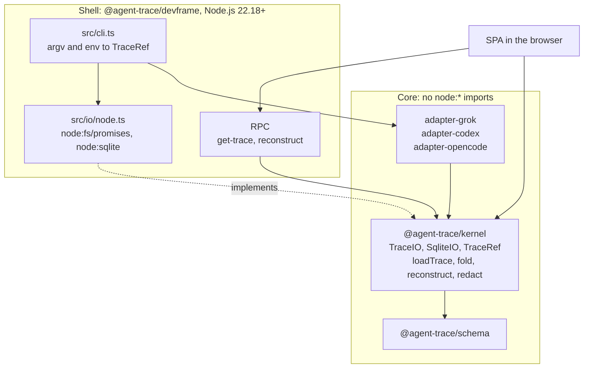
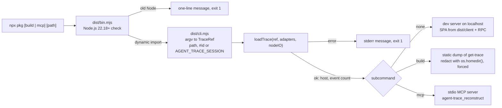
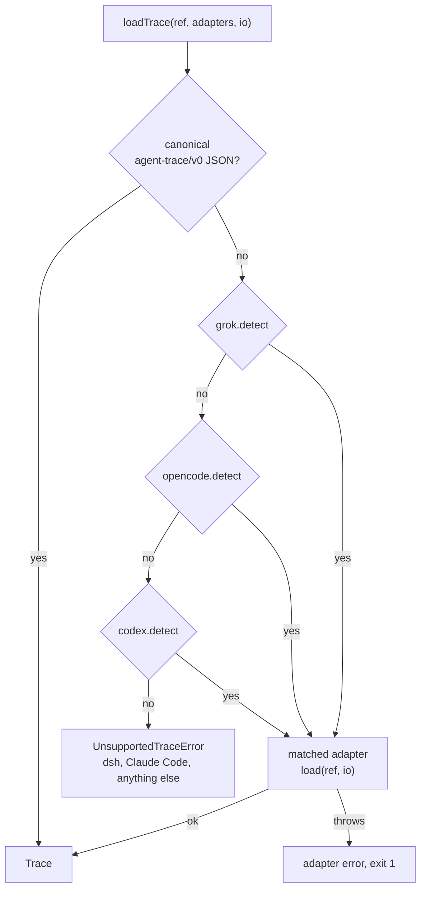
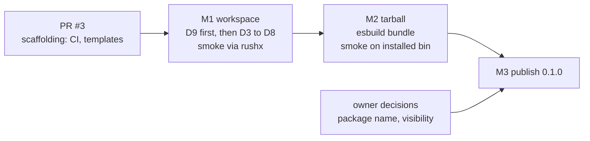

# Ship agent-trace as one installable CLI

- Status: draft
- Owner: unconfirmed
- Reviewer: unconfirmed
- Last updated: 2026-09-23
- Paired Spec: [`specs/0001-external-release.md`](../../specs/0001-external-release.md)

This plan turns the MVP on `main` (065ae72) into a CLI that someone else can run with `npx`, without cloning the repository. It fixes the three entry points the CLI already declares (viewer, `build` static report, `mcp`), because two of them fail today. It also removes Node.js from the core packages: schema, kernel, and adapters take their file and SQLite access as injected dependencies, and only the CLI shell provides Node implementations. It does not add viewer features, new hosts, or a browser file-open entry point.

## Contents

1. Background and goals
2. Outline
3. Detailed design
4. Rollout and stability
5. Verification
6. Delivery plan and effort
7. Risks, open questions, and follow-up
8. Appendix: measurements

## 1. Background and goals

### 1.1 Current behavior and constraints

All results below were measured on `main` at 065ae72 on 2026-09-23. Commands are in the appendix.

| Entry point | Command | Result on `main` |
|---|---|---|
| Viewer | `node bin.mjs --no-auth` | Works. `GET /__agent-trace/` returns 200 with the demo trace |
| Static report | `node bin.mjs build --out-dir <dir>` | Exits 1: `TypeError: Cannot destructure property 'eventId' of 'undefined'` |
| MCP | `node bin.mjs mcp` | Exits 1: `DF0079`, optional peer `@devframes/agentic` is not installed |

Other facts that constrain the design:

- **Node.js range is wrong.** `rush.json` allows `>=20.11.0 <25.0.0`. `bin.mjs` imports `src/devframe.ts` directly, and `adapter-opencode` imports `node:sqlite`. On Node.js 20.19.0 and 22.12.0 both fail (`ERR_UNKNOWN_FILE_EXTENSION`, `ERR_UNKNOWN_BUILTIN_MODULE`). On 22.18.0 both work.
- **Source `.ts` cannot be published as is.** Node.js refuses to strip types under `node_modules` (`ERR_UNSUPPORTED_NODE_MODULES_TYPE_STRIPPING`). A published package needs compiled JavaScript.
- **The CLI has no path argument.** The session comes only from `AGENT_TRACE_PATH`. DevFrame's `createCac` accepts `[...args]` for the dev command and ignores them (`devframe/dist/adapters/cac.mjs`, `devCommand.action(async (_args, rawFlags) => …)`).
- **The static build fails because of `snapshot: true` on `reconstruct`.** The dump calls every snapshot query with no arguments. `get-trace` takes none. `reconstruct` needs `eventId`. The client does not call the `reconstruct` RPC. It calls `get-trace` (`client/app.tsx:17`) and runs `reconstruct` in the browser (`client/components/inspector.tsx:48`). Removing `snapshot: true` from `reconstruct` makes the build exit 0.
- **The static report carries the sharer's local path.** After that fix, the dump for the demo contains `"path":"/Users/<name>/…/fixtures/demo.trace.json"`. `redact` (`kernel/src/redact.ts`) only rewrites `events[].payload` and `events[].original`, and only for `sk-`, `AKIA`, `ghp_`, `xox[baprs]-` tokens. `trace.session.cwd` and the `path` field are not touched. A real Grok or Codex trace also contains absolute paths in tool arguments.
- **dsh and Claude Code adapters claim files and then throw.** `loadTrace` stops at the first adapter whose `detect` returns true. `adapter-dsh` claims `.zip` and `session*.jsonl`. `adapter-claude-code` claims any path containing `.claude/projects`.
- **Core packages import Node.js for I/O only.** The parsers are already pure functions over rows or text: `parseJsonl`, `fold`, `reconstruct`, `redact`, `parseGrokUpdates`, `parseCodexRows`, `parseOpenCodeSession`. Node.js appears only in the `detect` and `load` wrappers and two kernel helpers:

  | Need | Where |
  |---|---|
  | Read text or bytes | `kernel/load.ts`, `kernel/jsonl.ts` (`readFile`); `adapter-grok` (`summary.json`, `system_prompt.txt`, `tool_definitions.json`); `adapter-opencode` (SQLite header sniff) |
  | Stat | `adapter-grok` `detect` |
  | `basename`, `dirname`, `join` | all five adapters |
  | Environment variable | `adapter-opencode` reads `AGENT_TRACE_SESSION` |
  | SQLite | `adapter-opencode` (`node:sqlite`) |

  The browser client already works around this: `inspector.tsx` imports `@agent-trace/kernel/reconstruct`, not the kernel root, which pulls in `node:fs/promises`. Bundling kernel, `adapter-grok`, and `adapter-codex` with `esbuild --platform=browser` fails today with `Could not resolve "node:path"` and `Could not resolve "node:fs/promises"`.
- **The default fixture and client assets are found by relative URL.** `get-trace.ts` uses `new URL('../../../../../fixtures/demo.trace.json', import.meta.url)`. `devframe.ts` uses `new URL('../dist/client', import.meta.url)`. Both break once the code moves.
- **Package name.** `agent-trace` on the public npm registry belongs to an unrelated project (version 0.4.0, "Self-hosted observability for AI coding agents"). `@agent-trace/devframe` is free. Whether the `@agent-trace` scope can be registered is unconfirmed.
- The GitHub repository `PerfectPan/agent-trace` is private.

A bundling probe (appendix A.4) showed the approach in section 2.4 works: an esbuild bundle of `bin.mjs` is 20.4 KB, and after the two path fixes and the `snapshot` fix, the packed tarball installed into an empty directory ran `--help`, `build` (exit 0), and `mcp` (`tools/list` returned `agent-trace_get-trace`, `agent-trace_reconstruct`, `devframe_state_read`; calling reconstruct on `e6` returned `visibleIds: [e1, e2, e5, e6]`, `completeness: partial`).

### 1.2 Problem

"Usable by someone else" today means: clone, install Rush, run eight package installs, set an environment variable, and avoid two commands that crash. The product's main idea is that other agents can call `reconstruct` over MCP. That path does not start. The share path does not start either, and once it does, it would publish the sharer's home directory.

### 1.3 Goals and success criteria

- `npx <package> [path]`, `npx <package> build [path]`, and `npx <package> mcp [path]` work from an empty directory on Node.js 22.18 and 24. CI proves this against the packed tarball, not the workspace.
- A static report built on the CI runner contains no occurrence of `os.homedir()`.
- A dsh or Claude Code input exits 1 with `UnsupportedTraceError`.
- Node.js 20 gets a one-line message that names 22.18.
- Every scenario in the paired Spec has a CI check or a recorded manual run.
- `schema`, `kernel`, and every `adapter-*` package have no `node:*` import outside test files, and CI bundles them with `esbuild --platform=browser` without errors.

### 1.4 Non-goals

- Viewer features listed in the Spec as out of scope.
- dsh and Claude Code parsers.
- Publishing `schema`, `kernel`, or adapters as separate packages.
- A secret scanner beyond the current token patterns plus path rewriting.
- A browser entry point that opens a session the user drops into the page. D9 makes it possible; it is a follow-up (section 7).
- Running the CLI shell on Bun or Deno. DevFrame's server, static build, and MCP stdio stay on Node.js.
- Changing repository visibility. That is an owner decision; section 4.1 lists what must be true first.

## 2. Outline

### 2.1 Design principles

- The unit that ships is the CLI. Internal packages are an implementation detail until someone needs them as a library.
- Tests run against what users install. A green `rush test` does not prove the tarball works.
- A shared file must not identify the sharer's machine by default.
- The core does not know where bytes come from. Files, SQLite, environment variables, and the home directory are passed in by the entry point.

### 2.2 Boundaries and responsibilities

| Piece | Owns in this plan | Change |
|---|---|---|
| `@agent-trace/kernel` | `TraceIO`, `SqliteIO`, `TraceRef`, path helpers, `loadTrace`, `redact` | Defines the injected interfaces (D9). `redact` takes `homeDir` from the caller and rewrites it in all strings, including `session` |
| `adapter-grok`, `adapter-codex`, `adapter-opencode` | Host format to `Trace` | Read through the injected `TraceIO` / `SqliteIO`. No `node:*` import |
| `adapter-dsh`, `adapter-claude-code` | Stub adapters | Only the new `Adapter` signature and kernel path helpers. They stay in the workspace and are not registered by the CLI |
| `@agent-trace/devframe` | CLI argv, startup load, RPC, Node I/O implementation, bundle, package | Most of the work. `src/io/node.ts` is the only Node implementation of `TraceIO` and `SqliteIO` |
| `scripts/smoke.mjs` (new) | Runs Spec scenarios against an installed bin | New |
| CI | Runs smoke on the packed tarball | Extended |

Solid arrows mean "imports". The dotted arrow is the injected implementation: kernel declares `TraceIO` and `SqliteIO`, `src/io/node.ts` implements them, and `src/cli.ts` passes that implementation into `loadTrace`. `adapter-dsh` and `adapter-claude-code` stay in the core but are not registered, so they are not drawn. DevFrame 1.0.0 and `@devframes/agentic` 1.0.0 host the RPC and are left out of the picture.



### 2.3 Main path

One process handles one trace. The trace is loaded and checked before any subcommand starts, so a bad path fails before a port opens.



### 2.4 Design decisions

**D1. Distribute as one npm package. Do not stop at git clone.**
Alternative A: git clone plus Rush. It needs no build work, but every user installs a monorepo to read one file, and `mcp` cannot be registered in another agent's config as a short command. Alternative B: publish all eight workspace packages. It gives library users an API, but `agent-trace/v0` is not stable and every package becomes a support promise. Chosen: one package whose `dist/` contains the bundled workspace code. Runtime dependencies are only `devframe`, `@devframes/agentic`, and `cac`.

**D2. Bundle with esbuild.**
Alternative: `tsc` per package plus `workspace:*` rewriting. That brings back alternative B. Alternative: `tsdown`. It would work, but the probe already passed with esbuild, and esbuild needs no config file. Command: `esbuild src/cli.ts --bundle --platform=node --format=esm --target=node22.18 --external:devframe --external:@devframes/agentic --external:cac --outfile=dist/cli.mjs`. `node:sqlite` stays a Node built-in.

**D3. Require Node.js `>=22.18.0 <25`.**
Measured in section 1.1. The bundle removes the type-stripping requirement, but `node:sqlite` still needs 22.13 or later, and the workspace dev path (`rushx dev`) still runs `.ts` directly. One floor for both keeps it simple. Set it in `rush.json`, in `engines`, and in `dist/bin.mjs` (see 3.1), because npm only warns on `engines` by default. After D9 the floor applies to the CLI shell and `src/io/node.ts` only. The core packages have no Node.js floor.

**D4. Path as positional argument, parsed in our bin, not in DevFrame.**
DevFrame ignores dev-command args and has no build or mcp args. Changing DevFrame means an upstream release. Our bin reads the first positional argument after an optional `build` or `mcp` subcommand, removes it from `argv`, resolves it to an absolute path, and sets `AGENT_TRACE_PATH`. `#sessionId` suffixes are kept. The environment variable still works when no argument is given.

**D5. Do not register dsh and Claude Code in the CLI.**
Alternative: make their `detect` return false. That also works, but changes two packages to express a CLI decision, and has to be reverted in both when a parser lands. Chosen: remove them from the `adapters` array in `get-trace.ts`. `loadTrace` then throws `UnsupportedTraceError`. When a parser lands, its PR adds it back to the array.

**D6. Remove `snapshot: true` from the `reconstruct` RPC.**
It is the measured cause of the build failure. The static page does not need it (section 1.1). MCP still lists and calls the tool without it (probe). `get-trace` keeps `snapshot: true`.

**D7. Redact paths, always redact the static report.**
`redact` gains a second rule: replace every occurrence of the caller's home directory with `~` in all strings of the trace, including `session.cwd` and `session.title`. The home directory is a required argument, not a default read inside kernel, so kernel stays free of `node:os` (D9). The CLI passes `os.homedir()`. `get-trace` returns `path` as its base name when redaction is on. For `build`, redaction is forced; if `AGENT_TRACE_REDACT=0` is set, `build` prints that it was ignored. After a build, the CLI prints the count of replaced tokens and paths and one line: session text is included; read the report before you send it. Alternative: a general secret scanner. Not designed; listed as follow-up.

**D8. Pin `devframe` and `@devframes/agentic` to `1.0.0` exactly.**
`@devframes/agentic@1.0.0` declares `peerDependencies: { devframe: "1.0.0" }`. With `devframe: ^1.0.0`, a `1.0.1` release would break the peer and `mcp`. Upgrades are explicit.

**D9. Core packages take I/O by injection and import no Node.js built-ins.**
`schema`, `kernel`, and all `adapter-*` packages receive file access, SQLite access, and the session id from the caller (interfaces in 3.2). The Node implementation lives in `packages/devframe/src/io/node.ts`.
Why now: the refactor is small (two kernel files, five adapters, `get-trace.ts`) because the parsers are already pure. It also removes two couplings that this plan would otherwise add or keep: `adapter-opencode` reading `AGENT_TRACE_SESSION`, and `redact` reading `os.homedir()`. Adapter tests can use an in-memory `TraceIO` instead of temp files.
What it makes possible later: a static page that opens a dropped Codex file or Grok directory in the browser, and running the core in a Worker, Bun, or Deno. None of these ships in this plan.
Alternatives considered:
- Keep Node in the core and add a browser build later. Rejected because every new adapter would add more `node:*` imports to undo, and the kernel root is already unusable in the browser.
- Inject through adapter factories (`createGrokAdapter(io)`). Rejected because adapters hold no state; an `io` argument per call is simpler and lets one adapter list serve several I/O implementations.
- A put-everything-in-memory interface (`files: Map<string, Uint8Array>`). Rejected because an OpenCode database or a large Codex rollout would have to be read in full before `detect`. `readBytes` with a range keeps `detect` to a header read.
- Put `node.ts` in its own `io-node` package. Rejected for now: only the CLI uses it, and the CLI is the one package that ships (D1). Move it out if a second Node entry point appears.
Enforcement: oxlint `no-restricted-imports` with pattern `node:*` on `packages/{schema,kernel,adapter-*}/src`, excluding `*.test.ts` (tests may keep `node:url` for fixture paths). Plus a CI step that bundles kernel and every adapter with `esbuild --platform=browser`. Both checks were run against `main` and both fail on the current imports, so they detect the problem they are meant to prevent (appendix A.5).

## 3. Detailed design

### 3.1 Entry points and request path

`packages/devframe` layout after this plan:

| File | Purpose |
|---|---|
| `bin.mjs` | Workspace entry, unchanged role: `rushx dev` runs source `.ts` |
| `src/cli.ts` (new) | argv handling (D4), startup load, then `createCac(devframe).parse(argv)` |
| `src/shared/paths.ts` (new) | Resolves `clientAssets` and the demo fixture for both source and bundle layouts |
| `src/io/node.ts` (new) | `nodeIO: TraceIO & { sqlite: SqliteIO }` over `node:fs/promises` and `node:sqlite` (D9) |
| `dist/bin.mjs` (generated) | Checks `process.versions.node >= 22.18.0`, prints one line and exits 1 if not, then `await import('./cli.mjs')` |
| `dist/cli.mjs` (generated) | esbuild output |
| `dist/client/` (generated) | Vite SPA, as today |
| `dist/demo.trace.json` (copied) | Copy of `fixtures/demo.trace.json` |

`dist/bin.mjs` must use a dynamic import. A static import would load `node:sqlite` before the version check runs.

`paths.ts` uses one build-time constant. esbuild sets `--define:AGENT_TRACE_BUNDLE=true`; source mode leaves it undefined. In bundle mode, paths are relative to `dist/cli.mjs` (`./client`, `./demo.trace.json`). In source mode they stay as today.

Commands after this plan:

```
agent-trace [path] [--port] [--host] [--no-auth] [--open]
agent-trace build [path] [--out-dir report]
agent-trace mcp [path]
```

Startup load: `src/cli.ts` calls `loadTrace` once before handing off to DevFrame, prints `host`, `session.id`, and `events.length` to stderr, and exits 1 on error. The RPC handlers keep loading on each call, as today. A cache is not added in this plan.

### 3.2 Interfaces

- RPC `get-trace`: unchanged shape `{ path, trace, fold }`. `path` is a base name when redaction is on.
- RPC `reconstruct`: unchanged shape. No longer a snapshot query.
- MCP tools: whatever DevFrame derives from the two RPCs. Today that is `agent-trace_get-trace` and `agent-trace_reconstruct`.
- `redact(trace, { homeDir })`: `homeDir` is required. An empty string disables the path rule. Tests pass a fixed value.
- Package `bin`: `{ "agent-trace": "dist/bin.mjs" }`. `files`: `["dist"]`.

Injected I/O, exported from `@agent-trace/kernel` (D9):

```ts
/** Where the trace comes from. `path` uses `/` separators; `sessionId` replaces `#id` and AGENT_TRACE_SESSION. */
export interface TraceRef {
  path: string
  sessionId?: string
}

export interface TraceIO {
  readText: (path: string) => Promise<string>
  /** `end` is exclusive. Used by `detect` to read a header without loading the file. */
  readBytes: (path: string, range?: { start: number, end: number }) => Promise<Uint8Array>
  /** `null` when the path does not exist. */
  kind: (path: string) => Promise<'file' | 'dir' | null>
}

export interface SqliteIO {
  /** Opens `file` read-only, runs one statement, closes. */
  all: <T>(file: string, sql: string, params?: readonly unknown[]) => Promise<T[]>
}

export interface LoadIO extends TraceIO {
  sqlite?: SqliteIO
}

export interface Adapter {
  id: string
  detect: (ref: TraceRef, io: LoadIO) => Promise<boolean>
  load: (ref: TraceRef, io: LoadIO) => Promise<Trace>
}

export function loadTrace(ref: TraceRef, adapters: readonly Adapter[], io: LoadIO): Promise<Trace>
export function parseTraceRef(input: string, fallbackSessionId?: string): TraceRef
export const tracePath: { basename, dirname, join }  // pure, `/` only
```

Rules:

- `readJsonl(path)` becomes `parseJsonl(await io.readText(path))` at the call site. `readJsonl` is removed from the kernel exports.
- `adapter-opencode` `detect` checks `basename === 'opencode.db'` or the first 16 bytes from `io.readBytes(file, { start: 0, end: 16 })`. `load` throws `opencode adapter needs SqliteIO` when `io.sqlite` is absent. It runs its three queries through `io.sqlite.all`, which opens the database once per statement. Three opens per load is acceptable for a local tool. A connection-scoped interface is a follow-up if a trace needs many queries.
- `parseTraceRef` replaces `splitSessionRef`. The CLI calls `parseTraceRef(path, process.env.AGENT_TRACE_SESSION)`. No adapter reads the environment.
- `src/io/node.ts` converts Windows separators to `/` in `TraceRef.path` before it reaches the core, and back when it calls `fs`. The Node implementation is the only place that knows the platform.
- The UI client may now import the kernel root instead of `@agent-trace/kernel/reconstruct`. The subpath export stays for compatibility.

### 3.3 Failures and recovery

`loadTrace` tries canonical JSON first, then each registered adapter in order. The first `detect` that returns true owns the input. On `main`, dsh and Claude Code sit after Codex and claim their files, then throw a not-implemented error. After D5 they are not in the list, so those inputs reach `UnsupportedTraceError`.



| Input | Result |
|---|---|
| No path, no env | Demo trace |
| Path does not exist | Exit 1 at startup, message names the path |
| Canonical JSON, Grok dir, Codex rollout, `opencode.db#id` | That trace |
| `opencode.db` with several sessions, no id | Existing error that names the session count |
| dsh file, Claude Code path, anything else | Exit 1, `UnsupportedTraceError` |
| Unknown host generation | Adapter throws, exit 1. No silent drop |
| Node.js < 22.18 | One-line message, exit 1 |
| `opencode.db` loaded with an I/O that has no `sqlite` | `opencode adapter needs SqliteIO`. Cannot happen in the CLI; guards future entry points |

### 3.4 Compatibility and migration

- `agent-trace/v0` files: unchanged.
- `AGENT_TRACE_PATH`, `AGENT_TRACE_SESSION`: unchanged. A positional path wins over `AGENT_TRACE_PATH`.
- `AGENT_TRACE_REDACT=0`: still disables redaction in the viewer and MCP. Ignored by `build` (D7).
- `rushx dev` from the workspace: unchanged.
- Node.js 20 and 22.0–22.17: dropped. They never worked (section 1.1).
- `Adapter`, `loadTrace`, `splitSessionRef`, `readJsonl`: signatures change (D9). Their only callers are in this repository, so there is no external migration. Adapter unit tests on `parse*` functions do not change.

### 3.5 Security and privacy

- Default bind stays `localhost`. `--no-auth` stays opt-in. README documents it for loopback only.
- The static report is redacted for tokens and home-directory paths. Session text, file contents, and other secrets stay. README and the post-build message say so.
- `mcp` over stdio returns unredacted data when `AGENT_TRACE_REDACT=0`. That matches the viewer and is local only.
- The package must not include `fixtures/` beyond `demo.trace.json`, or any file from a real session. CI checks the tarball file list (5.1).

## 4. Rollout and stability

### 4.1 Gates and rollout stages



| Stage | Precondition | What ships | Stop if |
|---|---|---|---|
| M1: entry points work in the workspace | This plan accepted | D9 first, then D3–D8 in source, `scripts/smoke.mjs`, the `node:*` lint rule and browser-bundle check, CI runs smoke with `rushx` on Node 22.18 and 24 | Any smoke scenario fails, or either D9 check fails |
| M2: packable CLI | M1 merged | D1, D2, `dist/bin.mjs`, `paths.ts`, CI job: `npm pack`, install tarball in a temp dir, run the same smoke against the installed bin; Node 20 check for S8 | Tarball smoke differs from workspace smoke |
| M3: first publish | M2 merged; owner decides name and visibility | `0.1.0` published from a GitHub Actions workflow triggered by a tag | Any item in the list below is not done |

M3 checklist:

1. Package name chosen (7, first row).
2. If the repository goes public: a secret scanner such as gitleaks run over the full history with no findings. PR #3 deletes `docs/VISION.md` from the tree, but commit 065ae72 still contains it with a local home path and `/tmp` research paths. Decide whether that is acceptable or whether the history is squashed before the visibility change.
3. `LICENSE` present at the root (MIT is already declared in `package.json`).
4. README quick start is `npx <package>`, and the host table lists canonical JSON, Grok, Codex, OpenCode only.

### 4.2 Signals

Local tool, no telemetry. Signals are CI results on each PR and GitHub issues after publish. Owner unconfirmed.

### 4.3 Rollback

- M1, M2: revert the PR. No data changes.
- M3: `npm deprecate <package>@<version> "<reason>"` and publish a fixed patch. Do not `npm unpublish` after other people may have installed it.

## 5. Verification

### 5.1 Functional checks

`scripts/smoke.mjs <bin>` runs the Spec scenarios against a given bin path. M1 passes the workspace `bin.mjs`; M2 passes the installed `node_modules/.bin/agent-trace`.

| Spec | Check |
|---|---|
| S1 | Start with `--no-open --port <free>`, wait for the ready line, `GET /__agent-trace/` is 200, stop |
| S3 | Nonexistent path exits 1 before any ready line |
| S4 | Temp file `session.jsonl` with one non-canonical line exits 1, stderr contains `UnsupportedTraceError`; same for a temp dir named `.claude/projects/x` |
| S5 | `build` on demo exits 0; `index.html` exists; `grep -r "$HOME"` over the output finds nothing |
| S6 | Same as S5 with `AGENT_TRACE_REDACT=0`; stderr contains the ignore notice |
| S7 | Pipe `initialize`, `notifications/initialized`, `tools/list`, `tools/call` for reconstruct on `e6`; assert the tool is listed and the result has `completeness` |
| S8 | M2 only: run the installed bin on Node 20; exit 1, stderr names 22.18 |

M2 also asserts the tarball file list is `package.json`, `README.md`, `LICENSE`, and `dist/**` only.

Unit tests: `redact` replaces a fixed `homeDir` in `session.cwd`, `payload`, and `original`, and leaves other strings alone. `cli.ts` argv parsing: `[]`, `[path]`, `[build, path, --out-dir, x]`, `[mcp, path]`, `[path#id]`.

D9 checks:

| Check | Pass condition |
|---|---|
| `rush lint` with the `node:*` rule | No finding in `packages/{schema,kernel,adapter-*}/src` outside `*.test.ts` |
| `esbuild <kernel and each adapter entry> --bundle --platform=browser` | Exit 0 |
| `detect` / `load` tests per adapter with an in-memory `TraceIO` | Grok: directory with `summary.json` + `updates.jsonl` is detected; missing `summary.json` is not. Codex: `rollout-*.jsonl` is detected by name and by first record. OpenCode: header bytes detect; a fake `SqliteIO` returning fixed rows produces the same trace as today's `parseOpenCodeSession` test; no `sqlite` gives the named error |
| `src/io/node.ts` tests | `readBytes` with a range returns only that range; `kind` returns `null` for a missing path; `sqlite.all` opens read-only |

### 5.2 Compatibility checks

One local Grok session directory, one Codex rollout file, and one `opencode.db#<id>` load through the installed M2 tarball. Record the command, host, and event count in the M2 PR. Do not commit the files or paste session text.

### 5.3 End-to-end acceptance

M2 is accepted when the tarball smoke job is green on Node 22.18 and 24 in GitHub Actions. A run on the author's machine does not count.

## 6. Delivery plan and effort

One person can deliver this. Estimates assume the author knows the code and the probe in A.4 is representative. They are not commitments.

### 6.1 Work split

| Component | Change | Owner | Depends on | Effort |
|---|---|---|---|---|
| kernel I/O interfaces + adapters (D9) | `TraceIO`, `SqliteIO`, `TraceRef`, path helpers; five adapters moved onto them; `src/io/node.ts`; in-memory adapter tests; lint rule and browser-bundle check | unconfirmed | plan accepted | 1 day |
| kernel `redact` | Home-dir rule with required `homeDir`, `session` fields, tests | unconfirmed | D9 | 0.5 day |
| devframe RPC | D5, D6, D7 `path` base name, forced redaction in build | unconfirmed | redact | 0.5 day |
| devframe CLI | `src/cli.ts`, startup load, argv tests | unconfirmed | none | 0.5 day |
| deps and Node range | D3, D8 in `rush.json` and `package.json` | unconfirmed | none | under 0.5 day |
| smoke + CI (M1) | `scripts/smoke.mjs`, CI matrix | unconfirmed | items above | 1 day |
| bundle + package (M2) | esbuild, `paths.ts`, `dist/bin.mjs`, pack job, S8 | unconfirmed | M1 | 1 day |
| publish (M3) | Release workflow, README, LICENSE, M3 checklist | unconfirmed | M2, owner decisions | 0.5 day plus owner time |

Basis: the probe did bundle, path patch, pack, install, build, and MCP in under an hour by hand. Most of the estimate is tests and CI.

### 6.2 Release order

Inside M1, land D9 first as its own commit with no behavior change: `rush test` and the smoke run on the demo must give the same results before and after. The other M1 decisions then build on the new interfaces. M1 before M2, because the smoke script is written against the workspace first and then reused unchanged against the tarball. The README must not show `npx` until M3 publishes.

## 7. Risks, open questions, and follow-up

| Item | Type | Impact | Owner | Next step |
|---|---|---|---|---|
| Package name: `agent-trace` is taken on npm | open question | Blocks M3 | unconfirmed | Pick `@agent-trace/cli` (try to register the org) or a user scope like `@perfectpan/agent-trace` before M3 |
| Repository visibility | open question | npm provenance may require a public source repository; unverified | unconfirmed | Decide before M3. If it stays private, publish without `--provenance` |
| `redact` misses secrets outside the token patterns | risk | A report can contain session text with secrets | unconfirmed | README and post-build message; scanner is follow-up |
| DevFrame 1.0.0 behavior changes on upgrade | risk | Pinned versions (D8) avoid surprise breakage | unconfirmed | Upgrade in a dedicated PR with the tarball smoke |
| `node:sqlite` prints `ExperimentalWarning` on 22.x | risk | Rush treats that stderr as a warning and exits 1, which failed the first CI run of PR #3. PR #3 disables the warning in the opencode test workers only. In the CLI it is still printed once on stderr | unconfirmed | `smoke.mjs` must not fail on it. Decide in M2 whether `dist/bin.mjs` filters this one warning |
| Project scaffolding (CONTRIBUTING, CI, templates) | dependency | This plan assumes a CI workflow exists | unconfirmed | Split out of PR #1 as PR #3; merge it before M1. Not part of this plan |
| Browser entry point: open a dropped session in the static page | follow-up | No install needed for Codex and Grok; enabled by D9 | unconfirmed | Separate Spec and Plan after 0.1.0. Start with Codex (one file) and Grok (directory via `webkitdirectory` or the File System Access API) |
| OpenCode in the browser | risk for that follow-up | Needs a WASM SQLite (sql.js or wa-sqlite, about 1 MB). `opencode.db` usually runs in WAL mode; if the user picks only the `.db` file, rows still in `opencode.db-wal` are missing, and the page would show an incomplete trace without an error. `node:sqlite` reads the WAL itself | unconfirmed | The browser plan must either require the `-wal` file, detect a non-empty WAL and refuse, or leave OpenCode to the CLI |
| dsh zstd frames outside Node | risk for the dsh plan | The dsh parser will need a WASM zstd decoder behind `TraceIO` to stay Node-free | unconfirmed | Decide in the dsh plan |
| dsh and Claude Code parsers | follow-up | Users of those hosts cannot use 0.1.0 | unconfirmed | Separate Spec and Plan each |
| Viewer features (timeline, virtualization, request dots, turn collapse, composer) | follow-up | Large traces may be slow | unconfirmed | Separate plans after 0.1.0 |
| Split packages as a library | follow-up | Only if someone asks for it | unconfirmed | Revisit after `agent-trace/v1` |

## 8. Appendix: measurements

All on macOS, 2026-09-23, from a worktree of `main` at 065ae72 after `install-run-rush.js update` and `build`.

A.1 Node.js versions (`npx -p node@<v>`):

```
v20.19.0  sqlite FAIL ERR_UNKNOWN_BUILTIN_MODULE   ts import FAIL ERR_UNKNOWN_FILE_EXTENSION
v22.12.0  sqlite FAIL ERR_UNKNOWN_BUILTIN_MODULE   ts import FAIL ERR_UNKNOWN_FILE_EXTENSION
v22.18.0  sqlite ok                                ts import ok
```

Type stripping under `node_modules` on v24.18.0: `ERR_UNSUPPORTED_NODE_MODULES_TYPE_STRIPPING`.

A.2 Static build on `main`:

```
$ node bin.mjs build --out-dir <dir>; echo $?
TypeError: Cannot destructure property 'eventId' of 'undefined' as it is undefined.
    at handler (packages/devframe/src/rpc/functions/get-trace.ts:60:23)
    at dump (devframe/dist/write-*.mjs)
1
```

With `snapshot: true` removed from `reconstruct` only: exit 0, and `agent-trace~get-trace.record.*.json` contains `"path":"/Users/<name>/…/fixtures/demo.trace.json"`.

A.3 MCP on `main`:

```
$ node bin.mjs mcp
DF0079: The `mcp` option is enabled, but the optional peer "@devframes/agentic" could not be loaded
```

`@devframes/agentic@1.0.0` exists on npm with `peerDependencies: { devframe: "1.0.0" }`.

A.4 Bundle probe (scratch directory, not committed): esbuild bundle of `bin.mjs` with `devframe`, `@devframes/agentic`, `cac` external → 20.4 KB. Patched the two relative URLs and removed `snapshot: true` from `reconstruct`. `npm pack`, installed into an empty directory, then:

```
npx agent-trace --help            → prints usage
npx agent-trace build --out-dir out → exit 0; out/ has index.html, assets/, __rpc-dump/
npx agent-trace mcp  (tools/list) → agent-trace_get-trace, agent-trace_reconstruct, devframe_state_read
                     (reconstruct e6) → visibleIds [e1,e2,e5,e6], unavailable [tools], completeness partial
```

A.5 D9 checks against `main` (both must fail today and pass after D9):

```
$ oxlint -c <config with no-restricted-imports patterns ["node:*"]> packages/kernel/src packages/adapter-grok/src
packages/kernel/src/reconstruct.test.ts:2:1: error eslint(no-restricted-imports): 'node:url' import is restricted …
packages/adapter-grok/src/index.ts:4:1: error eslint(no-restricted-imports): 'node:path' import is restricted …

$ esbuild kernel/src/index.ts adapter-grok/src/index.ts adapter-codex/src/index.ts --bundle --platform=browser
✘ [ERROR] Could not resolve "node:path"
✘ [ERROR] Could not resolve "node:fs/promises"
```

The first finding is a test file, which is why the rule excludes `*.test.ts`. oxlint 1.83.0.
