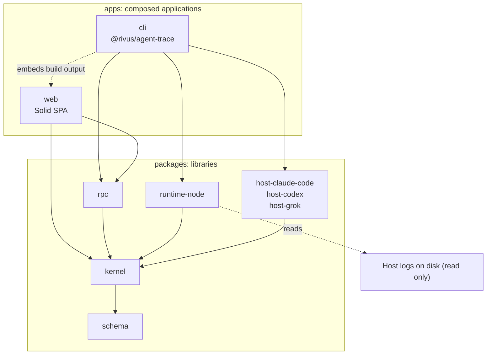
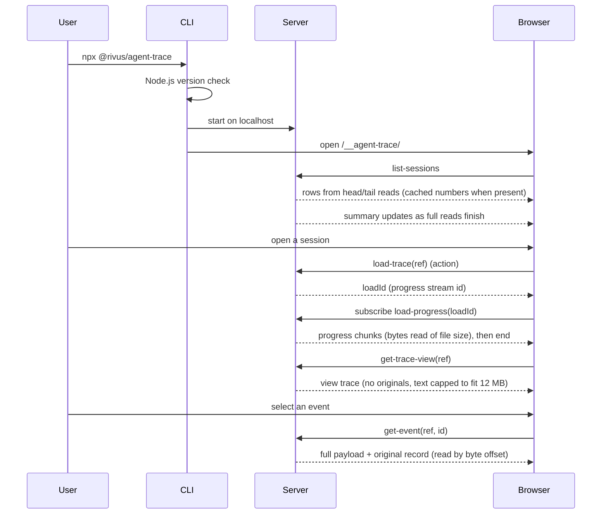
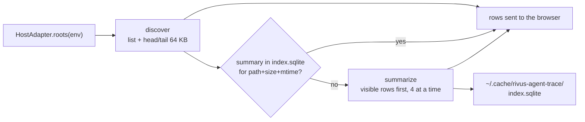
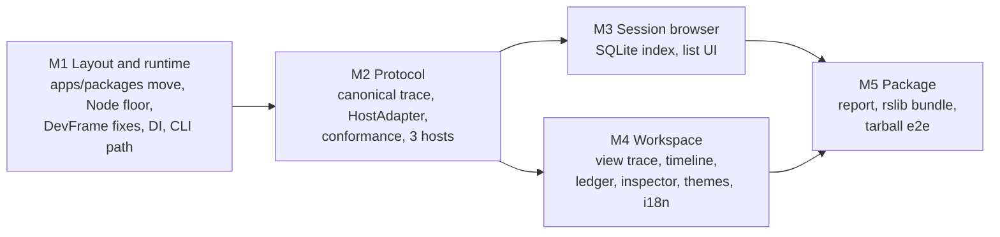

# agent-trace DevTools: host protocol, session browser, and workspace

- Status: Implemented
- Owner: unconfirmed
- Reviewer: unconfirmed
- Last updated: 2026-09-25
- Paired Spec: [`docs/specs/0001-external-release.md`](../specs/0001-external-release.md)
- Visual design: [`docs/design/`](../design/README.md)

This plan turns the MVP on `main` into `@rivus/agent-trace`: a local DevTools that `npx @rivus/agent-trace` opens in the browser. The user picks a session from Claude Code, Codex, or Grok and debugs it in one workspace. The plan defines the host protocol that those three hosts implement first, the canonical trace, how sessions are discovered and loaded at the sizes found on a real machine, the UI build against the chosen design in English and Simplified Chinese, and packaging into a tarball that installs and runs anywhere. Publishing to npm, ATIF export, OpenCode, and dsh are follow-ups. Nothing is released yet, so interfaces and formats change in place without version numbers or compatibility layers.

## Contents

1. Background and goals
2. Outline
3. Detailed design
4. Rollout and stability
5. Verification
6. Delivery plan and effort
7. Risks, open questions, and follow-up
8. Appendix: measurements

## 1. Background and goals

### 1.1 Current behavior and constraints

Measured on `main` and on this machine on 2026-09-23 and 2026-09-24. Commands and raw output are in section 8.

**Entry points.** The dev server works on the demo fixture. `build` exits 1 (`Cannot destructure property 'eventId'`), because `reconstruct` is registered with `snapshot: true` and the static dump calls it without arguments. `mcp` exits 1 (`DF0079`, `@devframes/agentic` not installed). The session comes only from `AGENT_TRACE_PATH`; there is no session list.

**Runtime.** `rush.json` allows Node.js `>=20.11`. `bin.mjs` imports `.ts` directly and `adapter-opencode` imports `node:sqlite`. Both fail on 20.19 and 22.12 and work on 22.18. Node.js refuses to strip types under `node_modules`, so a published package needs compiled JavaScript.

**Current UI.** On a real 3,300-record Grok session the ledger renders 2,258 rows at once (14,066 DOM nodes). 1,294 of those rows (57%) are `UNKNOWN hook_execution`. There is no timeline, no turn collapse, and no virtualization.

**Adapter interface.** `Adapter = { id, detect(path), load(path) }`. It cannot list sessions, cannot say which fields a host provides, and reads files through `node:fs` directly. `adapter-dsh` and `adapter-claude-code` claim files and then throw.

**Host logs on this machine.** All three hosts record request boundaries, token usage, timing, compaction, and subagents, under different names:

| Need | Claude Code | Codex | Grok |
|---|---|---|---|
| Location | `~/.claude/projects/<cwd>/<id>.jsonl`, subagents in `<id>/subagents/agent-*.jsonl` | `~/.codex/sessions/YYYY/MM/DD/rollout-*.jsonl` | `~/.grok/sessions/<cwd>/<id>/updates.jsonl` plus `summary.json`, `system_prompt.txt`, `tool_definitions.json`, `subagents/` |
| Request boundary, model | `requestId`, `message.model` | `response_id`, `turn_context` | `_meta.modelId`, `_meta.promptIndex` |
| Request unit | one model call (`requestId`) | one model call (`token_usage_record`; before the first one, `token_count.info.last_token_usage`) | one request per turn: usage is recorded only in `turn_completed.usage`, summed over the turn's calls (`modelCalls`, `numTurns` are counts, `modelUsage` is per model). Per-call records exist (`events.jsonl` `loop_started` / `first_token`, `chat_history.jsonl` assistant entries) but carry no usage |
| Tokens | `message.usage` | `token_usage_record` | `turn_completed.usage` |
| Timing | record `timestamp`, `system/turn_duration` | record `timestamp`, `task_complete.duration_ms` per turn; `started_at_ms` / `completed_at_ms` only on `item_completed` | `turn_completed.elapsed_ms` per turn |
| Compaction | `system/compact_boundary` with `compactMetadata.{trigger, preTokens, postTokens, durationMs, preservedSegment}` | `compacted` | `auto_compact_started/completed`, `compaction_checkpoint` |
| Subagents | `isSidechain`, `subagents/*.jsonl` | `event_msg/item_completed` with `item.type: SubAgentActivity` (`agent_thread_id`); `inter_agent_communication_metadata` carries only `trigger_turn` | `subagent_spawned/finished`, `subagents/` |
| System prompt, tool schemas | `attachment` records with `attachment.type: prompt_snapshot`, one or more per file (main and subagent files). Each has `systemPrompt` (a string array); some also have `tools` (`tools[].schema.input_schema`) and `cliPrefix`. Seen from 2.1.268; files without a snapshot record neither (re-measured 2026-09-25: 34 of 221 main files and 61 of 95 subagent files have snapshots, and 2 of the 36 main files at 2.1.268 or later have none) | System prompt: `session_meta.base_instructions.text` of the file's first `session_meta` (on 2026-09-25, 1,846 of the 1,984 `session_meta` records in 1,941 rollouts; older rollouts leave it out). Tool schemas: not recorded (`session_meta.dynamic_tools` lists only dynamic tools) | `system_prompt.txt`, `tool_definitions.json` (optional; 66 of 66 and 10 of 66 sessions on 2026-09-25) |

**Log volume on this machine.**

| Host | Files | Total | Median | p95 | Max |
|---|---|---|---|---|---|
| Claude Code (main) | 225 | 550 MB | 146 KB | 8.6 MB | 81.6 MB |
| Claude Code (subagents) | 74 | 49 MB | 485 KB | 1.1 MB | 5.9 MB |
| Codex | 1,935 | 10.8 GB | 557 KB | 22 MB | 355 MB |
| Grok | 77 | 220 MB | 1.2 MB | 10 MB | 29 MB |

Only counting the lines of all Claude Code main files takes 2.35 s. The current Codex adapter loads the 355 MB file in 1.7 s into 16,652 events, but the serialized trace is 360 MB and the process peaks at 3.2 GB RSS. Without `original` the events are 21.3 MB; with long strings capped at 4 KB they are 9.5 MB.

**Community formats** (read from primary sources; section 8, A.7):

- ATIF v1.8 (Harbor, Apache-2.0) is a trajectory format of steps. It has tool call and result pairing by id, a written compaction boundary rule, and embedded subagent trajectories. Harbor ships converters for Claude Code, Codex, Grok, and OpenCode. Its unit is a step, roughly one model call. It does not keep the host record or say which individual events a compaction removed.
- OpenTelemetry GenAI semantic conventions define the widest vocabulary (`gen_ai.usage.*`, `gen_ai.request.model`, `gen_ai.response.id`, `gen_ai.tool.call.id`, `CompactionPart`). All of it is at Development stability, and it moved to its own repository in May 2026 with no release yet.
- ACP is a live client protocol. It is Grok's log format here, not a trace model.
- Cursor's "Agent Trace" (agent-trace.dev) is a code-attribution format with a near-identical name and no functional overlap.

**Publishing.** `@rivus/agent-trace` is unpublished and stays unpublished in this plan. `PerfectPan/rivus-agent` is a private repository that publishes the `@rivus/*` packages from `.github/workflows/publish-npm.yml` on a GitHub release, with `id-token: write` and no npm token.

### 1.2 Problem

A developer cannot open the tool, pick a session, and see what happened. The shipped commands are half broken, there is no list of sessions, Claude Code (the host with the most local sessions and the richest compaction data) is not supported, and the data model cannot express request boundaries, context size, or subagent lanes, so the UI cannot draw them. At the log sizes above, sending one complete trace to the browser does not work for the largest sessions.

### 1.3 Goals and success criteria

- Every scenario in the Spec passes as listed under its Acceptance Evidence: in CI against the packed tarball, and for real sessions by a recorded local run.
- Claude Code, Codex, and Grok adapters implement the host protocol and pass the conformance suite on synthetic fixtures.
- The session browser shows rows within 2 s on this machine (2,300+ files, 11.6 GB) and within 300 ms on the second launch for the cached numbers.
- The 355 MB Codex session opens with at most 12 MB sent to the browser before the first event is selected.
- `schema`, `kernel`, `rpc`, and every `host-*` package import no `node:*` module outside tests, and every package's dependencies follow the layer table in 2.2.
- The two screens match `docs/design/` in both themes and both languages, reviewed side by side with the design HTML at 1440 × 900 in the delivery PR.
- Every UI string exists in English and Simplified Chinese, enforced by the type checker.

### 1.4 Non-goals

- ATIF export, OTLP export (follow-ups, section 7).
- OpenCode and dsh in the session browser (follow-ups on the same protocol).
- Publishing to npm. Release intent is recorded with Rush change files from now on (D12); the version bump and publish workflow are a follow-up plan.
- Live follow of a running session.
- Search inside session content beyond title and first prompt.
- A stable library API for internal packages.
- Changing repository visibility.

## 2. Outline

### 2.1 Design principles

- The product is the DevTools screen. The CLI only starts it.
- Draw only what the host recorded. Missing is `unavailable`, never zero or an estimate.
- A host plugs in through one protocol with a declared capability list, and proves it with the same conformance suite as every other host.
- The browser receives a view of the trace sized for display. The full record is one request away.
- The core does not know where bytes come from. Files, SQLite, the environment, and the home directory are passed in.

### 2.2 Boundaries and responsibilities

The workspace has two kinds of projects. `apps/` holds applications composed from libraries; `packages/` holds the libraries. Every project uses the `@rivus` scope. Only `@rivus/agent-trace` is published; the others are `private` and bundled into it.



| Directory | Package | Owns | May depend on |
|---|---|---|---|
| `apps/cli` | `@rivus/agent-trace` | Composition root: registers hosts, provides the Node runtime, starts the DevFrame server, terminal output (D14), embeds the web build, rslib bundle | every package; web's build output |
| `apps/e2e` | `@rivus/agent-trace-e2e` | Private test harness for the packed tarball: CLI smoke (5.3) and the browser suite (5.2) | nothing at runtime; test tooling only |
| `apps/web` | `@rivus/agent-trace-web` | Solid SPA: session browser, workspace, report mode, dictionaries (D13), tokens from `docs/design/` | `rpc` (types), `kernel`, `schema` |
| `packages/rpc` | `@rivus/agent-trace-rpc` | RPC contracts (`list-sessions`, `load-trace` with the `load-progress` stream, `get-trace-view`, `get-event`, `reconstruct`, the `export-report` action, and the `report-trace` snapshot in build mode), their server handlers, and the trace store (ref resolution, shared loads, last 3 traces) over an injected resolver and I/O | `kernel`, `schema` |
| `packages/runtime-node` | `@rivus/agent-trace-runtime-node` | `NodeIO` (`TraceIO` over `node:fs`), home directory, session index in `node:sqlite` (D7) | `kernel`, `schema` |
| `packages/host-claude-code`, `host-codex`, `host-grok` | `@rivus/agent-trace-host-<id>` | One host each: layout knowledge, parsing, capabilities | `kernel`, `schema` |
| `packages/host-opencode`, `host-dsh` | `@rivus/agent-trace-host-<id>` | Kept, not registered in this release | `kernel`, `schema` |
| `packages/kernel` | `@rivus/agent-trace-kernel` | Host protocol types, `loadTrace`, `fold`, `reconstruct`, `redact`, `toView`, projections, conformance suite | `schema` |
| `packages/schema` | `@rivus/agent-trace-schema` | Canonical trace types and their `zod` schemas | no workspace package; small browser-safe external libraries (`zod`) |

Rules:

- Apps depend on packages; packages never depend on apps. The two apps share no code; `cli` takes `web`'s build output as a file through a Rush build dependency.
- `apps/cli` is the only composition root. It alone knows which hosts are registered and that the runtime is Node.
- Only `apps/cli` and `packages/runtime-node` import `node:*`. `schema`, `kernel`, `rpc`, and every `host-*` do not (D5).
- UI components stay inside `apps/web` until a second consumer needs them.
- The "May depend on" column lists workspace packages. External npm libraries are allowed when they are small and browser-safe; `schema` uses `zod` and no workspace package.
- `apps/e2e` tests the packed tarball from outside: it depends on no workspace package and has no runtime dependencies.
- `scripts/check-layers.mjs` checks every `package.json` against the "May depend on" column in CI.

In this plan, "the shell" means `apps/cli` together with `packages/runtime-node`.

### 2.3 Main path



With a path argument the CLI loads and checks that session before listening, then opens the workspace URL for it.

Opening a session takes two calls because DevFrame rejects a subscription to a stream id that does not exist yet (DF0030): the `load-trace` action creates the progress stream and returns its id, the browser subscribes, then `get-trace-view` returns the view once the shared load finishes.

### 2.4 Design decisions

**D1. The product is a browser DevTools; the CLI is its launcher.**
Alternatives: a CLI-first tool (the previous draft of this plan), and a desktop app. A CLI cannot show a timeline or an inspector. A desktop app adds an installer and signing for no capability the browser lacks. DevFrame already provides the local server, the SPA shell, the static build, and MCP.

**D2. A host protocol replaces `Adapter`.**
The current interface cannot list sessions or state which fields a host records, so the UI cannot tell "zero" from "not recorded". The host protocol adds `discover`, `summarize`, a capability list, and a conformance suite (3.2). Alternative: keep `Adapter` and add discovery in the shell per host. Rejected because each host's layout knowledge would then live in two places.

**D3. The canonical trace stays event-level; field meanings follow OTel GenAI; the structure stays mappable to ATIF.**
Events remain the canonical unit because `reconstruct` answers per event and the inspector shows per-event raw records. Alternatives: ATIF as storage (rejected: step granularity, no raw record, no per-event visibility), OTel spans as storage (rejected: Development stability, and a span tree has no place for per-event visibility). Usage, model, request, and tool fields take their meaning, units, and names from OTel GenAI, written in camelCase in TypeScript with a one-to-one table (3.3). Every canonical field that ATIF also has must map to it without loss, so the ATIF export follow-up is a projection, not a redesign.

**D4. Claude Code, Codex, and Grok in this release.**
Claude Code has the most sessions and the fullest compaction record here. Codex and Grok already have adapters to port. OpenCode needs `SqliteIO` and is the next host on the same protocol; dsh needs zstd and its format catalog.

**D5. Core packages take I/O by injection.**
`TraceIO` (read text, read a byte range, list a directory, stat) and `homeDir` are passed in; the Node implementation lives in `packages/runtime-node`. Enforced by oxlint `no-restricted-imports` on `node:*` outside tests, and by an `esbuild --platform=browser` bundle of kernel and adapters in CI. Both checks were run on `main` and fail today (A.5, measured with esbuild; M1 runs the browser-target bundle with rslib `output.target: 'web'`).

**D6. The browser receives a view trace; originals and full text load on demand.**
This changes two current rules in `AGENTS.md`: "canonical storage is `events[]` plus `original`" becomes "every event can return its original", and "`getTrace` is one snapshot blob" becomes "`get-trace-view` is one snapshot blob; `get-event` returns one event in full". Measured on the 355 MB session: 360 MB full, 37.9 MB without originals, 14.0 MB as a view with strings capped at 4 KB, and 11.4 MB with the cap `fitView` chose (A.6). Alternatives: paging events (rejected: the timeline and the ledger need every event's shape, and `reconstruct` needs the whole sequence), and compressing the full blob (rejected: the server would still hold 3.2 GB). The server keeps each event's source pointer (file, byte offset, length) and reads the line again when `get-event` asks for it. `AGENTS.md` is updated in the same change.

**D7. Session discovery reads heads and tails; full summaries are computed lazily and stored in a SQLite index.**
A full parse of 11.6 GB at launch is not possible. `discover` lists files and reads the first and last 64 KB of each to fill title, project, start and last activity, and size. `summarize` parses one file fully for turns, requests, tokens, duration, flags, and user prompts. The shell runs `summarize` for visible rows first, with a concurrency limit of 4, and stores the result in `~/.cache/rivus-agent-trace/index.sqlite` through the built-in `node:sqlite`, keyed by path, size, and mtime. An FTS5 table with the `trigram` tokenizer indexes titles and user prompts, so search covers every prompt, in English and Chinese, not only the first one. Measured (A.10): FTS5 with `trigram` is available on Node.js 22.18 (SQLite 3.50.2) and 24.18 (SQLite 3.53.1); 2,300 rows insert in 13 ms and a search takes 0.1 ms.
Alternatives: a JSON cache file (no search, whole-file rewrites); DuckDB (`@duckdb/node-api` installs 115 MB on macOS arm64, and scans all 550 MB of Claude Code logs in 252 ms against 1,176 ms for a Node line scan, but it would restate each host's parsing rules in SQL beside the adapters); `better-sqlite3` (a native addon per platform, where `node:sqlite` needs none). Node.js 22 prints an `ExperimentalWarning` for `node:sqlite`; `dist/bin.mjs` suppresses that one warning, verified in M1.

**D8. RPC shape and the static report.**
Queries: `list-sessions` (not a snapshot), `get-trace-view(ref)`, `get-event(ref, id)`, `reconstruct(ref, eventId)` (for MCP; `snapshot: true` removed, the measured cause of the `build` failure). Two actions: `load-trace(ref)` starts or joins the load and returns the id of a `load-progress` stream (2.3), and `export-report(ref, locale)` writes the same report as `build` for a session of the dev server. DevFrame's static dump only bakes argument-free snapshot queries, so `build <path>` registers one extra argument-free snapshot query, `report-trace`, bound to that session and registered only in DevFrame's build mode, and the SPA starts in report mode when it finds it. A report includes the view trace and the original records of at most the first 2,000 events or 20 MB, whichever is smaller, and says so in the report header when it truncates.

**D9. UI stack and design contract.**
Solid, Tailwind v4, and shadcn-solid stay. Tokens, palette, type, and encoding rules come from `docs/design/README.md` and become CSS variables in `styles.css` under `data-theme="dark|light"`. The ledger uses `@tanstack/solid-virtual` 3.13. The timeline and preview shape are SVG drawn from kernel projections; no chart library.

**D10. Redaction.**
`redact(trace, { homeDir })` replaces the home directory with `~` in every string and replaces the known token patterns. The report path always redacts. `AGENT_TRACE_REDACT=0` affects only the local server.

**D11. One bundled package, `@rivus/agent-trace`, built with rslib.**
rslib 1.0 bundles the shell and all workspace packages into `dist/cli.mjs` (ESM, `output.target: 'node'`, `bundle: true`) with `devframe`, `@devframes/agentic`, and `cac` as externals and runtime dependencies. Rspack resolves `new URL('<literal>', import.meta.url)` as an asset import, and `module.parser.javascript.url: false` did not turn that off in the probe; so no module locates files that way. `apps/cli/src/paths.ts` builds paths with `join(dirname(fileURLToPath(import.meta.url)), …)`, with a build-time constant for the bundle layout. `dist/bin.mjs` checks Node.js `>=22.18` before a dynamic import, because a static import would load `node:sqlite` first. `devframe` and `@devframes/agentic` are pinned to `1.0.0`, since `@devframes/agentic@1.0.0` declares `peerDependencies: { devframe: "1.0.0" }`. Probe (A.9): the rslib bundle is 20.8 KB, builds in 0.12 s, and, installed from its tarball into an empty directory, ran `build` (exit 0) and `mcp` (reconstruct returned `completeness: partial`). Alternative: esbuild, which also worked (A.4); rslib is chosen to stay on the Rspack toolchain.

**D12. Release intent through Rush change files now; publishing later.**
`@rivus/agent-trace` gets a Rush version policy, and every PR that changes what the package ships carries a change file from `rush change`, checked in CI with `rush change --verify`. `rush version` turns the files into the package's `CHANGELOG.md` when a release happens. The version bump and npm publish workflows are a follow-up plan; `PerfectPan/rivus-agent` (Version Packages on dispatch, publish on GitHub release with `id-token: write`) is the reference. The mechanism lands in its own PR before M1.

**D13. UI strings in English and Simplified Chinese through typed dictionaries.**
`@solid-primitives/i18n` 2.2 resolves keys against one dictionary per locale. `en` is the base dictionary and the type source; `zh-CN` is declared with `satisfies Dictionary` against it, so a missing or extra key fails `typecheck`, and a new string cannot ship in one language only. Dates, times, durations, and numbers go through one `format` module over `Intl.DateTimeFormat`, `Intl.RelativeTimeFormat`, and `Intl.NumberFormat`; the token abbreviation (`118.4k`, `2.41M`) is locale-independent. Session content is rendered as recorded and never passed through the dictionary. Alternatives: i18next (larger runtime, untyped keys), and plain objects without a library (no interpolation or plural rules). CLI and MCP output stay English.

**D14. Terminal output through `@clack/prompts`; command parsing stays on cac.**
DevFrame builds the commands with cac (`createCac`), so parsing stays there. `@clack/prompts` 1.8 draws the terminal moments (3.1): `intro`, `spinner`, `progress`, `tasks`, `box`, `log`, and `autocomplete` for `--pick`. It is what create-vite, Astro, the Svelte CLI, and Nuxt's CLI use; it installs about 280 KB in 6 packages, colors through `node:util.styleText`, and bundles with rslib (probe: 28 KB). Measured: piped output has no color codes, but the spinner still writes cursor hide/show sequences, so the shell turns spinners and progress into plain lines when `stdout` is not a TTY or `NO_COLOR` is set. In `mcp` mode clack is not called; messages go to stderr. DevFrame's own `[devframe] …` lines print color codes even with `NO_COLOR=1` and piped output (measured); the shell filters escape sequences from them when color is off, and the fix is proposed upstream. Alternatives: Ink (React plus about 24 MB through npx, for a full-screen UI this CLI does not have); OpenTUI (needs Bun or Node.js 26.4 with an experimental flag, and a native binary per platform); ora plus chalk plus listr2 (three overlapping libraries, about 1.5 MB).

**D15. Apps compose; packages provide.**
The MVP's `packages/devframe` mixes the CLI entry, the server RPC, and the SPA in one package, so nothing but the file layout shows which code may use Node or know the host list. The layout in 2.2 makes those boundaries package boundaries that a script can check. Alternatives: keep one app package with folders inside (rejected: the `node:*` and dependency rules would rest on review alone), and put the SPA inside `apps/cli` (rejected: the static report reuses the same build, and the SPA must not see Node code). Adapters are renamed `host-*` to match the host protocol. Moving the code is the first step of M1.

**D16. End-to-end tests on Playwright; local verification in a real browser through chrome-devtools-mcp or browser-harness.**
CI runs the browser scenarios (5.2) with `@playwright/test` against the packed tarball. Local verification is a separate step: before a UI change is called done, its author, human or agent, checks it in a real browser and attaches the evidence to the PR (screenshots of the changed screens in both themes and both languages beside `docs/design/`, the console, and for heavy views a performance trace). Two tools serve this:
- `chrome-devtools-mcp` 1.10 (Chrome DevTools team, Node.js) starts its own headless Chrome in an isolated profile. The documented command always passes `--no-usage-statistics --no-performance-crux`, because by default the server sends usage statistics to Google and may send trace URLs to the CrUX API, and `--allowedUrlPattern` limits the browser to `http://localhost:*` (Chrome 149+). Probe (A.12): page load, text waits, accessibility snapshots, scripts in the page, console, `colorScheme` emulation, and `--chromeArg=--lang=zh-CN` all work against the MVP demo, and the probe found a real `404` in the console.
- `browser-harness` drives the user's own Chrome over CDP, for checks that need the real browser session. It needs Python 3.11+ and is at 0.1 (alpha), so it stays a local tool.
The exact commands go into `docs/development/setup.md` in M4.

## 3. Detailed design

### 3.1 Entry points

```
npx @rivus/agent-trace [path] [--port] [--host] [--no-open] [--no-auth]
npx @rivus/agent-trace build <path> [--out-dir report]
npx @rivus/agent-trace mcp <path>
```

- No path: open `/__agent-trace/` (session browser).
- Path: load it once through `loadTrace`; on failure exit 1 with the message before listening; on success open `/__agent-trace/#/s/<ref>`.
- `ref` is an opaque id the index assigns (a hash of host and path). The absolute path never appears in a URL.
- `AGENT_TRACE_PATH` is used when no path argument is given.
- `--pick` opens a clack `autocomplete` over the index rows (title, host, project, last activity), then opens the workspace URL for the choice. Without a TTY on stdin it exits 1.

Terminal moments (D14):

| Moment | TTY | Not a TTY or `NO_COLOR` |
|---|---|---|
| Start | `intro` with name and version | `agent-trace <version>` |
| Session index | `progress` with files read / total per host | one line per host when done |
| Loading a session | `spinner` with bytes read and event count | one line when done |
| `build` | `tasks`: load, redact, write | one line per step |
| Ready | `box` with the URL as an OSC 8 link when supported, then `outro` | `Ready: <url>` |
| Error | `log.error` with cause and fix, then exit code 1 | same text, no color |
| `mcp` | stderr only; stdout carries protocol | same |

### 3.2 Host protocol

Exported from `@rivus/agent-trace-kernel`:

```ts
export interface TraceIO {
  readText: (path: string) => Promise<string>
  /** `end` is exclusive. */
  readBytes: (path: string, range?: { start: number, end: number }) => Promise<Uint8Array>
  list: (dir: string) => Promise<{ name: string, kind: 'file' | 'dir' }[]>
  /** `null` when the path does not exist. */
  stat: (path: string) => Promise<{ kind: 'file' | 'dir', size: number, mtimeMs: number } | null>
  /** Iterate lines with their byte offsets; used to build source pointers. */
  lines: (path: string, opts?: { signal?: AbortSignal }) => AsyncIterable<{ text: string, offset: number, length: number, line: number }>
}

export interface HostEnv {
  homeDir: string
  env: Readonly<Record<string, string | undefined>>
}

export type Capability =
  | 'requests' | 'usage' | 'durations' | 'thinking'
  | 'compaction' | 'compactionTokens' | 'subagents'
  | 'systemPrompt' | 'toolSchemas' | 'hooks'

export interface SessionRef { host: string, path: string, sessionId?: string }

export interface SessionHead {
  ref: SessionRef
  title?: string
  cwd?: string
  startedAt?: number
  lastActiveAt: number
  sizeBytes: number
  firstPrompt?: string
}

export interface SessionSummary {
  turns?: number
  requests?: number
  tokensIn?: number
  tokensOut?: number
  durationMs?: number
  compactions?: number
  subagents?: number
  failedTools?: number
  /** Input tokens per request in order, downsampled to at most 120 points, for the preview shape. */
  contextShape?: number[]
}

export interface HostAdapter {
  id: string
  displayName: string
  capabilities: readonly Capability[]
  /** Default locations for this host, for example `<home>/.claude/projects`. */
  roots: (env: HostEnv) => string[]
  /** Cheap: list files and read at most 64 KB from each end. */
  /** `onTotal` reports the number of files under the root before their heads are read (progress). */
  discover: (root: string, io: TraceIO, opts: { signal?: AbortSignal, onTotal?: (files: number) => void }) => AsyncIterable<SessionHead | { ref: SessionRef, error: string }>
  detect: (ref: SessionRef, io: TraceIO) => Promise<boolean>
  load: (ref: SessionRef, io: TraceIO, opts: { signal?: AbortSignal, onProgress?: (bytes: number) => void }) => Promise<Trace>
  /** Defaults to `fold(await load(...))`; a host may override it with a faster pass. */
  summarize?: (ref: SessionRef, io: TraceIO, opts: { signal?: AbortSignal }) => Promise<SessionSummary>
}
```

Rules:

- An adapter reads only through `TraceIO` and writes nothing.
- A field the host can record is declared in `capabilities`. A declared field that is missing from one record is `undefined` for that record, never zero.
- `HostAdapter.capabilities` lists the kinds of data the host records. `Trace.capabilities` repeats them for each trace, except `systemPrompt` and `toolSchemas`: those are listed on a trace exactly when its files contain that content (a Claude Code prompt snapshot, a Codex `base_instructions`, a Grok `system_prompt.txt` or `tool_definitions.json`). Every other capability means "this host records this kind of data", not that the session has any.
- `load` must account for every input record: it becomes one or more events, or one `skipped` entry with a reason and line number.
- An unknown record type becomes an `unknown` event with `payload.type` set to the host's type name. An unknown format generation fails `load` with the line number.
- Event ids are derived from host ids when the host has them, otherwise from file and line, so a second load gives the same ids.

**Conformance suite.** `@rivus/agent-trace-kernel/conformance` exports `describeHostConformance(adapter, fixtures)` for Vitest. Every registered adapter runs it on its synthetic fixtures. It checks:

1. `discover` returns every fixture session and reads no more than 128 KB per file.
2. `load` twice gives identical event ids and order.
3. Every input record is accounted for: it is the source of one or more events, or one `skipped` entry.
4. Every `tool_result.callId` matches an earlier `tool_call.callId` in the same agent, or the result is flagged `orphan`.
5. Every `shadowedBy` points to a later `compaction` event of the same agent.
6. Every event has a source pointer that reads back the same record.
7. Each declared capability appears at least once in the fixture that claims it; an undeclared one never appears. A trace lists only declared capabilities, lists every capability its fixture claims, and never shows one it does not list; it lists `systemPrompt` and `toolSchemas` exactly when it shows them.
8. `summarize` equals `fold(load())` for the fixture.
9. No `node:*` import is reachable from the adapter entry.
10. Event ids are unique.
11. `seq` equals the event index and is strictly increasing.
12. Every `shadowedBy` stays on the same agent.
13. For a session larger than 128 KB, generated in the test, `discover` reads at most 64 KB from each end, not the whole file.

### 3.3 Canonical trace

```ts
export type EventKind =
  | 'user' | 'assistant' | 'thinking' | 'tool_call' | 'tool_result'
  | 'request' | 'system' | 'compaction' | 'hook' | 'unknown'

export interface SourcePointer { file: string, offset: number, length: number, line: number }

export interface TraceEvent {
  id: string
  /** Order within the trace; ties in `ts` keep host order. */
  seq: number
  ts: number
  kind: EventKind
  agentId?: string
  parentId?: string
  /** Groups events that belong to one model request. */
  requestId?: string
  shadowedBy?: string
  payload: Record<string, unknown>
  source: SourcePointer
  /** Present in memory and in `get-event`; absent in the view trace. */
  original?: unknown
}

export interface RequestPayload {
  model?: string          // gen_ai.request.model
  responseId?: string     // gen_ai.response.id
  usage?: {
    inputTokens?: number        // total input, including cached tokens (OTel gen_ai.usage.input_tokens); cache_read/cache_write are breakdowns
    outputTokens?: number       // gen_ai.usage.output_tokens
    cacheReadTokens?: number    // gen_ai.usage.cache_read.input_tokens
    cacheWriteTokens?: number   // gen_ai.usage.cache_write.input_tokens
    reasoningTokens?: number    // gen_ai.usage.reasoning.output_tokens
  }
  startedAt?: number
  durationMs?: number
  stopReason?: string     // gen_ai.response.finish_reasons[0]
}

export interface CompactionPayload {
  trigger?: 'auto' | 'manual'
  preTokens?: number
  postTokens?: number
  summaryEventId?: string
}

export interface ToolCallPayload { callId: string, name: string, args?: unknown }            // gen_ai.tool.call.id, gen_ai.tool.name
export interface ToolResultPayload { callId: string, output?: unknown, isError?: boolean, exitCode?: number, orphan?: boolean }

export interface PromptSnapshotPayload { type: 'prompt_snapshot', systemPrompt?: string, tools?: unknown[] }  // on a `system` event

export interface AgentInfo { id: string, parentId?: string, spawnEventId?: string, title?: string, systemPrompt?: string }  // systemPrompt: this lane's own, when recorded

export interface Trace {
  schema: 'agent-trace'
  host: { id: string, version?: string }
  session: { id: string, title?: string, cwd?: string, startedAt?: number, endedAt?: number, systemPrompt?: string, tools?: unknown }
  capabilities: Capability[]
  agents: AgentInfo[]
  events: TraceEvent[]
  skipped: { line: number, file: string, reason: string }[]
}
```

A `request` event is one model call. A host that records only per-turn totals emits one request per turn and says so in its adapter. A turn duration goes on a `system` event with `type: 'turn_duration'`, never on a request's `durationMs`.

A host that records the system prompt or tool list during the session emits each record as a `system` event with `type: 'prompt_snapshot'` (`PromptSnapshotPayload`) on its lane; the event keeps its source pointer and original, and a compaction does not shadow it. `reconstruct` fills the `system` and `tools` slots from the latest snapshot at or before the event on that lane that recorded each field, and names it in `slot.recordedBy`; a slot with no such snapshot is `unavailable`, even when a later snapshot exists. `session.systemPrompt` and `session.tools` hold the main lane's latest snapshot, and `AgentInfo.systemPrompt` a subagent lane's own. A trace without snapshots uses those session and lane fields for every event. Claude Code joins the recorded `systemPrompt` blocks with a blank line. The view trace keeps each distinct snapshot system prompt and non-empty tool list once, on the first snapshot with it; a later snapshot with the same content carries `systemPromptSameAs` / `toolsSameAs` naming that snapshot and lists the field in `payload.$truncated`, so `get-event` returns it in full and `reconstruct` gives the same result on the view. A recorded empty tool list is an `empty` slot.

- `schema: 'agent-trace'` marks a canonical JSON file. The demo fixture is rewritten to this shape; no reader for the MVP shape is kept.
- Payload key names are fixed per kind; the comment beside each field is its OTel GenAI attribute. An OTLP exporter maps them one to one.
- Each canonical field that ATIF also covers is listed in section 8, A.8, so the ATIF export follow-up is a mapping.

**View trace.** `toView(trace, { maxString: 4096 })` drops `original`, caps every string at 4,096 characters, and records `payload.$truncated = [paths]` on events it shortened. The ledger shows a "shortened" marker for those; the inspector calls `get-event`. To keep per-event overhead low, the view lists source files once in `sourceFiles` and each event's `source.file` holds its index, and `skipped` is merged per file and reason with a count. Codex event ids are `L<line>`, since a Codex trace is one file. `get-trace-view` calls `fitView`: the view keeps 4,096 when it fits the 12 MB budget (1.3); otherwise the cap drops by a factor of 0.75 until it fits, down to 256. The view records the cap in `view.maxString`, so the UI can say that text was shortened further. On the 355 MB session the cap is 2,304 (A.6). At the 256 floor a Codex event costs about 466 bytes in the view, so about 25,600 events fit; a larger session gets `view.withinBudget: false`, a server log line, and a notice in the UI.

### 3.4 Session index



- Tables: `sessions` (ref, host, path, size, mtime, head fields, summary numbers, flags, error), `prompts` (session ref, sequence, first 500 characters of each user prompt, at most 200 per session), and `search`, an FTS5 `trigram` table over titles and prompts.
- `list-sessions` reads rows from the index and the latest `discover` pass. The browser receives rows first and summary updates as they finish.
- Search runs in the index, not in the browser. Queries shorter than 3 characters, which the `trigram` tokenizer cannot match, fall back to a substring match (`LIKE '%q%'`, escaped) over titles and the `prompts` table, so a 2-character Chinese word still finds its sessions.
- The index is a cache. `PRAGMA user_version` records its layout; a different layout, or a file that fails to open, is deleted and rebuilt. Writes run in one transaction per batch of summaries.
- Claude Code subagent files count toward their parent session and are not separate rows.
- A missing root yields a host entry with `count: 0` and `checked: <path>`.

### 3.5 Loading a session

- `load-trace(ref)` starts or joins the load through the adapter with `onProgress` and returns a stream id. The browser subscribes to `load-progress` with it at once (within 5 s) and receives bytes read out of file size, then calls `get-trace-view(ref)`, which returns when the load finishes.
- The server keeps the last 3 loaded traces in memory without originals; `get-event` reads the original from the source pointer, and returns `originalUnavailable` with a reason when the file changed and the bytes are no longer that record.
- Each reader holds the load. The last release aborts it (`AbortSignal`): the browser cancels the stream when it navigates away, disconnects, never subscribes, or opens another session. Another tab or an MCP `reconstruct` holds its own, so it is not cancelled by one browser's navigation.
- Error messages are redacted before they reach the browser.
- DevFrame 1.0.0 does not expose a stream's subscribers, so the 5 s check reads the calling connection's subscriptions. DevFrame 1.0.0 does not reconnect a closed WebSocket, so on a drop the browser shows "lost the connection" with a reload; the reloaded page's `load-trace` joins the running load or gets the cached trace.

### 3.6 UI

Components map to the design:

| Area | Data | Notes |
|---|---|---|
| Session browser rows and preview | `list-sessions` rows and summaries | Filters and search are client-side over rows |
| Session header | `fold(trace)` | "—" for undeclared capabilities |
| Timeline | `projectRequests(trace)`, `projectLanes(trace)` from kernel | Bar height = `usage.inputTokens`; missing usage draws a hollow bar; brush emits a time range |
| Ledger | `projectTurns(trace)`, hook-run folding, visibility from `reconstruct` | `@tanstack/solid-virtual`, fixed 36 px rows, 40 px turn headers |
| Inspector: Model saw | `reconstruct(trace, eventId)` extended with slot token counts | Slots not recorded show hatched "unavailable" |
| Inspector: Raw | `get-event` | Pretty-printed original record |
| Theme | `prefers-color-scheme`, manual switch in `localStorage` | Tokens from `docs/design/README.md` |
| Language | `navigator.languages`, manual switch in `localStorage` | `zh*` selects `zh-CN`, anything else `en`; `<html lang>` follows the active locale |

Localization details (D13):

- Dictionaries live in `apps/web/src/i18n/{en,zh-CN}.ts`. Keys are grouped by screen (`browser.*`, `workspace.*`, `inspector.*`, `report.*`, `common.*`).
- Event kind labels are UI strings (`REQUEST` / `请求`, `TOOL` / `工具`). Host names, model names, and field names in "Raw" are not.
- CJK fallbacks join both font stacks: `"PingFang SC", "Hiragino Sans GB", "Noto Sans SC", "Microsoft YaHei"` after the Latin faces. Uppercase section labels and their letter-spacing apply only under `:lang(en)`.
- Column widths in the ledger and the session list are set for the longer of the two languages; the M4 design review includes a `zh-CN` screenshot of both screens.
- The report bundles both dictionaries (a few kilobytes), opens in the export-time locale, and keeps the switch.

`reconstruct` gains per-slot token counts when the host records them: the request's input tokens, and the compaction's `postTokens` when it is the first request after a compaction. It does not estimate slot sizes from text length. Each count lists the slots it covers together, because hosts record totals, not per-slot sizes. `reconstruct` works on the target event's own agent lane: a model call sees only its own agent's events.

### 3.7 Failures and recovery

| Condition | Behavior |
|---|---|
| Host root missing | Host shows 0 and the checked path |
| File unreadable or unknown generation | Row marked "could not read"; opening shows host, file, and line |
| Summary fails | Row keeps head fields; numbers show "—"; failure is not cached |
| Session load fails | Workspace shows the error with host, file, and line; back to the list |
| Browser closes during a load | Load aborted |
| Cache corrupt | Discarded and rebuilt |
| Node.js < 24 | One-line message, exit 1 |

### 3.8 Compatibility and migration

- `Adapter`, `loadTrace(path, adapters)`, `splitSessionRef`, `readJsonl` change signature, and every workspace package is renamed to `@rivus/agent-trace-*`. All callers are in this repository.
- `AGENTS.md` updates its layer table to 2.2 in the layout-move PR.
- No compatibility layer: nothing is released, so interfaces and file shapes change in place.
- `AGENTS.md` rules on `original` and `getTrace` change as stated in D6, in the same PR as the code.
- Node.js 20 and 22.0–22.17 are dropped; they never worked.

### 3.9 Security and privacy

- The server binds `localhost`. DevFrame's authentication gate stays on by default; `--no-auth` stays opt-in. How the gate behaves with `--open` is an open question (section 7).
- URLs carry opaque session refs, never paths.
- The index holds titles, user prompts (first 500 characters each), paths, and numbers. It lives in the user's cache directory with mode 0600. `--no-index` runs without reading or writing it.
- The report is always redacted (D10). Session text and file contents remain; the export dialog and the report header say so.
- Nothing is sent off the machine.

## 4. Rollout and stability

### 4.1 Stages



| Stage | Ships | Gate |
|---|---|---|
| M1 | D15 layout move (`apps/cli`, `apps/web`, `packages/rpc`, `packages/runtime-node`, `host-*` renames, `check-layers.mjs`), D5, D11 runtime parts (Node floor, pins, `@devframes/agentic`), `snapshot` fix, positional path, D14 terminal output and `--pick` skeleton | `build` and `mcp` exit 0 on the demo; D5 checks pass; S15 green |
| M2 | Canonical trace, host protocol, conformance suite, Claude Code adapter, Codex and Grok ports, synthetic fixtures | Conformance green for 3 hosts; real-session runs recorded |
| M3 | Session index (SQLite, FTS5), `list-sessions`, session browser screen | S1, S3, S4 green; 2 s first screen on this machine recorded |
| M4 | View trace, `get-event`, timeline, ledger, inspector, themes, English and Chinese UI | S5–S8, S11, S12, S14 green; design review against `docs/design/` in both languages |
| M5 | Report mode, rslib bundle, tarball e2e | All scenarios green on the tarball |

M3 and M4 can run in parallel after M2.

### 4.2 Signals

Local tool, no telemetry. Signals are CI results and GitHub issues.

### 4.3 Rollback

- M1–M4: revert the PR.
- M5: revert the PR. Nothing is published.

## 5. Verification

### 5.1 Unit and conformance

- Kernel: `toView`, `redact`, `fold`, `reconstruct` slot counts, projections.
- Each host: `describeHostConformance` on synthetic fixtures under `packages/host-*/fixtures/`. Fixtures are written by hand from the record shapes in 1.1 and contain no real session text.
- D5: oxlint `node:*` rule and a browser-target rslib bundle of kernel and adapters.

### 5.2 Browser end-to-end

Playwright against the packed tarball, with a synthetic home directory that holds fixture sessions for the three hosts. Every scenario also fails on a console error:

| Spec | Check | How |
|---|---|---|
| S1 | Rows for all three hosts and per-host counts | Row locators by host |
| S3 | Home without `.codex`: Codex shows 0 and the checked path | Separate synthetic home |
| S4 | Fixture with an unknown generation: "could not read" row, error with line | Click the row, read the error panel |
| S5 | Compaction fixture: dashed rule with pre/post tokens | Timeline SVG locator and its label |
| S6 | Brush filters the ledger; event count shown. The brush handles are focusable and move with arrow keys | `page.keyboard` on a focused handle, and a mouse drag |
| S7 | Model saw: slots, system prompt and tools present with a prompt snapshot and hatched without one, removed events | Select the request in both Claude Code sessions, read the inspector |
| S8 | Generated 10,000-event trace: rendered rows stay under 100 while scrolling, and no long task over 200 ms during the scroll | Row count in the DOM; a `PerformanceObserver` for `longtask` in the page |
| S9 | Export, open from `file://`, grep output for the home path | `page.goto('file://…')`; file scan in Node |
| S11 | Emulated light scheme, then switch and reload | `page.emulateMedia({ colorScheme })`, reload |
| S12 | Generated 350 MB Codex-format file (built at test time): payload before selection ≤ 12 MB; selecting a shortened event loads the full text | Sum of response sizes from `page.on('response')` |
| S14 | Browser locale `zh-CN`: Chinese labels and date format; session text unchanged; switch to English survives reload | Browser context with `locale: 'zh-CN'` |

The M4 design review is local verification (D16), not part of this suite.

### 5.3 CLI smoke

S2, S10, S13, S15 on the installed tarball, on Node.js 24; S13 also on Node.js 22. S16 runs in a pseudo-terminal (`node-pty`, test harness only).

### 5.4 Real sessions and design review

- One local run per host through the installed tarball. Record host, event count, load time, and view size in the delivery PR. No session text.
- Screenshots of both screens in both themes and both languages beside screenshots of `docs/design/*.html` at the same viewport, taken during local verification (D16), attached to the PR, not committed.
- Session browser first-screen time and second-launch time on this machine.

## 6. Delivery plan and effort

One person can deliver this. Owners and dates are unconfirmed. Estimates assume the author knows the code base; they are not commitments.

| Stage | Main work | Estimate |
|---|---|---|
| M1 | Layout move and layer check, runtime fixes, `TraceIO`, `NodeIO`, CLI path, D5 checks, terminal output | 3.5 days |
| M2 | Canonical trace, host protocol, conformance suite, Claude Code adapter, Codex and Grok ports, fixtures | 5 days |
| M3 | SQLite index with FTS5, `list-sessions`, session browser UI | 3.5 days |
| M4 | View trace, `get-event`, projections, timeline, virtualized ledger, inspector, themes, dictionaries and formatting | 7 days |
| M5 | Report mode, rslib bundle, Playwright suite on the tarball | 2 days |

Basis: the M1 changes were each tried in a probe (section 8); M2 is dominated by the Claude Code adapter and fixtures; M4 by the timeline and ledger.

### 6.1 Delivery notes

Implemented as planned, except for these choices made during delivery:

- RPC: D8 and the 2.2 table now name the `export-report` action ("Export report" in the workspace) and the `report-trace` snapshot, which only DevFrame's build mode registers.
- Report file: a page opened from `file://` cannot `fetch()` DevFrame's static dump, run module scripts, or load fonts in Chromium. `build` still registers `report-trace` and lets DevFrame bake it; then the report writer moves the baked output into `index.html` as `<script type="application/json" id="report-trace">`, inlines the script (the web build is one chunk), the styles, and the `woff2` fonts, and removes `assets/`, `__rpc-dump/`, and `__connection.json`. A report is one `index.html`. agent-trace no longer reads `--pretty`; DevFrame still lists it under `build --help`, where it has no effect.
- Session list: rows send `shape` (the summary's `contextShape`, scaled to 0–100) rather than `contextShape`.
- Summaries start after the server listens, and every `summarize` failure marks the row "could not read" with its reason; 3.7's "row keeps head fields; numbers show —" is that row.
- Dictionaries are `apps/web/src/i18n/dictionary.en.ts` and `dictionary.zh-CN.ts`, not `{en,zh-CN}.ts`.
- Model saw lists each token count the host recorded with the slots it covers together (a request's input tokens, a compaction's post tokens); there is no count per slot.
- `reconstruct` works on the target event's own lane: a subagent's request sees only that subagent's events.
- System prompt and tools: the 1.1 table said Claude Code records neither. Claude Code writes `prompt_snapshot` attachments (seen from 2.1.268), and Codex rollouts carry `session_meta.base_instructions.text`; the adapters now read them (3.3), traces list `systemPrompt` / `toolSchemas` only when their files record them (3.2), and Model saw explains an unavailable slot from what that trace lacks and links a recorded one to its snapshot. The view keeps each distinct snapshot prompt and tool list once (3.3).
- Report contents: the first events are included in full (normalized payload plus original record), not only their originals, so a shortened text is also complete for those events. The 2,000-event and 20 MB limits count those full events. `build` records no locale, so its report opens in the browser's language; an export records the UI locale.
- Export: "Export report" writes into a new `agent-trace-report-<ref>-<time>/` directory in the server's working directory and shows the absolute path with `~` for the home directory. Exports run one at a time. DevFrame's build mode skips the session push, so a build inside the dev server does not rebind the live shared state.
- Legacy `get-trace` is removed. `mcp` keeps `reconstruct` over the TraceStore. Model saw computes `reconstruct` in the browser on the view trace, on the dev server and in a report.
- S4: the session list does not open a "could not read" row. Its preview shows file, line, and reason, and the workspace URL of that ref shows host, file, and line in the error panel.
- S2: the CLI opens `<base>?s=<ref>#devframe_otp=<code>`, because DevFrame's one-time code uses the fragment; the SPA moves the ref to `#/s/<ref>`. The smoke test checks the opened URL; the browser suite checks the landing route.
- Ledger: each subagent lane's events in a turn sit behind one subagent row at its spawn call; row sizes are fixed per row type (hook fold 30 px, compaction 44 px).
- Tooling: `@clack/prompts` is bundled into `dist/cli.mjs`; `node-pty` is `1.2.0-beta.15` because 1.1.0 has no Linux prebuilds; `dist/THIRD-PARTY-NOTICES.txt` is written by a small rspack plugin; `npm pack` keeps `workspace:*` in the packed `devDependencies`, which `npm install` ignores (the publish follow-up should pack with Rush or pnpm).
- The browser suite runs Playwright's Chromium in CI. `AGENT_TRACE_E2E_CHANNEL=chrome` runs it on an installed Google Chrome where Playwright's download is not reachable.

## 7. Risks, open questions, and follow-up

| Item | Type | Impact | Owner | Next step |
|---|---|---|---|---|
| Host log formats change without notice | risk | Adapters fail on new generations | unconfirmed | Fail loud with line numbers (3.2); conformance fixtures per known generation |
| DevFrame auth gate with `--open` | open question | Extra manual step on first launch would break S1 | unconfirmed | Verify in M1; if it adds a step, check whether DevFrame accepts a one-time token in the opened URL before choosing |
| Index holds prompt text | risk | Sensitive text in the cache directory | unconfirmed | 500-character limit per prompt, mode 0600, documented; `--no-index` flag |
| 2 s first screen on slower disks | risk | S1 budget missed | unconfirmed | Measure in M3; the first screen needs only `discover` and index reads |
| OTel GenAI renames | risk | Mapping table goes stale | unconfirmed | Pin the schema version used (`gen-ai-dev/1.42.0-dev` at time of writing) in the mapping table |
| Name overlap with Cursor Agent Trace | risk | Search confusion | unconfirmed | Keep the `@rivus` scope in docs and README title |
| `node:sqlite` ExperimentalWarning on Node 22 | risk | Rush exits 1 on stderr; CLI prints one warning | unconfirmed | Already silenced in opencode tests on `main`; OpenCode is not registered in this release |
| DuckDB for cross-session analytics | follow-up | Faster bulk queries over raw logs | unconfirmed | Optional dependency if a feature needs it (A.10) |
| ATIF export | follow-up | Interop with Harbor evaluation and datasets | unconfirmed | Next plan; mapping in A.8; validate with Harbor's validator |
| npm publishing | follow-up | Users install from the registry | unconfirmed | Version Packages and publish workflows, after M5; reference `rivus-agent` |
| OpenCode on the host protocol | follow-up | OpenCode users | unconfirmed | Needs `SqliteIO`; next host after M5 |
| dsh on the host protocol | follow-up | dsh users | unconfirmed | Needs zstd and the format catalog |
| OTLP export | follow-up | Langfuse, LangSmith, Phoenix | unconfirmed | After ATIF |
| UI string quality in Chinese | risk | Literal or inconsistent terms | unconfirmed | One glossary in `i18n/zh-CN.ts` header comment, reviewed with the M4 screenshots |
| More UI languages; localized CLI and MCP output | follow-up | Non-English and non-Chinese users | unconfirmed | Add a dictionary; the type check covers it |
| chrome-devtools-mcp sends usage data by default | risk | A local check sends statistics to Google | unconfirmed | The documented command passes both opt-out flags (D16) |
| DevFrame log lines ignore `NO_COLOR` | risk | Escape codes in CI logs | unconfirmed | Filter in the shell (D14); propose the fix to DevFrame |
| Grok per-call requests | follow-up | Grok requests are per turn, so per-call context growth is not shown | unconfirmed | Join `events.jsonl` `loop_started` / `first_token` and `chat_history.jsonl` assistant entries to calls; usage stays per turn unless Grok logs it per call |
| Live follow, content search, lane view toggle | follow-up | Viewer features | unconfirmed | Separate plans |

## 8. Appendix: measurements

A.1–A.5 are from 2026-09-23 on `main` at 065ae72. A.6 is from 2026-09-24.

All on macOS, 2026-09-23, from a worktree of `main` at 065ae72 after `install-run-rush.js update` and `build`.

A.1 Node.js versions (`npx -p node@<v>`):

```
v20.19.0  sqlite FAIL ERR_UNKNOWN_BUILTIN_MODULE   ts import FAIL ERR_UNKNOWN_FILE_EXTENSION
v22.12.0  sqlite FAIL ERR_UNKNOWN_BUILTIN_MODULE   ts import FAIL ERR_UNKNOWN_FILE_EXTENSION
v22.18.0  sqlite ok                                ts import ok
```

Type stripping under `node_modules` on v24.18.0: `ERR_UNSUPPORTED_NODE_MODULES_TYPE_STRIPPING`.

A.2 Static build on `main`:

```
$ node bin.mjs build --out-dir <dir>; echo $?
TypeError: Cannot destructure property 'eventId' of 'undefined' as it is undefined.
    at handler (packages/devframe/src/rpc/functions/get-trace.ts:60:23)
    at dump (devframe/dist/write-*.mjs)
1
```

With `snapshot: true` removed from `reconstruct` only: exit 0, and `agent-trace~get-trace.record.*.json` contains `"path":"/Users/<name>/…/fixtures/demo.trace.json"`.

A.3 MCP on `main`:

```
$ node bin.mjs mcp
DF0079: The `mcp` option is enabled, but the optional peer "@devframes/agentic" could not be loaded
```

`@devframes/agentic@1.0.0` exists on npm with `peerDependencies: { devframe: "1.0.0" }`.

A.4 Bundle probe (scratch directory, not committed): esbuild bundle of `bin.mjs` with `devframe`, `@devframes/agentic`, `cac` external → 20.4 KB. Patched the two relative URLs and removed `snapshot: true` from `reconstruct`. `npm pack`, installed into an empty directory, then:

```
npx agent-trace --help            → prints usage
npx agent-trace build --out-dir out → exit 0; out/ has index.html, assets/, __rpc-dump/
npx agent-trace mcp  (tools/list) → agent-trace_get-trace, agent-trace_reconstruct, devframe_state_read
                     (reconstruct e6) → visibleIds [e1,e2,e5,e6], unavailable [tools], completeness partial
```

A.5 D5 checks against `main` (both must fail today and pass after D5):

```
$ oxlint -c <config with no-restricted-imports patterns ["node:*"]> packages/kernel/src packages/adapter-grok/src
packages/kernel/src/reconstruct.test.ts:2:1: error eslint(no-restricted-imports): 'node:url' import is restricted …
packages/adapter-grok/src/index.ts:4:1: error eslint(no-restricted-imports): 'node:path' import is restricted …

$ esbuild kernel/src/index.ts adapter-grok/src/index.ts adapter-codex/src/index.ts --bundle --platform=browser
✘ [ERROR] Could not resolve "node:path"
✘ [ERROR] Could not resolve "node:fs/promises"
```

The first finding is a test file, which is why the rule excludes `*.test.ts`. oxlint 1.83.0.

A.6 Log volume and large-session load (2026-09-24, this machine):

```
claude-code main: 225 files, total 550.5 MB, median 146 KB, p95 8.61 MB, max 81.6 MB
claude-code subagents: 74 files, total 48.7 MB, median 485 KB, p95 1.14 MB, max 5.9 MB
codex: 1935 files, total 10832.9 MB, median 557 KB, p95 22.07 MB, max 355.0 MB
grok updates.jsonl: 77 files, total 220.0 MB, median 1211 KB, p95 10.13 MB, max 28.8 MB
full line scan of claude main files: 225062 lines in 2.35s

codexAdapter.load, 26 MB file:  {"events":4970,"loadMs":101,"jsonMB":27.4,"rssMB":411}
codexAdapter.load, 354 MB file: {"events":16652,"loadMs":1712,"jsonMB":359.7,"rssMB":3221}
354 MB file, events JSON size:  {"full":359.7,"withoutOriginal":21.3,"withoutOriginalCapped4k":9.5}
```

```
M4a, 2026-09-25, canonical trace from M2 (13,163 events, 355.0 MB file; MB = 10^6 bytes):
without originals, no cap:             37.87 MB
view at 4,096 (M2 ids, file per event): 18.57 MB
view at 4,096 (files interned, skipped merged, short Codex ids): 14.04 MB
view at 3,072:                           12.66 MB
view at 2,304 (fitView choice):          11.45 MB; get-trace-view response 11.40 MB redacted
load 896 ms, view build 245 ms, peak RSS 1,082 MiB, get-event 9 ms
synthetic 360.5 MB Codex file (test-time generator): 10,976 events, view 11.77 MB at 4,096
at the 256 floor: 6.14 MB for 13,163 events (466 B per event), so about 25,600 Codex events fit
```

Current UI on a 3,300-record Grok session: 2,258 rendered rows, 14,066 DOM nodes, 1,294 rows `UNKNOWN` (hook executions).

A.7 Community formats, primary sources (read 2026-09-23):

- ATIF RFC 0001, v1.8, Status Active: https://github.com/harbor-framework/harbor/blob/main/rfcs/0001-trajectory-format.md . Converters: `src/harbor/agents/installed/{claude_code,codex,grok_build,opencode}.py` in the same repository (Apache-2.0).
- OpenTelemetry GenAI semantic conventions: https://github.com/open-telemetry/semantic-conventions-genai (created 2026-05-05, no release).
- Agent Client Protocol schema: https://github.com/agentclientprotocol/agent-client-protocol/tree/main/schema
- Claude Code monitoring (OTel export): https://code.claude.com/docs/en/monitoring-usage
- Codex OTel: https://github.com/openai/codex/tree/main/codex-rs/otel
- Cursor Agent Trace: https://agent-trace.dev/

A.8 Canonical trace to ATIF v1.8 (constraint for the export follow-up):

| Canonical | ATIF |
|---|---|
| `session.id` | `session_id`; `trajectory_id` for the document |
| `host.id`, `host.version` | `agent.name`, `agent.version` |
| `RequestPayload.model` | `agent.model_name`, or `model_name` on the step |
| `user` event | step with `source: "user"`, `message` |
| `assistant` event | step with `source: "agent"`, `message` |
| `thinking` event | `reasoning_content` on the agent step |
| `tool_call` (`callId`, `name`, `args`) | `tool_calls[]` (`tool_call_id`, `function_name`, `arguments`) |
| `tool_result` (`callId`, `output`) | `observation.results[]` (`source_call_id`, `content`) |
| `usage.inputTokens`, `outputTokens`, `cacheReadTokens` | `metrics.prompt_tokens`, `completion_tokens`, `cached_tokens` |
| `compaction` event | system step with `extra.context_management` `{ type: "compaction", boundary: "replace" }` |
| events kept across a compaction | steps with `is_copied_context: true` |
| `agents[]` with `spawnEventId` | `subagent_trajectories[]` and `subagent_trajectory_ref` |
| `session.systemPrompt`, `session.tools` | step with `source: "system"`; `agent.tool_definitions` |
| `ts` | `timestamp` (ISO 8601) |
| `durationMs`, `hook` events, `skipped`, `source`, `original` | `extra` only; ATIF has no field for them |

A.9 rslib probe (2026-09-24, scratch directory, not committed). `@rslib/core` 1.0.2, ESM, `target: 'node'`, `bundle: true`, externals `devframe`, `@devframes/agentic`, `cac`. With the two `new URL('<literal>', import.meta.url)` lookups in place the build fails with `Module not found: Can't resolve '../dist/client'`, also with `module.parser.javascript.url: false` set. With those lookups rewritten to `join(dirname(fileURLToPath(import.meta.url)), …)`:

```
ready   built in 0.12s
File (esm)     Size
dist/cli.mjs   20.8 kB

installed tarball: npx agent-trace build --out-dir out → build exit 0
installed tarball: npx agent-trace mcp, tools/call agent-trace_reconstruct e6 → "completeness": "partial"
```

A.10 Index store measurements (2026-09-24):

```
node:sqlite, 2,300 rows + FTS5 trigram, one search:
{"node":"v22.18.0","sqlite":"3.50.2","fts":"fts5+trigram","insert2300ms":13,"query":2300,"queryMs":0.11}   (prints ExperimentalWarning)
{"node":"v24.18.0","sqlite":"3.53.1","fts":"fts5+trigram","insert2300ms":14,"query":2300,"queryMs":0.12}

@duckdb/node-api 1.5.5-r.5 install: node_modules 115M (node-bindings-darwin-arm64 113M)
Scan of all Claude Code main logs (550 MB, 221 files), assistant records and input tokens:
duckdb {"requests":"53136","input_tokens":"91828506","files":"221"} 252ms
node   {"requests":53135,"input_tokens":91828474,"files":221} 1176ms
```

A.11 Terminal output probe (2026-09-24, scratch directory). `@clack/prompts` 1.8.1 (depends on `@clack/core` 1.5.1 and `sisteransi`) bundled with rslib into `clk.mjs` 28.0 kB. Escape sequences in output:

```
piped:              2   (cursor hide/show from the spinner, no color)
FORCE_COLOR=1:      10
DevFrame build line, piped:            ^[[36m[devframe] copying SPA from …
DevFrame build line, NO_COLOR=1 piped: ^[[36m[devframe] copying SPA from …
```

A.12 Browser automation probe (2026-09-24). `chrome-devtools-mcp` 1.10.1 over stdio with `--headless --isolated --no-usage-statistics --no-performance-crux`, against the MVP dev server on the demo trace:

```
tools: 30 (includes new_page, wait_for, take_snapshot, evaluate_script, click, press_key, emulate,
       list_console_messages, list_network_requests, performance_start_trace, take_screenshot)
new_page 1749ms ok
wait_for 20ms ok                     (text "Turn 1")
snapshot 30 lines; "Turn 1": true; USER tag: true
evaluate {"rows":9,"title":"Agent Trace"}
console  [error] Failed to load resource: the server responded with a status of 404
--chromeArg=--lang=zh-CN  → navigator.languages ["zh-CN","zh"]
emulate colorScheme light → matchMedia("(prefers-color-scheme: dark)").matches false
```

Without the two opt-out flags the server prints that it collects usage statistics and that performance tools may send trace URLs to the Google CrUX API.
