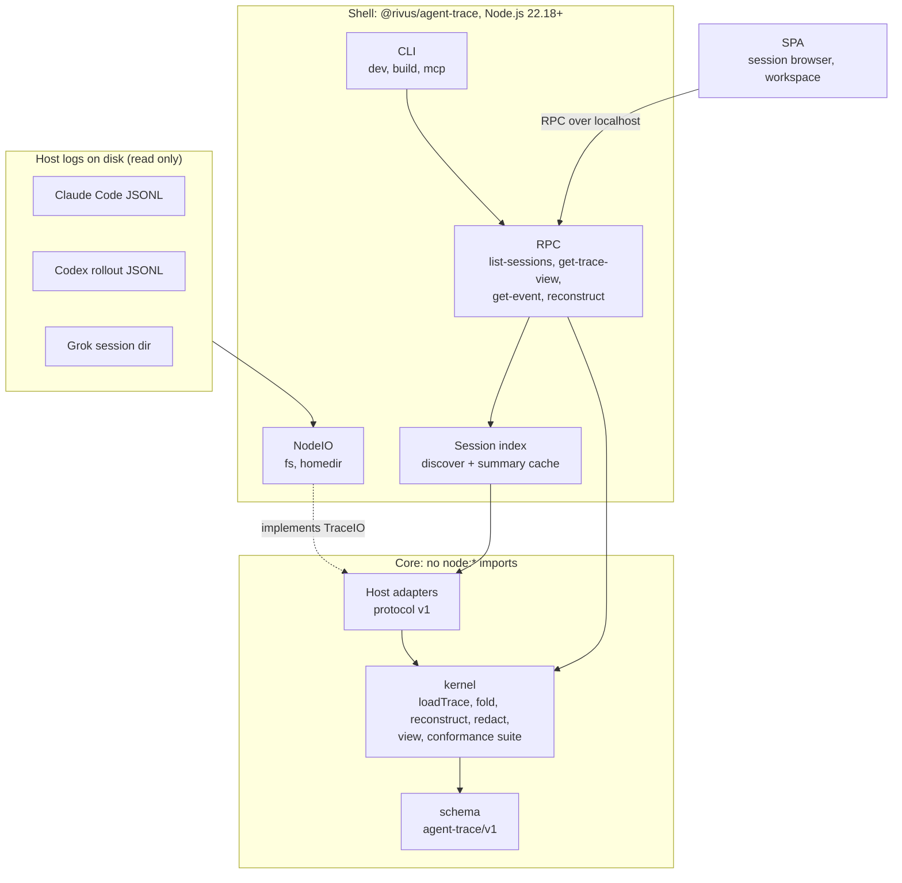
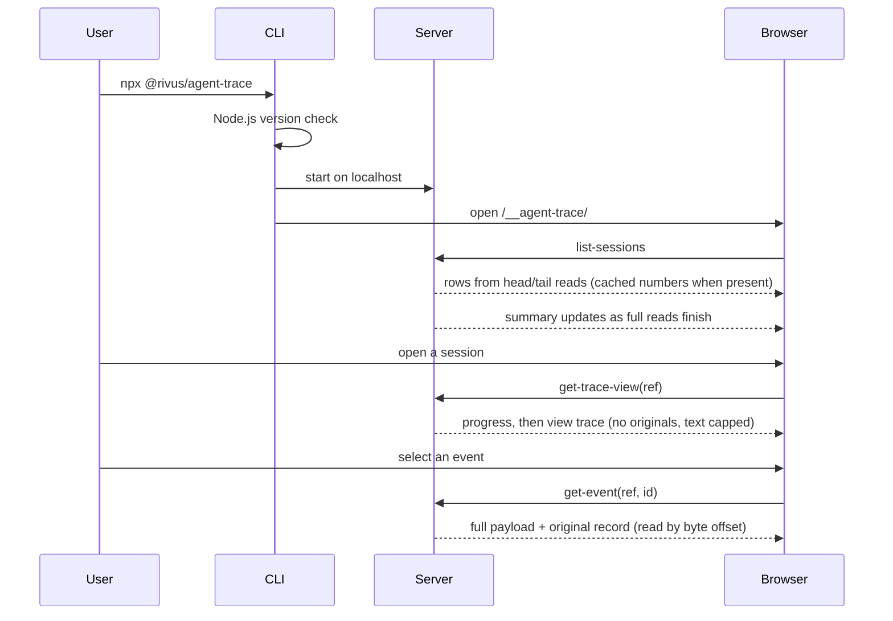
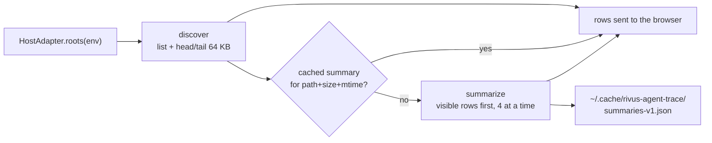
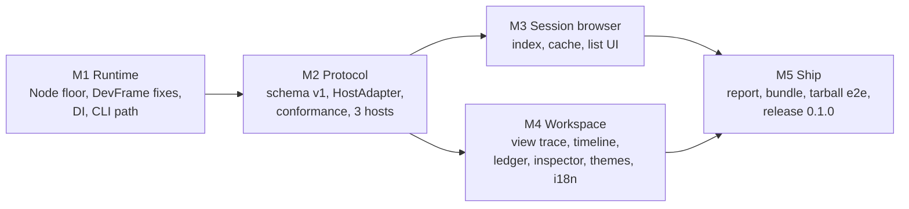

> 中文阅读版。以英文原文 docs/plans/0001-external-release.md 为准。

# agent-trace DevTools：host 协议、会话浏览器与工作区

- 状态：草稿
- 负责人：未确认
- 评审人：未确认
- 最后更新：2026-09-24
- 配套 Spec：[`specs/0001-external-release.md`](../../specs/0001-external-release.md)
- 视觉设计：[`docs/design/`](../design/README.md)

本计划把 `main` 上的 MVP 做成 `@rivus/agent-trace`：一个本地 DevTools，由 `npx @rivus/agent-trace` 在浏览器中打开。用户从 Claude Code、Codex 或 Grok 中选择一个会话，在一个工作区中调试它。本计划定义这三个 host 首先实现的 host 协议、规范 trace `agent-trace/v1`、在真实机器上的会话规模下会话的发现与加载方式、按选定设计实现的英文和简体中文 UI，以及打包。ATIF 导出、OpenCode 和 dsh 是基于同一协议的后续工作。

## 目录

1. 背景与目标
2. 概要
3. 详细设计
4. 上线与稳定性
5. 验证
6. 交付计划与工作量
7. 风险、待定问题与后续工作
8. 附录：测量数据

## 1. 背景与目标

### 1.1 现状与约束

测量于 2026-09-23 和 2026-09-24，基于 `main` 和本机。命令和原始输出位于第 8 节。

**入口。** dev server 在 demo fixture 上可用。`build` 以 1 退出（`Cannot destructure property 'eventId'`），原因是 `reconstruct` 以 `snapshot: true` 注册，而静态 dump 不带参数调用它。`mcp` 以 1 退出（`DF0079`，未安装 `@devframes/agentic`）。会话只来自 `AGENT_TRACE_PATH`；没有会话列表。

**运行时。** `rush.json` 允许 Node.js `>=20.11`。`bin.mjs` 直接导入 `.ts`，`adapter-opencode` 导入 `node:sqlite`。两者在 20.19 和 22.12 上失败，在 22.18 上可用。Node.js 拒绝对 `node_modules` 下的文件做类型剥离，因此发布的包需要编译后的 JavaScript。

**当前 UI。** 在一个真实的 3,300 条记录的 Grok 会话上，ledger 一次渲染 2,258 行（14,066 个 DOM 节点）。其中 1,294 行（57%）是 `UNKNOWN hook_execution`。没有 timeline，没有 turn 折叠，也没有虚拟化。

**Adapter 接口。** `Adapter = { id, detect(path), load(path) }`。它不能列出会话，不能说明 host 提供哪些字段，并且直接通过 `node:fs` 读取文件。`adapter-dsh` 和 `adapter-claude-code` 认领文件后抛出异常。

**本机上的 host 日志。** 三个 host 都记录请求边界、token 用量、耗时、压缩和 subagent，只是名称不同：

| 需求 | Claude Code | Codex | Grok |
|---|---|---|---|
| 位置 | `~/.claude/projects/<cwd>/<id>.jsonl`，subagent 位于 `<id>/subagents/agent-*.jsonl` | `~/.codex/sessions/YYYY/MM/DD/rollout-*.jsonl` | `~/.grok/sessions/<cwd>/<id>/updates.jsonl` 以及 `summary.json`、`system_prompt.txt`、`tool_definitions.json`、`subagents/` |
| 请求边界、模型 | `requestId`, `message.model` | `response_id`, `turn_context` | `_meta.modelId`, `_meta.promptIndex` |
| Token | `message.usage` | `token_usage_record` | `turn_completed.usage` |
| 耗时 | 记录的 `timestamp`、`system/turn_duration` | `started_at_ms`, `completed_at_ms` | `turn_completed.elapsed_ms` |
| 压缩 | `system/compact_boundary`，带 `compactMetadata.{trigger, preTokens, postTokens, durationMs, preservedSegment}` | `compacted` | `auto_compact_started/completed`, `compaction_checkpoint` |
| Subagent | `isSidechain`, `subagents/*.jsonl` | `inter_agent_communication_metadata` | `subagent_spawned/finished`, `subagents/` |
| System prompt、tool schema | 未记录 | 未记录（未对所有格式代际验证） | `system_prompt.txt`, `tool_definitions.json` |

**本机日志量。**

| Host | 文件数 | 总量 | 中位数 | p95 | 最大值 |
|---|---|---|---|---|---|
| Claude Code（主会话） | 225 | 550 MB | 146 KB | 8.6 MB | 81.6 MB |
| Claude Code（subagent） | 74 | 49 MB | 485 KB | 1.1 MB | 5.9 MB |
| Codex | 1,935 | 10.8 GB | 557 KB | 22 MB | 355 MB |
| Grok | 77 | 220 MB | 1.2 MB | 10 MB | 29 MB |

仅统计所有 Claude Code 主会话文件的行数就耗时 2.35 s。当前 Codex adapter 在 1.7 s 内把 355 MB 的文件加载为 16,652 个事件，但序列化后的 trace 为 360 MB，进程 RSS 峰值为 3.2 GB。去掉 `original` 后事件为 21.3 MB；长字符串截断到 4 KB 后为 9.5 MB。

**社区格式**（读自一手来源；第 8 节，A.7）：

- ATIF v1.8（Harbor，Apache-2.0）是由 step 组成的 trajectory 格式。它按 id 配对 tool call 与 result，有成文的压缩边界规则，并内嵌 subagent trajectory。Harbor 提供 Claude Code、Codex、Grok 和 OpenCode 的转换器。它的单位是 step，大致对应一次模型调用。它不保留 host 记录，也不说明一次压缩移除了哪些具体事件。
- OpenTelemetry GenAI 语义约定定义的词汇最广（`gen_ai.usage.*`、`gen_ai.request.model`、`gen_ai.response.id`、`gen_ai.tool.call.id`、`CompactionPart`）。全部处于 Development 稳定级别，并于 2026 年 5 月迁移到独立仓库，尚无发布版本。
- ACP 是实时客户端协议。在这里它是 Grok 的日志格式，不是 trace 模型。
- Cursor 的 "Agent Trace"（agent-trace.dev）是代码归属格式，名称几乎相同，功能上没有重叠。

**发布。** `@rivus/agent-trace` 尚未发布。`PerfectPan/rivus-agent` 是一个私有仓库，在 GitHub release 时通过 `.github/workflows/publish-npm.yml` 发布 `@rivus/*` 包，使用 `id-token: write`，没有 npm token。

### 1.2 问题

开发者无法打开工具、选择一个会话并查看发生了什么。已发布的命令一半不可用，没有会话列表，Claude Code（本地会话最多、压缩数据最丰富的 host）不受支持，数据模型无法表达请求边界、上下文大小或 subagent lane，因此 UI 无法绘制它们。在上述日志规模下，把一个完整 trace 发送给浏览器对最大的会话不可行。

### 1.3 目标与成功标准

- Spec 中每个场景按其 Acceptance Evidence 所列方式通过：在 CI 中针对打包后的 tarball，真实会话则通过一次记录下来的本地运行。
- Claude Code、Codex 和 Grok adapter 实现 host 协议 v1，并在合成 fixture 上通过一致性测试。
- 会话浏览器在本机（2,300+ 个文件，11.6 GB）上 2 s 内显示行，第二次启动时缓存的数字在 300 ms 内显示。
- 355 MB 的 Codex 会话在选中第一个事件之前发送给浏览器的数据最多 12 MB。
- `schema`、`kernel` 和 adapter 在测试之外不导入任何 `node:*` 模块。
- 两个界面在两种主题和两种语言下与 `docs/design/` 一致，在交付 PR 中与设计 HTML 在 1440 × 900 下并排评审。
- 每个 UI 字符串都有英文和简体中文两个版本，由类型检查强制保证。

### 1.4 非目标

- ATIF 导出、OTLP 导出（后续工作，第 7 节）。
- 会话浏览器中的 OpenCode 和 dsh（基于协议 v1 的后续工作）。
- 实时跟随正在运行的会话。
- 标题和首条 prompt 之外的会话内容搜索。
- 内部包的稳定库 API。
- 更改仓库可见性。

## 2. 概要

### 2.1 设计原则

- 产品是 DevTools 界面。CLI 只负责启动它。
- 只绘制 host 记录了的内容。缺失即 `unavailable`，从不为零或估算值。
- host 通过一个带有声明式 capability 列表的协议接入，并用与其他所有 host 相同的一致性测试证明这一点。
- 浏览器接收按显示需要裁剪的 trace 视图。完整记录只需一次请求即可获取。
- 核心不知道字节从哪里来。文件、SQLite、环境变量和 home 目录都由外部传入。

### 2.2 边界与职责



| 组件 | 负责 | 本计划中的变更 |
|---|---|---|
| `@agent-trace/schema` | `agent-trace/v1` 类型、v0 reader | 新的事件类型、请求与压缩 payload、agent、capability、source pointer |
| `@agent-trace/kernel` | `TraceIO`、`HostAdapter`、`loadTrace`、`fold`、`reconstruct`、`redact`、`toView`、一致性测试 | 新协议、视图投影、一致性测试；无 `node:*` |
| `adapter-claude-code` | Claude Code 日志 | 新实现 |
| `adapter-codex`, `adapter-grok` | 各自的日志 | 移植到协议 v1，扩展到请求、用量、耗时、压缩、subagent |
| `adapter-opencode`, `adapter-dsh` | 各自的日志 | 本次发布中不注册 |
| `@agent-trace/devframe`（以 `@rivus/agent-trace` 发布） | NodeIO、会话索引、RPC、CLI、SPA | 大部分工作 |
| `docs/design/` | 视觉契约 | 实现为 `styles.css` 中的 token |

### 2.3 主路径



带路径参数时，CLI 在开始监听之前加载并检查该会话，然后打开该会话的工作区 URL。

### 2.4 设计决策

**D1. 产品是浏览器 DevTools，CLI 是它的启动器。**
备选方案：以 CLI 为主的工具（本计划的上一版草稿），以及桌面应用。CLI 无法展示 timeline 或 inspector。桌面应用增加了安装程序和签名，却没有提供浏览器所缺的任何能力。DevFrame 已经提供本地 server、SPA 外壳、静态构建和 MCP。

**D2. host 协议 v1 取代 `Adapter`。**
当前接口不能列出会话，也不能声明 host 记录了哪些字段，因此 UI 无法区分“零”和“未记录”。协议 v1 增加 `discover`、`summarize`、capability 列表和一致性测试（3.2）。备选方案：保留 `Adapter`，在 shell 中为每个 host 单独添加发现逻辑。未采用，因为那样每个 host 的目录布局知识会分散在两处。

**D3. `agent-trace/v1` 保持事件级粒度，字段含义遵循 OTel GenAI，结构保持可映射到 ATIF。**
事件仍是规范单位，因为 `reconstruct` 按事件作答，inspector 按事件展示原始记录。备选方案：以 ATIF 作为存储（未采用：step 粒度，没有原始记录，没有逐事件可见性），以 OTel span 作为存储（未采用：Development 稳定级别，且 span 树中没有逐事件可见性的位置）。用量、模型、请求和工具字段的含义、单位和名称取自 OTel GenAI，在 TypeScript 中以 camelCase 书写，并附一一对应表（3.3）。v1 中 ATIF 也有的每个字段都必须能无损映射到 ATIF，因此 ATIF 导出这项后续工作是一次投影，而不是重新设计。

**D4. 本次发布包含 Claude Code、Codex 和 Grok。**
Claude Code 在本机会话最多，压缩记录最完整。Codex 和 Grok 已有可移植的 adapter。OpenCode 需要 `SqliteIO`，是同一协议上的下一个 host；dsh 需要 zstd 及其格式目录。

**D5. 核心包的 I/O 通过注入传入。**
`TraceIO`（读取文本、读取字节范围、列出目录、stat）和 `homeDir` 由外部传入；Node 实现位于 shell 中。通过 oxlint 在测试之外对 `node:*` 应用 `no-restricted-imports` 来强制，并在 CI 中对 kernel 和 adapter 做 `esbuild --platform=browser` 打包来强制。两项检查都已在 `main` 上运行，目前均失败（A.5）。

**D6. 浏览器接收视图版 trace，原始记录和完整文本按需加载。**
这改变了 `AGENTS.md` 中的两条现行规则：“规范存储是 `events[]` 加 `original`”变为“每个事件都能返回其原始记录”，“`getTrace` 是一个 snapshot blob”变为“`get-trace-view` 是一个 snapshot blob；`get-event` 返回一个完整事件”。在 355 MB 的会话上测得：完整为 360 MB，去掉原始记录为 21.3 MB，字符串截断到 4 KB 为 9.5 MB（A.6）。备选方案：对事件分页（未采用：timeline 和 ledger 需要每个事件的结构，`reconstruct` 需要完整序列），以及压缩完整 blob（未采用：server 仍需占用 3.2 GB）。server 保存每个事件的 source pointer（文件、字节偏移、长度），在 `get-event` 请求时重新读取该行。`AGENTS.md` 在同一变更中更新。

**D7. 会话发现读取文件头尾，完整摘要延迟计算并缓存到磁盘。**
启动时完整解析 11.6 GB 不可行。`discover` 列出文件，并读取每个文件首尾各 64 KB，以填充标题、项目、开始时间和最后活动时间以及大小。`summarize` 完整解析一个文件，得到 turn、请求、token、时长和标记。shell 优先对可见行运行 `summarize`，并发上限为 4，结果存入 `~/.cache/rivus-agent-trace/summaries-v1.json`，以路径、大小和 mtime 为键。备选方案：SQLite 索引。目前未采用；如果 JSON 缓存超过 5 MB 或首屏超过 2 s，再重新考虑。

**D8. RPC 形态与静态报告。**
查询：`list-sessions`（不是 snapshot）、`get-trace-view(ref)`、`get-event(ref, id)`、`reconstruct(ref, eventId)`（供 MCP 使用；移除 `snapshot: true`，这是测得的 `build` 失败原因）。DevFrame 的静态 dump 只固化无参数的 snapshot 查询，因此 `build <path>` 额外注册一个绑定到该会话的无参数查询 `report-trace`，SPA 检测到它时以报告模式启动。报告包含视图版 trace，以及最多前 2,000 个事件或 20 MB（取较小者）的原始记录，发生截断时在报告头部注明。

**D9. UI 技术栈与设计契约。**
保留 Solid、Tailwind v4 和 shadcn-solid。token、调色板、字体和编码规则来自 `docs/design/README.md`，在 `styles.css` 中以 `data-theme="dark|light"` 下的 CSS 变量实现。ledger 使用 `@tanstack/solid-virtual` 3.13。timeline 和预览形状是根据 kernel 投影绘制的 SVG；不使用图表库。

**D10. 脱敏。**
`redact(trace, { homeDir })` 在每个字符串中把 home 目录替换为 `~`，并替换已知的 token 模式。报告路径始终脱敏。`AGENT_TRACE_REDACT=0` 只影响本地 server。

**D11. 单一打包产物 `@rivus/agent-trace`。**
esbuild 把 shell 和所有 workspace 包打包进 `dist/cli.mjs`，`devframe`、`@devframes/agentic` 和 `cac` 作为运行时依赖。`dist/bin.mjs` 在动态导入之前检查 Node.js `>=22.18`，因为静态导入会先加载 `node:sqlite`。`devframe` 和 `@devframes/agentic` 固定为 `1.0.0`，因为 `@devframes/agentic@1.0.0` 声明了 `peerDependencies: { devframe: "1.0.0" }`。对这一方案的打包探针安装到空目录后，成功运行了 `build` 和 `mcp`（A.4）。

**D12. 发布方式为 GitHub release 加 npm trusted publishing，与 `rivus-agent` 相同。**
一个在 `release: published` 时触发的 workflow 先运行各项检查，再以 `id-token: write` 发布。仓库可以保持私有。本文不断言私有仓库是否会附带 npm provenance。

**D13. UI 字符串通过类型化词典提供英文和简体中文。**
`@solid-primitives/i18n` 2.2 按 locale 各用一份词典解析 key。`en` 是基础词典和类型来源；`zh-CN` 以 `satisfies Dictionary` 对照它声明，因此缺少或多出一个 key 都会让 `typecheck` 失败，新字符串无法只以一种语言发布。日期、时间、时长和数字统一经过一个基于 `Intl.DateTimeFormat`、`Intl.RelativeTimeFormat` 和 `Intl.NumberFormat` 的 `format` 模块；token 缩写（`118.4k`、`2.41M`）与 locale 无关。会话内容按原样渲染，从不经过词典。备选方案：i18next（运行时更大，key 无类型），以及不用库的普通对象（没有插值和复数规则）。CLI 和 MCP 输出保持英文。

## 3. 详细设计

### 3.1 入口

```
npx @rivus/agent-trace [path] [--port] [--host] [--no-open] [--no-auth]
npx @rivus/agent-trace build <path> [--out-dir report]
npx @rivus/agent-trace mcp <path>
```

- 无路径：打开 `/__agent-trace/`（会话浏览器）。
- 有路径：通过 `loadTrace` 加载一次；失败时在监听之前输出消息并以 1 退出；成功时打开 `/__agent-trace/#/s/<ref>`。
- `ref` 是索引分配的不透明 id（host 和路径的哈希）。绝对路径从不出现在 URL 中。
- 未提供路径参数时使用 `AGENT_TRACE_PATH`。

### 3.2 Host 协议 v1

从 `@agent-trace/kernel` 导出：

```ts
export interface TraceIO {
  readText: (path: string) => Promise<string>
  /** `end` is exclusive. */
  readBytes: (path: string, range?: { start: number, end: number }) => Promise<Uint8Array>
  list: (dir: string) => Promise<{ name: string, kind: 'file' | 'dir' }[]>
  /** `null` when the path does not exist. */
  stat: (path: string) => Promise<{ kind: 'file' | 'dir', size: number, mtimeMs: number } | null>
  /** Iterate lines with their byte offsets; used to build source pointers. */
  lines: (path: string, opts?: { signal?: AbortSignal }) => AsyncIterable<{ text: string, offset: number, length: number, line: number }>
}

export interface HostEnv {
  homeDir: string
  env: Readonly<Record<string, string | undefined>>
}

export type Capability =
  | 'requests' | 'usage' | 'durations' | 'thinking'
  | 'compaction' | 'compactionTokens' | 'subagents'
  | 'systemPrompt' | 'toolSchemas' | 'hooks'

export interface SessionRef { host: string, path: string, sessionId?: string }

export interface SessionHead {
  ref: SessionRef
  title?: string
  cwd?: string
  startedAt?: number
  lastActiveAt: number
  sizeBytes: number
  firstPrompt?: string
}

export interface SessionSummary {
  turns?: number
  requests?: number
  tokensIn?: number
  tokensOut?: number
  durationMs?: number
  compactions?: number
  subagents?: number
  failedTools?: number
  /** Input tokens per request in order, downsampled to at most 120 points, for the preview shape. */
  contextShape?: number[]
}

export interface HostAdapter {
  id: string
  displayName: string
  protocol: 1
  capabilities: readonly Capability[]
  /** Default locations for this host, for example `<home>/.claude/projects`. */
  roots: (env: HostEnv) => string[]
  /** Cheap: list files and read at most 64 KB from each end. */
  discover: (root: string, io: TraceIO, opts: { signal?: AbortSignal }) => AsyncIterable<SessionHead | { ref: SessionRef, error: string }>
  detect: (ref: SessionRef, io: TraceIO) => Promise<boolean>
  load: (ref: SessionRef, io: TraceIO, opts: { signal?: AbortSignal, onProgress?: (bytes: number) => void }) => Promise<Trace>
  /** Defaults to `fold(await load(...))`; a host may override it with a faster pass. */
  summarize?: (ref: SessionRef, io: TraceIO, opts: { signal?: AbortSignal }) => Promise<SessionSummary>
}
```

规则：

- adapter 只通过 `TraceIO` 读取，不写入任何内容。
- host 能够记录的字段在 `capabilities` 中声明。已声明的字段在某条记录中缺失时，该记录中为 `undefined`，从不为零。
- `load` 必须覆盖每条输入记录：它要么成为一个或多个事件，要么成为一个带原因和行号的 `skipped` 条目。
- 未知记录类型成为 `unknown` 事件，`payload.type` 设为 host 的类型名。未知的格式代际使 `load` 失败并给出行号。
- 事件 id 在 host 有 id 时从 host id 派生，否则从文件和行派生，因此第二次加载得到相同的 id。

**一致性测试。** `@agent-trace/kernel/conformance` 导出供 Vitest 使用的 `describeHostConformance(adapter, fixtures)`。每个已注册的 adapter 都在其合成 fixture 上运行它。检查项：

1. `discover` 返回每个 fixture 会话，每个文件读取不超过 128 KB。
2. `load` 两次得到相同的事件 id 和顺序。
3. 输入记录数 = 事件数 + skipped 数，以 fixture 的记录数为准。
4. 每个 `tool_result.callId` 都匹配同一 agent 中更早的 `tool_call.callId`，否则该 result 标记为 `orphan`。
5. 每个 `shadowedBy` 都指向更早的 `compaction` 事件。
6. 每个事件都有 source pointer，且能读回同一条记录。
7. 每个已声明的 capability 在声明它的 fixture 中至少出现一次；未声明的从不出现。
8. `summarize` 对该 fixture 等于 `fold(load())`。
9. 从 adapter 入口不可达任何 `node:*` 导入。

### 3.3 规范 trace `agent-trace/v1`

```ts
export type EventKind =
  | 'user' | 'assistant' | 'thinking' | 'tool_call' | 'tool_result'
  | 'request' | 'system' | 'compaction' | 'hook' | 'unknown'

export interface SourcePointer { file: string, offset: number, length: number, line: number }

export interface TraceEvent {
  id: string
  /** Order within the trace; ties in `ts` keep host order. */
  seq: number
  ts: number
  kind: EventKind
  agentId?: string
  parentId?: string
  /** Groups events that belong to one model request. */
  requestId?: string
  shadowedBy?: string
  payload: Record<string, unknown>
  source: SourcePointer
  /** Present in memory and in `get-event`; absent in the view trace. */
  original?: unknown
}

export interface RequestPayload {
  model?: string          // gen_ai.request.model
  responseId?: string     // gen_ai.response.id
  usage?: {
    inputTokens?: number        // gen_ai.usage.input_tokens
    outputTokens?: number       // gen_ai.usage.output_tokens
    cacheReadTokens?: number    // gen_ai.usage.cache_read.input_tokens
    cacheWriteTokens?: number   // gen_ai.usage.cache_write.input_tokens
    reasoningTokens?: number    // gen_ai.usage.reasoning.output_tokens
  }
  startedAt?: number
  durationMs?: number
  stopReason?: string     // gen_ai.response.finish_reasons[0]
}

export interface CompactionPayload {
  trigger?: 'auto' | 'manual'
  preTokens?: number
  postTokens?: number
  summaryEventId?: string
}

export interface ToolCallPayload { callId: string, name: string, args?: unknown }            // gen_ai.tool.call.id, gen_ai.tool.name
export interface ToolResultPayload { callId: string, output?: unknown, isError?: boolean, exitCode?: number, orphan?: boolean }

export interface AgentInfo { id: string, parentId?: string, spawnEventId?: string, title?: string }

export interface Trace {
  schema: 'agent-trace/v1'
  host: { id: string, version?: string }
  session: { id: string, title?: string, cwd?: string, startedAt?: number, endedAt?: number, systemPrompt?: string, tools?: unknown }
  capabilities: Capability[]
  agents: AgentInfo[]
  events: TraceEvent[]
  skipped: { line: number, file: string, reason: string }[]
}
```

- `agent-trace/v0` 文件通过一个 reader 加载，该 reader 把它们转换为 v1，`capabilities: []`，source pointer 为第 0 行。
- payload 的键名按事件类型固定；每个字段旁的注释是其 OTel GenAI 属性。OTLP exporter 一对一映射它们。
- v1 覆盖的每个 ATIF 字段列于第 8 节 A.8，因此 ATIF 导出这项后续工作是一次映射。

**视图版 trace。** `toView(trace, { maxString: 4096 })` 去掉 `original`，把每个字符串截断到 4,096 个字符，并在被截短的事件上记录 `payload.$truncated = [paths]`。ledger 对这些事件显示“已截短”标记；inspector 调用 `get-event`。

### 3.4 会话索引与缓存



- 索引位于 shell 进程中，每次 `list-sessions` 时重建。浏览器先收到行，摘要完成后收到摘要更新。
- 缓存文件以原子方式写入（先写临时文件再 rename）。损坏或版本未知的缓存被丢弃。
- Claude Code 的 subagent 文件计入其父会话，不单独成行。
- 缺失的根目录产生一个 `count: 0` 且 `checked: <path>` 的 host 条目。

### 3.5 会话加载

- `get-trace-view` 通过 adapter 以 `onProgress` 加载，并在返回结果之前向浏览器流式发送进度（已读字节数 / 文件大小）。
- server 在内存中保留最近 3 个已加载的 trace（不含原始记录）；`get-event` 通过 source pointer 读取原始记录。
- 浏览器离开页面时加载被取消（`AbortSignal`）。

### 3.6 UI

组件与设计的对应：

| 区域 | 数据 | 说明 |
|---|---|---|
| 会话浏览器的行与预览 | `list-sessions` 的行与摘要 | 筛选和搜索在客户端对行进行 |
| 会话头部 | `fold(trace)` | 未声明的 capability 显示 "—" |
| Timeline | kernel 中的 `projectRequests(trace)`、`projectLanes(trace)` | 柱高 = `usage.inputTokens`；缺少用量时绘制空心柱；brush 输出一个时间范围 |
| Ledger | `projectTurns(trace)`、hook 运行折叠、来自 `reconstruct` 的可见性 | `@tanstack/solid-virtual`，固定 36 px 行高，40 px turn 标题行 |
| Inspector：Model saw | 扩展了 slot token 数的 `reconstruct(trace, eventId)` | 未记录的 slot 显示带斜线填充的 "unavailable" |
| Inspector：Raw | `get-event` | 格式化打印的原始记录 |
| 主题 | `prefers-color-scheme`，手动切换存于 `localStorage` | token 来自 `docs/design/README.md` |
| 语言 | `navigator.languages`，手动切换存于 `localStorage` | `zh*` 选择 `zh-CN`，其他为 `en`；`<html lang>` 跟随当前 locale |

本地化细节（D13）：

- 词典位于 `packages/devframe/src/client/i18n/{en,zh-CN}.ts`。key 按界面分组（`browser.*`、`workspace.*`、`inspector.*`、`report.*`、`common.*`）。
- 事件类型标签属于 UI 字符串（`REQUEST` / `请求`、`TOOL` / `工具`）。host 名称、模型名称以及 "Raw" 中的字段名不属于。
- 两个字体栈在西文字体之后都加上中文回退：`"PingFang SC", "Hiragino Sans GB", "Noto Sans SC", "Microsoft YaHei"`。大写分区标签及其字距只在 `:lang(en)` 下生效。
- ledger 和会话列表的列宽按两种语言中较长的一种设定；M4 的设计评审包含两个界面的 `zh-CN` 截图。
- 报告打包两份词典（几 KB），以导出时的 locale 打开，并保留切换。

当 host 记录了相应数据时，`reconstruct` 增加每个 slot 的 token 数：请求的输入 token，以及当该请求是压缩后的第一个请求时压缩的 `postTokens`。它不根据文本长度估算 slot 大小。

### 3.7 失败与恢复

| 情况 | 行为 |
|---|---|
| Host 根目录缺失 | Host 显示 0 和所检查的路径 |
| 文件不可读或格式代际未知 | 该行标记为“无法读取”；打开时显示 host、文件和行 |
| 摘要失败 | 该行保留头部字段；数字显示 "—"；失败不缓存 |
| 会话加载失败 | 工作区显示带 host、文件和行的错误；返回列表 |
| 加载期间浏览器关闭 | 加载中止 |
| 缓存损坏 | 丢弃并重建 |
| Node.js < 22.18 | 一行消息，以 1 退出 |

### 3.8 兼容性与迁移

- `Adapter`、`loadTrace(path, adapters)`、`splitSessionRef`、`readJsonl` 的签名改变。所有调用方都在本仓库中。
- `agent-trace/v0` 文件继续可加载（3.3）。
- `AGENTS.md` 中关于 `original` 和 `getTrace` 的规则按 D6 所述改变，与代码在同一个 PR 中。
- 放弃 Node.js 20 和 22.0–22.17；它们从未可用。

### 3.9 安全与隐私

- server 绑定 `localhost`。DevFrame 的认证关卡默认保持开启；`--no-auth` 仍需显式开启。该关卡在 `--open` 下的行为是一个待定问题（第 7 节）。
- URL 携带不透明的会话 ref，从不携带路径。
- 摘要缓存保存标题、首条 prompt（前 200 个字符）、路径和数字。它位于用户的缓存目录中，权限为 0600。
- 报告始终脱敏（D10）。会话文本和文件内容保留；导出对话框和报告头部会说明这一点。
- 不向本机之外发送任何内容。

## 4. 上线与稳定性

### 4.1 阶段



| 阶段 | 交付内容 | 关卡 |
|---|---|---|
| M1 | D5、D11 的运行时部分（Node 最低版本、版本固定、`@devframes/agentic`）、`snapshot` 修复、位置参数路径 | `build` 和 `mcp` 在 demo 上以 0 退出；D5 检查通过 |
| M2 | `agent-trace/v1`、协议 v1、一致性测试、Claude Code adapter、Codex 和 Grok 移植、合成 fixture | 3 个 host 的一致性测试通过；真实会话运行已记录 |
| M3 | 会话索引、缓存、`list-sessions`、会话浏览器界面 | S1、S3、S4 通过；本机 2 s 首屏已记录 |
| M4 | 视图版 trace、`get-event`、timeline、ledger、inspector、主题、英文和中文 UI | S5–S8、S11、S12、S14 通过；对照 `docs/design/` 的两种语言设计评审 |
| M5 | 报告模式、打包、tarball e2e、release workflow | 所有场景在 tarball 上通过；`0.1.0` 已发布 |

M2 之后 M3 和 M4 可以并行。

### 4.2 信号

本地工具，无遥测。信号是 CI 结果和 GitHub issue。

### 4.3 回滚

- M1–M4：revert 该 PR。
- M5：`npm deprecate @rivus/agent-trace@<version> "<reason>"` 并发布一个补丁版本。不 unpublish。

## 5. 验证

### 5.1 单元测试与一致性测试

- Kernel：`toView`、`redact`、`fold`、`reconstruct` 的 slot 计数、投影、v0 reader。
- 每个 host：在 `packages/adapter-*/fixtures/` 下的合成 fixture 上运行 `describeHostConformance`。fixture 依据 1.1 中的记录结构手写，不包含真实会话文本。
- D5：oxlint `node:*` 规则，以及对 kernel 和 adapter 的 `esbuild --platform=browser` 打包。

### 5.2 浏览器端到端测试

使用 Playwright 针对打包后的 tarball 运行，配合一个合成的 home 目录，其中存放三个 host 的 fixture 会话：

| Spec | 检查 |
|---|---|
| S1 | 三个 host 的行以及每个 host 的计数 |
| S3 | 没有 `.codex` 的 home：Codex 显示 0 和所检查的路径 |
| S4 | 格式代际未知的 fixture：“无法读取”行，带行号的错误 |
| S5 | 压缩 fixture：带压缩前/后 token 的虚线分隔线 |
| S6 | 拖动 brush 筛选 ledger；显示事件数 |
| S7 | Model saw：slot、带斜线填充的 system prompt、被移除的事件 |
| S8 | 生成的 10,000 事件 trace：滚动时渲染的行保持在 100 以下 |
| S9 | 导出，从 `file://` 打开，在输出中 grep home 路径 |
| S11 | 模拟浅色配色方案，然后切换并重新加载 |
| S14 | 浏览器 locale 为 `zh-CN`：中文标签和日期格式；会话文本不变；切换到英文后重新加载仍保持 |
| S12 | 生成的 350 MB Codex 格式文件（测试时构建）：选中之前的 payload ≤ 12 MB；选中一个已截短的事件会加载完整文本 |

### 5.3 CLI 冒烟测试

在已安装的 tarball 上运行 S2、S10、S13，Node.js 22.18 和 24；S13 还在 Node.js 20 上运行。

### 5.4 真实会话与设计评审

- 每个 host 通过已安装的 tarball 进行一次本地运行。在交付 PR 中记录 host、事件数、加载时间和视图大小。不含会话文本。
- 两个界面在两种主题下的截图，与相同视口下 `docs/design/*.html` 的截图并排，附在 PR 中，不提交到仓库。
- 本机上会话浏览器的首屏时间和第二次启动时间。

## 6. 交付计划与工作量

一个人即可交付。负责人和日期未确认。估算假设作者熟悉代码库；它们不是承诺。

| 阶段 | 主要工作 | 估算 |
|---|---|---|
| M1 | 运行时修复、`TraceIO`、NodeIO、CLI 路径、D5 检查 | 1.5 天 |
| M2 | Schema v1、协议、一致性测试、Claude Code adapter、Codex 和 Grok 移植、fixture | 5 天 |
| M3 | 索引、缓存、`list-sessions`、会话浏览器 UI | 3 天 |
| M4 | 视图版 trace、`get-event`、投影、timeline、虚拟化 ledger、inspector、主题、词典和格式化 | 7 天 |
| M5 | 报告模式、打包、在 tarball 上运行 Playwright、release workflow | 2.5 天 |

依据：M1 的每项改动都已在探针中试过（第 8 节）；M2 的主要工作量是 Claude Code adapter 和 fixture；M4 的主要工作量是 timeline 和 ledger。

## 7. 风险、待定问题与后续工作

| 事项 | 类型 | 影响 | 负责人 | 下一步 |
|---|---|---|---|---|
| Host 日志格式在无通知的情况下变化 | 风险 | Adapter 在新格式代际上失败 | 未确认 | 带行号明确失败（3.2）；为每个已知格式代际准备一致性测试 fixture |
| DevFrame 认证关卡与 `--open` | 待定问题 | 首次启动时多出的手动步骤会破坏 S1 | 未确认 | 在 M1 中验证；如果它增加了步骤，在做选择之前检查 DevFrame 是否接受打开的 URL 中的一次性 token |
| 摘要缓存保存 prompt 文本 | 风险 | 缓存目录中有敏感文本 | 未确认 | 200 字符上限、权限 0600、写入文档；`--no-cache` 参数 |
| 较慢磁盘上的 2 s 首屏 | 风险 | 未达到 S1 预算 | 未确认 | 在 M3 中测量；SQLite 索引是后备方案（D7） |
| OTel GenAI 重命名 | 风险 | 映射表过时 | 未确认 | 在映射表中固定所用的 schema 版本（撰写时为 `gen-ai-dev/1.42.0-dev`） |
| 与 Cursor Agent Trace 名称重叠 | 风险 | 搜索混淆 | 未确认 | 在文档和 README 标题中保留 `@rivus` scope |
| Node 22 上的 `node:sqlite` ExperimentalWarning | 风险 | Rush 因 stderr 以 1 退出；CLI 打印一条警告 | 未确认 | `main` 上的 opencode 测试中已屏蔽；本次发布不注册 OpenCode |
| ATIF 导出 | 后续工作 | 与 Harbor 评测和数据集互通 | 未确认 | 下一份计划；映射见 A.8；用 Harbor 的 validator 验证 |
| 基于协议 v1 的 OpenCode | 后续工作 | OpenCode 用户 | 未确认 | 需要 `SqliteIO`；0.1.0 之后的下一个 host |
| 基于协议 v1 的 dsh | 后续工作 | dsh 用户 | 未确认 | 需要 zstd 和格式目录 |
| OTLP 导出 | 后续工作 | Langfuse、LangSmith、Phoenix | 未确认 | 在 ATIF 之后 |
| 中文 UI 字符串质量 | 风险 | 直译或术语不一致 | 未确认 | 在 `i18n/zh-CN.ts` 头部注释中维护一份术语表，随 M4 截图一起评审 |
| 更多 UI 语言；本地化的 CLI 和 MCP 输出 | 后续工作 | 非英文、非中文用户 | 未确认 | 增加一个词典；类型检查会覆盖它 |
| 实时跟随、内容搜索、lane 视图切换 | 后续工作 | 查看器功能 | 未确认 | 单独的计划 |

## 8. 附录：测量数据

A.1–A.5 来自 2026-09-23，基于 `main` 的 065ae72。A.6 来自 2026-09-24。

全部在 macOS 上，2026-09-23，来自 `main` 在 065ae72 的一个 worktree，已执行 `install-run-rush.js update` 和 `build`。

A.1 Node.js 版本（`npx -p node@<v>`）：

```
v20.19.0  sqlite FAIL ERR_UNKNOWN_BUILTIN_MODULE   ts import FAIL ERR_UNKNOWN_FILE_EXTENSION
v22.12.0  sqlite FAIL ERR_UNKNOWN_BUILTIN_MODULE   ts import FAIL ERR_UNKNOWN_FILE_EXTENSION
v22.18.0  sqlite ok                                ts import ok
```

v24.18.0 上 `node_modules` 下的类型剥离：`ERR_UNSUPPORTED_NODE_MODULES_TYPE_STRIPPING`。

A.2 `main` 上的静态构建：

```
$ node bin.mjs build --out-dir <dir>; echo $?
TypeError: Cannot destructure property 'eventId' of 'undefined' as it is undefined.
    at handler (packages/devframe/src/rpc/functions/get-trace.ts:60:23)
    at dump (devframe/dist/write-*.mjs)
1
```

仅从 `reconstruct` 移除 `snapshot: true` 时：以 0 退出，且 `agent-trace~get-trace.record.*.json` 包含 `"path":"/Users/<name>/…/fixtures/demo.trace.json"`。

A.3 `main` 上的 MCP：

```
$ node bin.mjs mcp
DF0079: The `mcp` option is enabled, but the optional peer "@devframes/agentic" could not be loaded
```

`@devframes/agentic@1.0.0` 在 npm 上存在，带有 `peerDependencies: { devframe: "1.0.0" }`。

A.4 打包探针（临时目录，未提交）：对 `bin.mjs` 做 esbuild 打包，`devframe`、`@devframes/agentic`、`cac` 设为 external → 20.4 KB。修补了两个相对 URL，并从 `reconstruct` 移除了 `snapshot: true`。执行 `npm pack`，安装到空目录，然后：

```
npx agent-trace --help            → prints usage
npx agent-trace build --out-dir out → exit 0; out/ has index.html, assets/, __rpc-dump/
npx agent-trace mcp  (tools/list) → agent-trace_get-trace, agent-trace_reconstruct, devframe_state_read
                     (reconstruct e6) → visibleIds [e1,e2,e5,e6], unavailable [tools], completeness partial
```

A.5 针对 `main` 的 D5 检查（两者目前都必须失败，D5 之后都必须通过）：

```
$ oxlint -c <config with no-restricted-imports patterns ["node:*"]> packages/kernel/src packages/adapter-grok/src
packages/kernel/src/reconstruct.test.ts:2:1: error eslint(no-restricted-imports): 'node:url' import is restricted …
packages/adapter-grok/src/index.ts:4:1: error eslint(no-restricted-imports): 'node:path' import is restricted …

$ esbuild kernel/src/index.ts adapter-grok/src/index.ts adapter-codex/src/index.ts --bundle --platform=browser
✘ [ERROR] Could not resolve "node:path"
✘ [ERROR] Could not resolve "node:fs/promises"
```

第一个发现是测试文件，这就是该规则排除 `*.test.ts` 的原因。oxlint 1.83.0。

A.6 日志量与大会话加载（2026-09-24，本机）：

```
claude-code main: 225 files, total 550.5 MB, median 146 KB, p95 8.61 MB, max 81.6 MB
claude-code subagents: 74 files, total 48.7 MB, median 485 KB, p95 1.14 MB, max 5.9 MB
codex: 1935 files, total 10832.9 MB, median 557 KB, p95 22.07 MB, max 355.0 MB
grok updates.jsonl: 77 files, total 220.0 MB, median 1211 KB, p95 10.13 MB, max 28.8 MB
full line scan of claude main files: 225062 lines in 2.35s

codexAdapter.load, 26 MB file:  {"events":4970,"loadMs":101,"jsonMB":27.4,"rssMB":411}
codexAdapter.load, 354 MB file: {"events":16652,"loadMs":1712,"jsonMB":359.7,"rssMB":3221}
354 MB file, events JSON size:  {"full":359.7,"withoutOriginal":21.3,"withoutOriginalCapped4k":9.5}
```

当前 UI 在一个 3,300 条记录的 Grok 会话上：渲染 2,258 行，14,066 个 DOM 节点，1,294 行为 `UNKNOWN`（hook 执行）。

A.7 社区格式，一手来源（读于 2026-09-23）：

- ATIF RFC 0001，v1.8，状态 Active：https://github.com/harbor-framework/harbor/blob/main/rfcs/0001-trajectory-format.md 。转换器：同一仓库中的 `src/harbor/agents/installed/{claude_code,codex,grok_build,opencode}.py`（Apache-2.0）。
- OpenTelemetry GenAI 语义约定：https://github.com/open-telemetry/semantic-conventions-genai （创建于 2026-05-05，无发布版本）。
- Agent Client Protocol schema：https://github.com/agentclientprotocol/agent-client-protocol/tree/main/schema
- Claude Code 监控（OTel 导出）：https://code.claude.com/docs/en/monitoring-usage
- Codex OTel：https://github.com/openai/codex/tree/main/codex-rs/otel
- Cursor Agent Trace：https://agent-trace.dev/

A.8 `agent-trace/v1` 到 ATIF v1.8 的映射（ATIF 导出后续工作的约束）：

| v1 | ATIF |
|---|---|
| `session.id` | `session_id`；文档使用 `trajectory_id` |
| `host.id`, `host.version` | `agent.name`, `agent.version` |
| `RequestPayload.model` | `agent.model_name`，或 step 上的 `model_name` |
| `user` 事件 | `source: "user"`、`message` 的 step |
| `assistant` 事件 | `source: "agent"`、`message` 的 step |
| `thinking` 事件 | agent step 上的 `reasoning_content` |
| `tool_call`（`callId`, `name`, `args`） | `tool_calls[]`（`tool_call_id`, `function_name`, `arguments`） |
| `tool_result`（`callId`, `output`） | `observation.results[]`（`source_call_id`, `content`） |
| `usage.inputTokens`, `outputTokens`, `cacheReadTokens` | `metrics.prompt_tokens`, `completion_tokens`, `cached_tokens` |
| `compaction` 事件 | 带 `extra.context_management` `{ type: "compaction", boundary: "replace" }` 的 system step |
| 跨压缩保留的事件 | 带 `is_copied_context: true` 的 step |
| 带 `spawnEventId` 的 `agents[]` | `subagent_trajectories[]` 和 `subagent_trajectory_ref` |
| `session.systemPrompt`, `session.tools` | `source: "system"` 的 step；`agent.tool_definitions` |
| `ts` | `timestamp`（ISO 8601） |
| `durationMs`、`hook` 事件、`skipped`、`source`、`original` | 仅 `extra`；ATIF 没有对应字段 |
