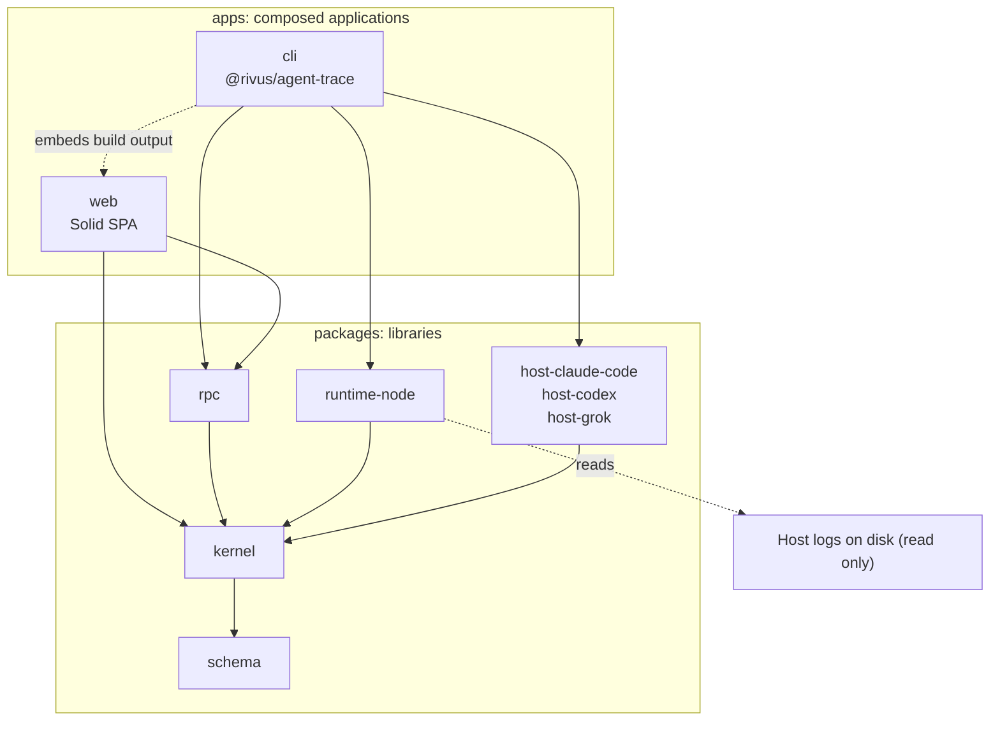
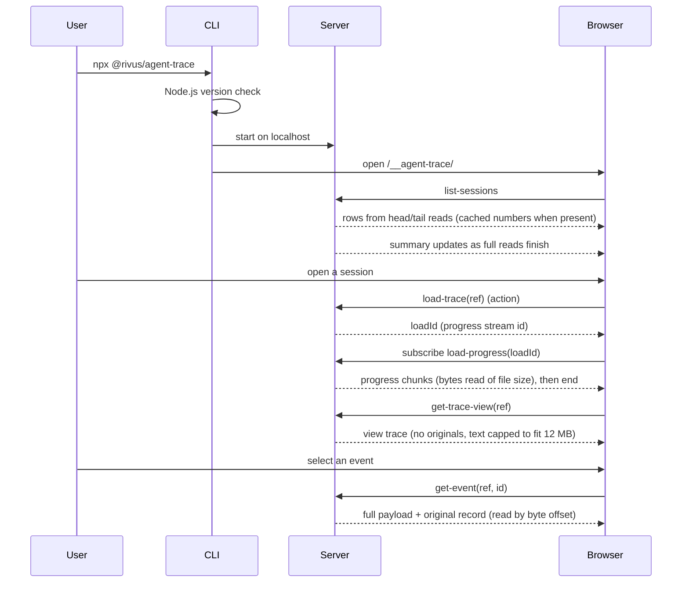
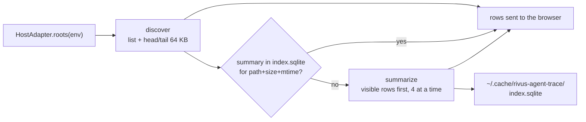
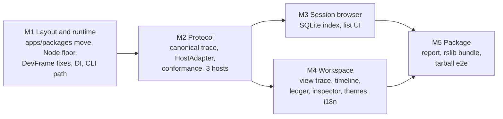

> 中文阅读版。以英文原文 docs/plans/0001-external-release.md 为准。

# agent-trace DevTools：host 协议、会话浏览器与工作区

- 状态：已实现
- 负责人：未确认
- 评审人：未确认
- 最后更新：2026-09-25
- 配套 Spec：[`docs/specs/0001-external-release.md`](../specs/0001-external-release.md)
- 视觉设计：[`docs/design/`](../design/README.md)

本计划把 `main` 上的 MVP 做成 `@rivus/agent-trace`：一个本地 DevTools，由 `npx @rivus/agent-trace` 在浏览器中打开。用户从 Claude Code、Codex 或 Grok 中选择一个会话，在一个工作区中调试它。本计划定义这三个 host 首先实现的 host 协议、规范 trace、在真实机器上的会话规模下会话的发现与加载方式、按选定设计实现的英文和简体中文 UI，以及打包成一个可在任何地方安装和运行的 tarball。发布到 npm、ATIF 导出、OpenCode 和 dsh 是后续工作。目前没有任何发布，因此接口和格式直接原地修改，不设版本号，也不设兼容层。

## 目录

1. 背景与目标
2. 概要
3. 详细设计
4. 上线与稳定性
5. 验证
6. 交付计划与工作量
7. 风险、待定问题与后续工作
8. 附录：测量数据

## 1. 背景与目标

### 1.1 现状与约束

测量于 2026-09-23 和 2026-09-24，基于 `main` 和本机。命令和原始输出位于第 8 节。

**入口。** dev server 在 demo fixture 上可用。`build` 以 1 退出（`Cannot destructure property 'eventId'`），原因是 `reconstruct` 以 `snapshot: true` 注册，而静态 dump 不带参数调用它。`mcp` 以 1 退出（`DF0079`，未安装 `@devframes/agentic`）。会话只来自 `AGENT_TRACE_PATH`；没有会话列表。

**运行时。** `rush.json` 允许 Node.js `>=20.11`。`bin.mjs` 直接导入 `.ts`，`adapter-opencode` 导入 `node:sqlite`。两者在 20.19 和 22.12 上失败，在 22.18 上可用。Node.js 拒绝对 `node_modules` 下的文件做类型剥离，因此发布的包需要编译后的 JavaScript。

**当前 UI。** 在一个真实的 3,300 条记录的 Grok 会话上，ledger 一次渲染 2,258 行（14,066 个 DOM 节点）。其中 1,294 行（57%）是 `UNKNOWN hook_execution`。没有 timeline，没有 turn 折叠，也没有虚拟化。

**Adapter 接口。** `Adapter = { id, detect(path), load(path) }`。它不能列出会话，不能说明 host 提供哪些字段，并且直接通过 `node:fs` 读取文件。`adapter-dsh` 和 `adapter-claude-code` 认领文件后抛出异常。

**本机上的 host 日志。** 三个 host 都记录请求边界、token 用量、耗时、压缩和 subagent，只是名称不同：

| 需求 | Claude Code | Codex | Grok |
|---|---|---|---|
| 位置 | `~/.claude/projects/<cwd>/<id>.jsonl`，subagent 位于 `<id>/subagents/agent-*.jsonl` | `~/.codex/sessions/YYYY/MM/DD/rollout-*.jsonl` | `~/.grok/sessions/<cwd>/<id>/updates.jsonl` 以及 `summary.json`、`system_prompt.txt`、`tool_definitions.json`、`subagents/` |
| 请求边界、模型 | `requestId`, `message.model` | `response_id`, `turn_context` | `_meta.modelId`, `_meta.promptIndex` |
| 请求单位 | 一次模型调用（`requestId`） | 一次模型调用（`token_usage_record`；在第一条之前用 `token_count.info.last_token_usage`） | 每轮一个 request：usage 只记录在 `turn_completed.usage` 中，是该轮所有调用的合计（`modelCalls`、`numTurns` 是计数，`modelUsage` 按模型分）。逐次调用的记录存在（`events.jsonl` 的 `loop_started` / `first_token`，`chat_history.jsonl` 的 assistant 条目），但不带 usage |
| Token | `message.usage` | `token_usage_record` | `turn_completed.usage` |
| 耗时 | 记录的 `timestamp`、`system/turn_duration` | 记录的 `timestamp`、每轮的 `task_complete.duration_ms`；`started_at_ms` / `completed_at_ms` 只出现在 `item_completed` 上 | 每轮的 `turn_completed.elapsed_ms` |
| 压缩 | `system/compact_boundary`，带 `compactMetadata.{trigger, preTokens, postTokens, durationMs, preservedSegment}` | `compacted` | `auto_compact_started/completed`, `compaction_checkpoint` |
| Subagent | `isSidechain`, `subagents/*.jsonl` | `event_msg/item_completed`，其 `item.type` 为 `SubAgentActivity`（`agent_thread_id`）；`inter_agent_communication_metadata` 只带 `trigger_turn` | `subagent_spawned/finished`, `subagents/` |
| System prompt、tool schema | `attachment.type: prompt_snapshot` 的 `attachment` 记录，每个文件一条或多条（主文件和子代理文件都有）。每条都有 `systemPrompt`（字符串数组）；部分还有 `tools`（`tools[].schema.input_schema`）和 `cliPrefix`。从 2.1.268 起可见；没有 snapshot 的文件两者都不记录（2026-09-25 重新测量：221 个主文件中 34 个、95 个子代理文件中 61 个有 snapshot，版本为 2.1.268 或更高的 36 个主文件中有 2 个没有） | System prompt：文件中第一条 `session_meta` 的 `session_meta.base_instructions.text`（2026-09-25，1,941 个 rollout 中 1,984 条 `session_meta` 记录里有 1,846 条；更早的 rollout 没有它）。Tool schema：未记录（`session_meta.dynamic_tools` 只列出动态工具） | `system_prompt.txt`, `tool_definitions.json`（可选；2026-09-25 分别为 66 个会话中 66 个和 10 个） |

**本机日志量。**

| Host | 文件数 | 总量 | 中位数 | p95 | 最大值 |
|---|---|---|---|---|---|
| Claude Code（主会话） | 225 | 550 MB | 146 KB | 8.6 MB | 81.6 MB |
| Claude Code（subagent） | 74 | 49 MB | 485 KB | 1.1 MB | 5.9 MB |
| Codex | 1,935 | 10.8 GB | 557 KB | 22 MB | 355 MB |
| Grok | 77 | 220 MB | 1.2 MB | 10 MB | 29 MB |

仅统计所有 Claude Code 主会话文件的行数就耗时 2.35 s。当前 Codex adapter 在 1.7 s 内把 355 MB 的文件加载为 16,652 个事件，但序列化后的 trace 为 360 MB，进程 RSS 峰值为 3.2 GB。去掉 `original` 后事件为 21.3 MB；长字符串截断到 4 KB 后为 9.5 MB。

**社区格式**（读自一手来源；第 8 节，A.7）：

- ATIF v1.8（Harbor，Apache-2.0）是由 step 组成的 trajectory 格式。它按 id 配对 tool call 与 result，有成文的压缩边界规则，并内嵌 subagent trajectory。Harbor 提供 Claude Code、Codex、Grok 和 OpenCode 的转换器。它的单位是 step，大致对应一次模型调用。它不保留 host 记录，也不说明一次压缩移除了哪些具体事件。
- OpenTelemetry GenAI 语义约定定义的词汇最广（`gen_ai.usage.*`、`gen_ai.request.model`、`gen_ai.response.id`、`gen_ai.tool.call.id`、`CompactionPart`）。全部处于 Development 稳定级别，并于 2026 年 5 月迁移到独立仓库，尚无发布版本。
- ACP 是实时客户端协议。在这里它是 Grok 的日志格式，不是 trace 模型。
- Cursor 的 "Agent Trace"（agent-trace.dev）是代码归属格式，名称几乎相同，功能上没有重叠。

**发布。** `@rivus/agent-trace` 尚未发布，在本计划中也保持未发布。`PerfectPan/rivus-agent` 是一个私有仓库，在 GitHub release 时通过 `.github/workflows/publish-npm.yml` 发布 `@rivus/*` 包，使用 `id-token: write`，没有 npm token。

### 1.2 问题

开发者无法打开工具、选择一个会话并查看发生了什么。已发布的命令一半不可用，没有会话列表，Claude Code（本地会话最多、压缩数据最丰富的 host）不受支持，数据模型无法表达请求边界、上下文大小或 subagent lane，因此 UI 无法绘制它们。在上述日志规模下，把一个完整 trace 发送给浏览器对最大的会话不可行。

### 1.3 目标与成功标准

- Spec 中每个场景按其 Acceptance Evidence 所列方式通过：在 CI 中针对打包后的 tarball，真实会话则通过一次记录下来的本地运行。
- Claude Code、Codex 和 Grok adapter 实现 host 协议，并在合成 fixture 上通过一致性测试。
- 会话浏览器在本机（2,300+ 个文件，11.6 GB）上 2 s 内显示行，第二次启动时缓存的数字在 300 ms 内显示。
- 355 MB 的 Codex 会话在选中第一个事件之前发送给浏览器的数据最多 12 MB。
- `schema`、`kernel`、`rpc` 和每个 `host-*` 包在测试之外不导入任何 `node:*` 模块，并且每个包的依赖都遵守 2.2 中的分层表。
- 两个界面在两种主题和两种语言下与 `docs/design/` 一致，在交付 PR 中与设计 HTML 在 1440 × 900 下并排评审。
- 每个 UI 字符串都有英文和简体中文两个版本，由类型检查强制保证。

### 1.4 非目标

- ATIF 导出、OTLP 导出（后续工作，第 7 节）。
- 会话浏览器中的 OpenCode 和 dsh（基于同一协议的后续工作）。
- 发布到 npm。从现在起用 Rush change file 记录发布意图（D12）；版本号提升和发布 workflow 是后续计划。
- 实时跟随正在运行的会话。
- 标题和首条 prompt 之外的会话内容搜索。
- 内部包的稳定库 API。
- 更改仓库可见性。

## 2. 概要

### 2.1 设计原则

- 产品是 DevTools 界面。CLI 只负责启动它。
- 只绘制 host 记录了的内容。缺失即 `unavailable`，从不为零或估算值。
- host 通过一个带有声明式 capability 列表的协议接入，并用与其他所有 host 相同的一致性测试证明这一点。
- 浏览器接收按显示需要裁剪的 trace 视图。完整记录只需一次请求即可获取。
- 核心不知道字节从哪里来。文件、SQLite、环境变量和 home 目录都由外部传入。

### 2.2 边界与职责

workspace 中有两类项目。`apps/` 存放由库组合而成的应用；`packages/` 存放库。所有项目都使用 `@rivus` scope。只有 `@rivus/agent-trace` 会发布；其他项目都是 `private`，并打包进它。



| 目录 | 包 | 负责 | 允许依赖 |
|---|---|---|---|
| `apps/cli` | `@rivus/agent-trace` | 组合根：注册 host、提供 Node 运行时、启动 DevFrame server、终端输出（D14）、嵌入 web 构建产物、rslib 打包 | 所有包；web 的构建产物 |
| `apps/e2e` | `@rivus/agent-trace-e2e` | 私有测试工具，测试打包后的 tarball：CLI 冒烟测试（5.3）和浏览器测试（5.2） | 运行时不依赖任何包；只用测试工具 |
| `apps/web` | `@rivus/agent-trace-web` | Solid SPA：会话浏览器、工作区、报告模式、词典（D13）、来自 `docs/design/` 的 token | `rpc`（类型）、`kernel`、`schema` |
| `packages/rpc` | `@rivus/agent-trace-rpc` | RPC 契约（`list-sessions`、带 `load-progress` stream 的 `load-trace`、`get-trace-view`、`get-event`、`reconstruct`、`export-report` action，以及 build 模式下的 `report-trace` snapshot）、其 server handler，以及基于注入的解析器和 I/O 的 trace store（ref 解析、共享加载、最近 3 个 trace） | `kernel`、`schema` |
| `packages/runtime-node` | `@rivus/agent-trace-runtime-node` | `NodeIO`（基于 `node:fs` 的 `TraceIO`）、home 目录、基于 `node:sqlite` 的会话索引（D7） | `kernel`、`schema` |
| `packages/host-claude-code`, `host-codex`, `host-grok` | `@rivus/agent-trace-host-<id>` | 每个包对应一个 host：目录布局知识、解析、capability | `kernel`、`schema` |
| `packages/host-opencode`, `host-dsh` | `@rivus/agent-trace-host-<id>` | 保留，本次发布中不注册 | `kernel`、`schema` |
| `packages/kernel` | `@rivus/agent-trace-kernel` | host 协议类型、`loadTrace`、`fold`、`reconstruct`、`redact`、`toView`、投影、一致性测试 | `schema` |
| `packages/schema` | `@rivus/agent-trace-schema` | 规范 trace 类型及其 `zod` schema | 不依赖任何工作区包；可用小型、浏览器安全的外部库（`zod`） |

规则：

- 应用依赖包；包从不依赖应用。两个应用之间不共享代码；`cli` 通过 Rush 构建依赖，以文件形式获取 `web` 的构建产物。
- `apps/cli` 是唯一的组合根。只有它知道注册了哪些 host，以及运行时是 Node。
- 只有 `apps/cli` 和 `packages/runtime-node` 导入 `node:*`。`schema`、`kernel`、`rpc` 和每个 `host-*` 都不导入（D5）。
- UI 组件留在 `apps/web` 内，直到出现第二个使用方。
- “允许依赖”列列出的是工作区包。小型、浏览器安全的外部 npm 库可以使用；`schema` 使用 `zod`，不依赖任何工作区包。
- `apps/e2e` 从外部测试打包后的 tarball：它不依赖任何工作区包，也没有运行时依赖。
- `scripts/check-layers.mjs` 在 CI 中对照“允许依赖”列检查每个 `package.json`。

本计划中的“shell”指 `apps/cli` 加上 `packages/runtime-node`。

### 2.3 主路径



带路径参数时，CLI 在开始监听之前加载并检查该会话，然后打开该会话的工作区 URL。

打开会话需要两次调用，因为 DevFrame 拒绝订阅尚不存在的 stream id（DF0030）：`load-trace` action 创建进度 stream 并返回其 id，浏览器订阅后，`get-trace-view` 在共享的加载完成时返回视图。

### 2.4 设计决策

**D1. 产品是浏览器 DevTools，CLI 是它的启动器。**
备选方案：以 CLI 为主的工具（本计划的上一版草稿），以及桌面应用。CLI 无法展示 timeline 或 inspector。桌面应用增加了安装程序和签名，却没有提供浏览器所缺的任何能力。DevFrame 已经提供本地 server、SPA 外壳、静态构建和 MCP。

**D2. 一个 host 协议取代 `Adapter`。**
当前接口不能列出会话，也不能声明 host 记录了哪些字段，因此 UI 无法区分“零”和“未记录”。host 协议增加 `discover`、`summarize`、capability 列表和一致性测试（3.2）。备选方案：保留 `Adapter`，在 shell 中为每个 host 单独添加发现逻辑。未采用，因为那样每个 host 的目录布局知识会分散在两处。

**D3. 规范 trace 保持事件级粒度，字段含义遵循 OTel GenAI，结构保持可映射到 ATIF。**
事件仍是规范单位，因为 `reconstruct` 按事件作答，inspector 按事件展示原始记录。备选方案：以 ATIF 作为存储（未采用：step 粒度，没有原始记录，没有逐事件可见性），以 OTel span 作为存储（未采用：Development 稳定级别，且 span 树中没有逐事件可见性的位置）。用量、模型、请求和工具字段的含义、单位和名称取自 OTel GenAI，在 TypeScript 中以 camelCase 书写，并附一一对应表（3.3）。ATIF 也有的每个规范字段都必须能无损映射到 ATIF，因此 ATIF 导出这项后续工作是一次投影，而不是重新设计。

**D4. 本次发布包含 Claude Code、Codex 和 Grok。**
Claude Code 在本机会话最多，压缩记录最完整。Codex 和 Grok 已有可移植的 adapter。OpenCode 需要 `SqliteIO`，是同一协议上的下一个 host；dsh 需要 zstd 及其格式目录。

**D5. 核心包的 I/O 通过注入传入。**
`TraceIO`（读取文本、读取字节范围、列出目录、stat）和 `homeDir` 由外部传入；Node 实现位于 `packages/runtime-node` 中。通过 oxlint 在测试之外对 `node:*` 应用 `no-restricted-imports` 来强制，并在 CI 中对 kernel 和 adapter 做 `esbuild --platform=browser` 打包来强制。两项检查都已在 `main` 上运行，目前均失败（A.5，用 esbuild 测得；M1 用 rslib `output.target: 'web'` 运行面向浏览器的打包）。

**D6. 浏览器接收视图版 trace，原始记录和完整文本按需加载。**
这改变了 `AGENTS.md` 中的两条现行规则：“规范存储是 `events[]` 加 `original`”变为“每个事件都能返回其原始记录”，“`getTrace` 是一个 snapshot blob”变为“`get-trace-view` 是一个 snapshot blob；`get-event` 返回一个完整事件”。在 355 MB 的会话上测得：完整为 360 MB，去掉原始记录为 37.9 MB，字符串截断到 4 KB 的视图为 14.0 MB，使用 `fitView` 选定的上限为 11.4 MB（A.6）。备选方案：对事件分页（未采用：timeline 和 ledger 需要每个事件的结构，`reconstruct` 需要完整序列），以及压缩完整 blob（未采用：server 仍需占用 3.2 GB）。server 保存每个事件的 source pointer（文件、字节偏移、长度），在 `get-event` 请求时重新读取该行。`AGENTS.md` 在同一变更中更新。

**D7. 会话发现读取文件头尾，完整摘要延迟计算并存入 SQLite 索引。**
启动时完整解析 11.6 GB 不可行。`discover` 列出文件，并读取每个文件首尾各 64 KB，以填充标题、项目、开始时间和最后活动时间以及大小。`summarize` 完整解析一个文件，得到 turn、请求、token、时长、标记和用户 prompt。shell 优先对可见行运行 `summarize`，并发上限为 4，结果通过内置的 `node:sqlite` 存入 `~/.cache/rivus-agent-trace/index.sqlite`，以路径、大小和 mtime 为键。一张使用 `trigram` tokenizer 的 FTS5 表为标题和用户 prompt 建立索引，因此搜索覆盖每一条 prompt，支持英文和中文，而不只是首条 prompt。实测（A.10）：带 `trigram` 的 FTS5 在 Node.js 22.18（SQLite 3.50.2）和 24.18（SQLite 3.53.1）上可用；插入 2,300 行耗时 13 ms，一次搜索耗时 0.1 ms。
备选方案：JSON 缓存文件（不能搜索，每次整文件重写）；DuckDB（`@duckdb/node-api` 在 macOS arm64 上安装后占 115 MB，扫描全部 550 MB 的 Claude Code 日志耗时 252 ms，而 Node 逐行扫描耗时 1,176 ms，但它会在 adapter 之外用 SQL 重复表述每个 host 的解析规则）；`better-sqlite3`（每个平台一个原生 addon，而 `node:sqlite` 不需要）。Node.js 22 对 `node:sqlite` 打印一条 `ExperimentalWarning`；`dist/bin.mjs` 屏蔽这一条警告，在 M1 中验证。

**D8. RPC 形态与静态报告。**
查询：`list-sessions`（不是 snapshot）、`get-trace-view(ref)`、`get-event(ref, id)`、`reconstruct(ref, eventId)`（供 MCP 使用；移除 `snapshot: true`，这是测得的 `build` 失败原因）。两个 action：`load-trace(ref)` 启动或加入加载，并返回 `load-progress` stream 的 id（2.3）；`export-report(ref, locale)` 为开发服务器上的会话写出与 `build` 相同的报告。DevFrame 的静态 dump 只固化无参数的 snapshot 查询，因此 `build <path>` 额外注册一个绑定到该会话的无参数 snapshot 查询 `report-trace`，它只在 DevFrame 的 build 模式下注册，SPA 检测到它时以报告模式启动。报告包含视图版 trace，以及最多前 2,000 个事件或 20 MB（取较小者）的原始记录，发生截断时在报告头部注明。

**D9. UI 技术栈与设计契约。**
保留 Solid、Tailwind v4 和 shadcn-solid。token、调色板、字体和编码规则来自 `docs/design/README.md`，在 `styles.css` 中以 `data-theme="dark|light"` 下的 CSS 变量实现。ledger 使用 `@tanstack/solid-virtual` 3.13。timeline 和预览形状是根据 kernel 投影绘制的 SVG；不使用图表库。

**D10. 脱敏。**
`redact(trace, { homeDir })` 在每个字符串中把 home 目录替换为 `~`，并替换已知的 token 模式。报告路径始终脱敏。`AGENT_TRACE_REDACT=0` 只影响本地 server。

**D11. 单一打包产物 `@rivus/agent-trace`，用 rslib 构建。**
rslib 1.0 把 shell 和所有 workspace 包打包进 `dist/cli.mjs`（ESM，`output.target: 'node'`，`bundle: true`），`devframe`、`@devframes/agentic` 和 `cac` 作为 external 和运行时依赖。Rspack 把 `new URL('<literal>', import.meta.url)` 解析为资源导入，而在探针中设置 `module.parser.javascript.url: false` 并未关闭这一行为；因此没有任何模块用这种方式定位文件。`apps/cli/src/paths.ts` 用 `join(dirname(fileURLToPath(import.meta.url)), …)` 构造路径，并用一个构建期常量表示打包后的目录布局。`dist/bin.mjs` 在动态导入之前检查 Node.js `>=22.18`，因为静态导入会先加载 `node:sqlite`。`devframe` 和 `@devframes/agentic` 固定为 `1.0.0`，因为 `@devframes/agentic@1.0.0` 声明了 `peerDependencies: { devframe: "1.0.0" }`。探针（A.9）：rslib 打包产物为 20.8 KB，构建耗时 0.12 s，从其 tarball 安装到空目录后，运行了 `build`（以 0 退出）和 `mcp`（reconstruct 返回 `completeness: partial`）。备选方案：esbuild，它同样可用（A.4）；选择 rslib 是为了留在 Rspack 工具链上。

**D12. 现在通过 Rush change file 记录发布意图，发布放到以后。**
`@rivus/agent-trace` 获得一个 Rush version policy，每个改变该包所发布内容的 PR 都附带一个由 `rush change` 生成的 change file，在 CI 中用 `rush change --verify` 检查。发布时，`rush version` 把这些文件转成该包的 `CHANGELOG.md`。版本号提升和 npm 发布 workflow 是后续计划；参考 `PerfectPan/rivus-agent`（dispatch 时运行 Version Packages，GitHub release 时以 `id-token: write` 发布）。这套机制在 M1 之前以单独的 PR 落地。

**D13. UI 字符串通过类型化词典提供英文和简体中文。**
`@solid-primitives/i18n` 2.2 按 locale 各用一份词典解析 key。`en` 是基础词典和类型来源；`zh-CN` 以 `satisfies Dictionary` 对照它声明，因此缺少或多出一个 key 都会让 `typecheck` 失败，新字符串无法只以一种语言发布。日期、时间、时长和数字统一经过一个基于 `Intl.DateTimeFormat`、`Intl.RelativeTimeFormat` 和 `Intl.NumberFormat` 的 `format` 模块；token 缩写（`118.4k`、`2.41M`）与 locale 无关。会话内容按原样渲染，从不经过词典。备选方案：i18next（运行时更大，key 无类型），以及不用库的普通对象（没有插值和复数规则）。CLI 和 MCP 输出保持英文。

**D14. 终端输出通过 `@clack/prompts` 实现；命令解析保留在 cac 上。**
DevFrame 用 cac（`createCac`）构建命令，因此解析保留在那里。`@clack/prompts` 1.8 绘制各个终端时刻（3.1）：`intro`、`spinner`、`progress`、`tasks`、`box`、`log`，以及用于 `--pick` 的 `autocomplete`。create-vite、Astro、Svelte CLI 和 Nuxt 的 CLI 都使用它；它安装约 280 KB，共 6 个包，通过 `node:util.styleText` 着色，并能用 rslib 打包（探针：28 KB）。实测：管道输出中没有颜色代码，但 spinner 仍会写入光标隐藏/显示序列，因此当 `stdout` 不是 TTY 或设置了 `NO_COLOR` 时，shell 把 spinner 和进度改为纯文本行。在 `mcp` 模式下不调用 clack；消息写入 stderr。DevFrame 自己的 `[devframe] …` 行即使在 `NO_COLOR=1` 且输出为管道时也会打印颜色代码（实测）；关闭颜色时 shell 会从这些行中过滤转义序列，并向上游提出修复。备选方案：Ink（React 加上通过 npx 约 24 MB，用于本 CLI 并不具备的全屏 UI）；OpenTUI（需要 Bun 或带实验性参数的 Node.js 26.4，并且每个平台需要一个原生二进制文件）；ora 加 chalk 加 listr2（三个功能重叠的库，约 1.5 MB）。

**D15. 应用负责组合；包负责提供能力。**
MVP 的 `packages/devframe` 把 CLI 入口、server RPC 和 SPA 混在一个包中，因此只有文件布局能说明哪些代码可以使用 Node 或知道 host 列表。2.2 中的布局把这些边界变成包边界，可以用脚本检查。备选方案：保留一个应用包，在内部用文件夹划分（未采用：`node:*` 和依赖规则将只能靠 review 保证），以及把 SPA 放进 `apps/cli`（未采用：静态报告复用同一份构建产物，而且 SPA 不能看到 Node 代码）。adapter 改名为 `host-*`，与 host 协议一致。移动代码是 M1 的第一步。

**D16. 端到端测试基于 Playwright；本地验证通过 chrome-devtools-mcp 或 browser-harness 在真实浏览器中进行。**
CI 用 `@playwright/test` 针对打包后的 tarball 运行浏览器场景（5.2）。本地验证是单独的一步：在一项 UI 改动被称为完成之前，其作者（人或 agent）在真实浏览器中检查它，并把证据附到 PR 中（改动过的界面在两种主题和两种语言下的截图，与 `docs/design/` 并排；console；对于重型视图还有一份性能 trace）。有两个工具用于这一步：
- `chrome-devtools-mcp` 1.10（Chrome DevTools 团队，Node.js）在隔离的 profile 中启动自己的无头 Chrome。文档中给出的命令始终传入 `--no-usage-statistics --no-performance-crux`，因为该 server 默认向 Google 发送使用统计，并可能把 trace URL 发送到 CrUX API；`--allowedUrlPattern` 把浏览器限制在 `http://localhost:*`（Chrome 149+）。探针（A.12）：页面加载、文本等待、无障碍快照、页面内脚本、console、`colorScheme` 模拟和 `--chromeArg=--lang=zh-CN` 在 MVP demo 上都可用，并且探针在 console 中发现了一个真实的 `404`。
- `browser-harness` 通过 CDP 驱动用户自己的 Chrome，用于需要真实浏览器会话的检查。它需要 Python 3.11+，版本为 0.1（alpha），因此只作为本地工具。
具体命令在 M4 中写入 `docs/development/setup.md`。

## 3. 详细设计

### 3.1 入口

```
npx @rivus/agent-trace [path] [--port] [--host] [--no-open] [--no-auth]
npx @rivus/agent-trace build <path> [--out-dir report]
npx @rivus/agent-trace mcp <path>
```

- 无路径：打开 `/__agent-trace/`（会话浏览器）。
- 有路径：通过 `loadTrace` 加载一次；失败时在监听之前输出消息并以 1 退出；成功时打开 `/__agent-trace/#/s/<ref>`。
- `ref` 是索引分配的不透明 id（host 和路径的哈希）。绝对路径从不出现在 URL 中。
- 未提供路径参数时使用 `AGENT_TRACE_PATH`。
- `--pick` 在索引行（标题、host、项目、最后活动）上打开一个 clack `autocomplete`，然后打开所选项的工作区 URL。stdin 不是 TTY 时以 1 退出。

终端时刻（D14）：

| 时刻 | TTY | 不是 TTY 或设置了 `NO_COLOR` |
|---|---|---|
| 启动 | 带名称和版本的 `intro` | `agent-trace <version>` |
| 会话索引 | 按 host 显示已读 / 总文件数的 `progress` | 完成时每个 host 一行 |
| 加载会话 | 显示已读字节数和事件数的 `spinner` | 完成时一行 |
| `build` | `tasks`：加载、脱敏、写入 | 每个步骤一行 |
| 就绪 | 用 `box` 显示 URL，终端支持时为 OSC 8 链接，然后 `outro` | `Ready: <url>` |
| 错误 | 带原因和修复方法的 `log.error`，然后以退出码 1 退出 | 相同文本，无颜色 |
| `mcp` | 只用 stderr；stdout 承载协议 | 相同 |

### 3.2 Host 协议

从 `@rivus/agent-trace-kernel` 导出：

```ts
export interface TraceIO {
  readText: (path: string) => Promise<string>
  /** `end` is exclusive. */
  readBytes: (path: string, range?: { start: number, end: number }) => Promise<Uint8Array>
  list: (dir: string) => Promise<{ name: string, kind: 'file' | 'dir' }[]>
  /** `null` when the path does not exist. */
  stat: (path: string) => Promise<{ kind: 'file' | 'dir', size: number, mtimeMs: number } | null>
  /** Iterate lines with their byte offsets; used to build source pointers. */
  lines: (path: string, opts?: { signal?: AbortSignal }) => AsyncIterable<{ text: string, offset: number, length: number, line: number }>
}

export interface HostEnv {
  homeDir: string
  env: Readonly<Record<string, string | undefined>>
}

export type Capability =
  | 'requests' | 'usage' | 'durations' | 'thinking'
  | 'compaction' | 'compactionTokens' | 'subagents'
  | 'systemPrompt' | 'toolSchemas' | 'hooks'

export interface SessionRef { host: string, path: string, sessionId?: string }

export interface SessionHead {
  ref: SessionRef
  title?: string
  cwd?: string
  startedAt?: number
  lastActiveAt: number
  sizeBytes: number
  firstPrompt?: string
}

export interface SessionSummary {
  turns?: number
  requests?: number
  tokensIn?: number
  tokensOut?: number
  durationMs?: number
  compactions?: number
  subagents?: number
  failedTools?: number
  /** Input tokens per request in order, downsampled to at most 120 points, for the preview shape. */
  contextShape?: number[]
}

export interface HostAdapter {
  id: string
  displayName: string
  capabilities: readonly Capability[]
  /** Default locations for this host, for example `<home>/.claude/projects`. */
  roots: (env: HostEnv) => string[]
  /** Cheap: list files and read at most 64 KB from each end. */
  /** `onTotal` reports the number of files under the root before their heads are read (progress). */
  discover: (root: string, io: TraceIO, opts: { signal?: AbortSignal, onTotal?: (files: number) => void }) => AsyncIterable<SessionHead | { ref: SessionRef, error: string }>
  detect: (ref: SessionRef, io: TraceIO) => Promise<boolean>
  load: (ref: SessionRef, io: TraceIO, opts: { signal?: AbortSignal, onProgress?: (bytes: number) => void }) => Promise<Trace>
  /** Defaults to `fold(await load(...))`; a host may override it with a faster pass. */
  summarize?: (ref: SessionRef, io: TraceIO, opts: { signal?: AbortSignal }) => Promise<SessionSummary>
}
```

规则：

- adapter 只通过 `TraceIO` 读取，不写入任何内容。
- host 能够记录的字段在 `capabilities` 中声明。已声明的字段在某条记录中缺失时，该记录中为 `undefined`，从不为零。
- `HostAdapter.capabilities` 列出 host 记录的数据种类。`Trace.capabilities` 对每个 trace 重复这些种类，但 `systemPrompt` 和 `toolSchemas` 除外：只有当 trace 的文件含有这些内容时（Claude Code 的 prompt snapshot、Codex 的 `base_instructions`、Grok 的 `system_prompt.txt` 或 `tool_definitions.json`）才列出它们。其他每个 capability 的含义都是“这个 host 记录这类数据”，而不是该会话一定含有这类数据。
- `load` 必须覆盖每条输入记录：它要么成为一个或多个事件，要么成为一个带原因和行号的 `skipped` 条目。
- 未知记录类型成为 `unknown` 事件，`payload.type` 设为 host 的类型名。未知的格式代际使 `load` 失败并给出行号。
- 事件 id 在 host 有 id 时从 host id 派生，否则从文件和行派生，因此第二次加载得到相同的 id。

**一致性测试。** `@rivus/agent-trace-kernel/conformance` 导出供 Vitest 使用的 `describeHostConformance(adapter, fixtures)`。每个已注册的 adapter 都在其合成 fixture 上运行它。检查项：

1. `discover` 返回每个 fixture 会话，每个文件读取不超过 128 KB。
2. `load` 两次得到相同的事件 id 和顺序。
3. 每条输入记录都被计入：它是一个或多个事件的来源，或者对应一条 `skipped`。
4. 每个 `tool_result.callId` 都匹配同一 agent 中更早的 `tool_call.callId`，否则该 result 标记为 `orphan`。
5. 每个 `shadowedBy` 都指向同一 agent 更晚的 `compaction` 事件。
6. 每个事件都有 source pointer，且能读回同一条记录。
7. 每个已声明的 capability 在声明它的 fixture 中至少出现一次；未声明的从不出现。trace 只列出已声明的 capability，列出其 fixture 声明的每个 capability，并且从不出现它没有列出的 capability；它恰好在出现 `systemPrompt` 和 `toolSchemas` 时列出它们。
8. `summarize` 对该 fixture 等于 `fold(load())`。
9. 从 adapter 入口不可达任何 `node:*` 导入。
10. 事件 id 唯一。
11. `seq` 等于事件下标，并且严格递增。
12. 每个 `shadowedBy` 都留在同一个 agent 内。
13. 对测试中生成的大于 128 KB 的会话，`discover` 从两端各读取不超过 64 KB，不读整个文件。

### 3.3 规范 trace

```ts
export type EventKind =
  | 'user' | 'assistant' | 'thinking' | 'tool_call' | 'tool_result'
  | 'request' | 'system' | 'compaction' | 'hook' | 'unknown'

export interface SourcePointer { file: string, offset: number, length: number, line: number }

export interface TraceEvent {
  id: string
  /** Order within the trace; ties in `ts` keep host order. */
  seq: number
  ts: number
  kind: EventKind
  agentId?: string
  parentId?: string
  /** Groups events that belong to one model request. */
  requestId?: string
  shadowedBy?: string
  payload: Record<string, unknown>
  source: SourcePointer
  /** Present in memory and in `get-event`; absent in the view trace. */
  original?: unknown
}

export interface RequestPayload {
  model?: string          // gen_ai.request.model
  responseId?: string     // gen_ai.response.id
  usage?: {
    inputTokens?: number        // total input, including cached tokens (OTel gen_ai.usage.input_tokens); cache_read/cache_write are breakdowns
    outputTokens?: number       // gen_ai.usage.output_tokens
    cacheReadTokens?: number    // gen_ai.usage.cache_read.input_tokens
    cacheWriteTokens?: number   // gen_ai.usage.cache_write.input_tokens
    reasoningTokens?: number    // gen_ai.usage.reasoning.output_tokens
  }
  startedAt?: number
  durationMs?: number
  stopReason?: string     // gen_ai.response.finish_reasons[0]
}

export interface CompactionPayload {
  trigger?: 'auto' | 'manual'
  preTokens?: number
  postTokens?: number
  summaryEventId?: string
}

export interface ToolCallPayload { callId: string, name: string, args?: unknown }            // gen_ai.tool.call.id, gen_ai.tool.name
export interface ToolResultPayload { callId: string, output?: unknown, isError?: boolean, exitCode?: number, orphan?: boolean }

export interface PromptSnapshotPayload { type: 'prompt_snapshot', systemPrompt?: string, tools?: unknown[] }  // on a `system` event

export interface AgentInfo { id: string, parentId?: string, spawnEventId?: string, title?: string, systemPrompt?: string }  // systemPrompt: this lane's own, when recorded

export interface Trace {
  schema: 'agent-trace'
  host: { id: string, version?: string }
  session: { id: string, title?: string, cwd?: string, startedAt?: number, endedAt?: number, systemPrompt?: string, tools?: unknown }
  capabilities: Capability[]
  agents: AgentInfo[]
  events: TraceEvent[]
  skipped: { line: number, file: string, reason: string }[]
}
```

一个 `request` 事件是一次模型调用。只记录每轮合计的 host 每轮发出一个 request，并在 adapter 里说明。轮次耗时放在 `type: 'turn_duration'` 的 `system` 事件上，从不写进 request 的 `durationMs`。

在会话过程中记录 system prompt 或工具列表的 host，把每条这样的记录作为其泳道上 `type: 'prompt_snapshot'` 的 `system` 事件（`PromptSnapshotPayload`）发出；该事件保留 source pointer 和原始记录，上下文压缩不会遮蔽它。`reconstruct` 用该泳道上、位于该事件处或之前、记录了相应字段的最新 snapshot 填充 `system` 和 `tools` 槽位，并在 `slot.recordedBy` 中给出它；没有这样的 snapshot 的槽位为 `unavailable`，即使之后有 snapshot。`session.systemPrompt` 和 `session.tools` 保存主泳道最新的 snapshot，`AgentInfo.systemPrompt` 保存子代理泳道自己的。没有 snapshot 的 trace 对每个事件都使用这些会话和泳道字段。Claude Code 用一个空行连接记录的 `systemPrompt` 各块。视图版 trace 对每个不同的 snapshot system prompt 和非空工具列表只保留一份，放在第一个含有它的 snapshot 上；之后内容相同的 snapshot 带有指向该 snapshot 的 `systemPromptSameAs` / `toolsSameAs`，并在 `payload.$truncated` 中列出该字段，因此 `get-event` 返回完整内容，`reconstruct` 在视图上给出相同结果。记录为空的工具列表是 `empty` 槽位。

- `schema: 'agent-trace'` 标记一个规范 JSON 文件。demo fixture 改写为这一形状；不保留 MVP 形状的 reader。
- payload 的键名按事件类型固定；每个字段旁的注释是其 OTel GenAI 属性。OTLP exporter 一对一映射它们。
- ATIF 也覆盖的每个规范字段列于第 8 节 A.8，因此 ATIF 导出这项后续工作是一次映射。

**视图版 trace。** `toView(trace, { maxString: 4096 })` 去掉 `original`，把每个字符串截断到 4,096 个字符，并在被截短的事件上记录 `payload.$truncated = [paths]`。ledger 对这些事件显示“已截短”标记；inspector 调用 `get-event`。为降低每个事件的开销，视图在 `sourceFiles` 中只列一次源文件，每个事件的 `source.file` 存其下标；`skipped` 按文件和原因合并并带计数。Codex 事件 id 为 `L<line>`，因为一个 Codex trace 只有一个文件。`get-trace-view` 调用 `fitView`：视图在 12 MB 预算（1.3）内时保持 4,096；否则上限按 0.75 倍逐步降低直到放得下，最低 256。视图在 `view.maxString` 中记录所用上限，UI 可据此说明文本被进一步截短。在 355 MB 的会话上上限为 2,304（A.6）。在 256 的下限时，一个 Codex 事件在视图中约占 466 字节，因此约可容纳 25,600 个事件；更大的会话会得到 `view.withinBudget: false`、一行 server 日志，以及 UI 中的提示。

### 3.4 会话索引



- 表：`sessions`（ref、host、路径、大小、mtime、头部字段、摘要数字、标记、错误），`prompts`（会话 ref、序号、每条用户 prompt 的前 500 个字符，每个会话最多 200 条），以及 `search`，一张覆盖标题和 prompt 的 FTS5 `trigram` 表。
- `list-sessions` 从索引和最近一次 `discover` 读取行。浏览器先收到行，摘要完成后收到摘要更新。
- 搜索在索引中运行，不在浏览器中运行。短于 3 个字符的查询（`trigram` 分词无法匹配）回退为对标题和 `prompts` 表的子串匹配（`LIKE '%q%'`，已转义），因此 2 个字符的中文词仍能找到对应会话。
- 索引是一份缓存。`PRAGMA user_version` 记录其布局；布局不同或无法打开的文件会被删除并重建。每批摘要的写入在一个事务中执行。
- Claude Code 的 subagent 文件计入其父会话，不单独成行。
- 缺失的根目录产生一个 `count: 0` 且 `checked: <path>` 的 host 条目。

### 3.5 会话加载

- `load-trace(ref)` 通过 adapter 以 `onProgress` 启动或加入加载，并返回 stream id。浏览器立即（5 秒内）用它订阅 `load-progress`，接收已读字节数 / 文件大小，然后调用 `get-trace-view(ref)`，后者在加载完成时返回。
- server 在内存中保留最近 3 个已加载的 trace（不含原始记录）；`get-event` 通过 source pointer 读取原始记录，当文件已变化且该处字节不再是那条记录时，返回 `originalUnavailable` 及原因。
- 每个读取方都持有该加载，最后一次释放时中止它（`AbortSignal`）：浏览器离开页面、断开连接、从未订阅或打开另一个会话时取消 stream。另一个标签页或 MCP `reconstruct` 持有自己的 hold，因此不会因某个浏览器的跳转而被取消。
- 错误信息在到达浏览器之前经过脱敏。
- DevFrame 1.0.0 不暴露 stream 的订阅者，因此 5 秒检查读取的是发起调用的连接的订阅。DevFrame 1.0.0 不会重连已关闭的 WebSocket，因此连接断开时浏览器显示“连接已断开”并提供重新加载；重新加载后页面的 `load-trace` 会加入正在进行的加载，或拿到已缓存的 trace。

### 3.6 UI

组件与设计的对应：

| 区域 | 数据 | 说明 |
|---|---|---|
| 会话浏览器的行与预览 | `list-sessions` 的行与摘要 | 筛选和搜索在客户端对行进行 |
| 会话头部 | `fold(trace)` | 未声明的 capability 显示 "—" |
| Timeline | kernel 中的 `projectRequests(trace)`、`projectLanes(trace)` | 柱高 = `usage.inputTokens`；缺少用量时绘制空心柱；brush 输出一个时间范围 |
| Ledger | `projectTurns(trace)`、hook 运行折叠、来自 `reconstruct` 的可见性 | `@tanstack/solid-virtual`，固定 36 px 行高，40 px turn 标题行 |
| Inspector：Model saw | 扩展了 slot token 数的 `reconstruct(trace, eventId)` | 未记录的 slot 显示带斜线填充的 "unavailable" |
| Inspector：Raw | `get-event` | 格式化打印的原始记录 |
| 主题 | `prefers-color-scheme`，手动切换存于 `localStorage` | token 来自 `docs/design/README.md` |
| 语言 | `navigator.languages`，手动切换存于 `localStorage` | `zh*` 选择 `zh-CN`，其他为 `en`；`<html lang>` 跟随当前 locale |

本地化细节（D13）：

- 词典位于 `apps/web/src/i18n/{en,zh-CN}.ts`。key 按界面分组（`browser.*`、`workspace.*`、`inspector.*`、`report.*`、`common.*`）。
- 事件类型标签属于 UI 字符串（`REQUEST` / `请求`、`TOOL` / `工具`）。host 名称、模型名称以及 "Raw" 中的字段名不属于。
- 两个字体栈在西文字体之后都加上中文回退：`"PingFang SC", "Hiragino Sans GB", "Noto Sans SC", "Microsoft YaHei"`。大写分区标签及其字距只在 `:lang(en)` 下生效。
- ledger 和会话列表的列宽按两种语言中较长的一种设定；M4 的设计评审包含两个界面的 `zh-CN` 截图。
- 报告打包两份词典（几 KB），以导出时的 locale 打开，并保留切换。

当 host 记录了相应数据时，`reconstruct` 增加每个 slot 的 token 数：请求的输入 token，以及当该请求是压缩后的第一个请求时压缩的 `postTokens`。它不根据文本长度估算 slot 大小。每个计数列出它共同覆盖的 slot，因为 host 记录的是总数，而非每个 slot 的大小。`reconstruct` 只在目标事件自己的 agent lane 上计算：一次模型调用只看到其所属 agent 的事件。

### 3.7 失败与恢复

| 情况 | 行为 |
|---|---|
| Host 根目录缺失 | Host 显示 0 和所检查的路径 |
| 文件不可读或格式代际未知 | 该行标记为“无法读取”；打开时显示 host、文件和行 |
| 摘要失败 | 该行保留头部字段；数字显示 "—"；失败不缓存 |
| 会话加载失败 | 工作区显示带 host、文件和行的错误；返回列表 |
| 加载期间浏览器关闭 | 加载中止 |
| 缓存损坏 | 丢弃并重建 |
| Node.js < 24 | 一行消息，以 1 退出 |

### 3.8 兼容性与迁移

- `Adapter`、`loadTrace(path, adapters)`、`splitSessionRef`、`readJsonl` 的签名改变，并且每个 workspace 包都改名为 `@rivus/agent-trace-*`。所有调用方都在本仓库中。
- `AGENTS.md` 在布局迁移 PR 中把其分层表更新为 2.2 的内容。
- 没有兼容层：目前没有任何发布，因此接口和文件形状直接原地修改。
- `AGENTS.md` 中关于 `original` 和 `getTrace` 的规则按 D6 所述改变，与代码在同一个 PR 中。
- 放弃低于 24 的 Node.js：20 和 22.0–22.17 从未可用，22.18 和 23 随 Node 24 要求一起放弃（#22）。

### 3.9 安全与隐私

- server 绑定 `localhost`。DevFrame 的认证关卡默认保持开启；`--no-auth` 仍需显式开启。该关卡在 `--open` 下的行为是一个待定问题（第 7 节）。
- URL 携带不透明的会话 ref，从不携带路径。
- 索引保存标题、用户 prompt（每条前 500 个字符）、路径和数字。它位于用户的缓存目录中，权限为 0600。`--no-index` 在不读写索引的情况下运行。
- 报告始终脱敏（D10）。会话文本和文件内容保留；导出对话框和报告头部会说明这一点。
- 不向本机之外发送任何内容。

## 4. 上线与稳定性

### 4.1 阶段



| 阶段 | 交付内容 | 关卡 |
|---|---|---|
| M1 | D15 布局迁移（`apps/cli`、`apps/web`、`packages/rpc`、`packages/runtime-node`、`host-*` 改名、`check-layers.mjs`）、D5、D11 的运行时部分（Node 最低版本、版本固定、`@devframes/agentic`）、`snapshot` 修复、位置参数路径、D14 终端输出和 `--pick` 骨架 | `build` 和 `mcp` 在 demo 上以 0 退出；D5 检查通过；S15 通过 |
| M2 | 规范 trace、host 协议、一致性测试、Claude Code adapter、Codex 和 Grok 移植、合成 fixture | 3 个 host 的一致性测试通过；真实会话运行已记录 |
| M3 | 会话索引（SQLite、FTS5）、`list-sessions`、会话浏览器界面 | S1、S3、S4 通过；本机 2 s 首屏已记录 |
| M4 | 视图版 trace、`get-event`、timeline、ledger、inspector、主题、英文和中文 UI | S5–S8、S11、S12、S14 通过；对照 `docs/design/` 的两种语言设计评审 |
| M5 | 报告模式、rslib 打包、tarball e2e | 所有场景在 tarball 上通过 |

M2 之后 M3 和 M4 可以并行。

### 4.2 信号

本地工具，无遥测。信号是 CI 结果和 GitHub issue。

### 4.3 回滚

- M1–M4：revert 该 PR。
- M5：revert 该 PR。没有任何发布。

## 5. 验证

### 5.1 单元测试与一致性测试

- Kernel：`toView`、`redact`、`fold`、`reconstruct` 的 slot 计数、投影。
- 每个 host：在 `packages/host-*/fixtures/` 下的合成 fixture 上运行 `describeHostConformance`。fixture 依据 1.1 中的记录结构手写，不包含真实会话文本。
- D5：oxlint `node:*` 规则，以及对 kernel 和 adapter 的面向浏览器的 rslib 打包。

### 5.2 浏览器端到端测试

使用 Playwright 针对打包后的 tarball 运行，配合一个合成的 home 目录，其中存放三个 host 的 fixture 会话。每个场景在出现 console 错误时也会失败：

| Spec | 检查 | 方法 |
|---|---|---|
| S1 | 三个 host 的行以及每个 host 的计数 | 按 host 定位行 |
| S3 | 没有 `.codex` 的 home：Codex 显示 0 和所检查的路径 | 单独的合成 home |
| S4 | 格式代际未知的 fixture：“无法读取”行，带行号的错误 | 点击该行，读取错误面板 |
| S5 | 压缩 fixture：带压缩前/后 token 的虚线分隔线 | timeline SVG 的 locator 及其标签 |
| S6 | brush 筛选 ledger；显示事件数。brush 手柄可以获得焦点，并能用方向键移动 | 在获得焦点的手柄上使用 `page.keyboard`，以及鼠标拖动 |
| S7 | Model saw：slot、有 prompt snapshot 时 system prompt 和工具为存在、没有时带斜线填充、被移除的事件 | 在两个 Claude Code 会话中选中该请求，读取 inspector |
| S8 | 生成的 10,000 事件 trace：滚动时渲染的行保持在 100 以下，且滚动期间没有超过 200 ms 的长任务 | DOM 中的行数；页面内针对 `longtask` 的 `PerformanceObserver` |
| S9 | 导出，从 `file://` 打开，在输出中 grep home 路径 | `page.goto('file://…')`；在 Node 中扫描文件 |
| S11 | 模拟浅色配色方案，然后切换并重新加载 | `page.emulateMedia({ colorScheme })`，重新加载 |
| S12 | 生成的 350 MB Codex 格式文件（测试时构建）：选中之前的 payload ≤ 12 MB；选中一个已截短的事件会加载完整文本 | 对 `page.on('response')` 得到的响应大小求和 |
| S14 | 浏览器 locale 为 `zh-CN`：中文标签和日期格式；会话文本不变；切换到英文后重新加载仍保持 | `locale: 'zh-CN'` 的浏览器 context |

M4 的设计评审属于本地验证（D16），不属于这套测试。

### 5.3 CLI 冒烟测试

在已安装的 tarball 上运行 S2、S10、S13、S15，Node.js 24；S13 还在 Node.js 22 上运行。S16 在伪终端中运行（`node-pty`，仅用于测试 harness）。

### 5.4 真实会话与设计评审

- 每个 host 通过已安装的 tarball 进行一次本地运行。在交付 PR 中记录 host、事件数、加载时间和视图大小。不含会话文本。
- 两个界面在两种主题和两种语言下的截图，与相同视口下 `docs/design/*.html` 的截图并排，在本地验证（D16）中截取，附在 PR 中，不提交到仓库。
- 本机上会话浏览器的首屏时间和第二次启动时间。

## 6. 交付计划与工作量

一个人即可交付。负责人和日期未确认。估算假设作者熟悉代码库；它们不是承诺。

| 阶段 | 主要工作 | 估算 |
|---|---|---|
| M1 | 布局迁移和分层检查、运行时修复、`TraceIO`、`NodeIO`、CLI 路径、D5 检查、终端输出 | 3.5 天 |
| M2 | 规范 trace、host 协议、一致性测试、Claude Code adapter、Codex 和 Grok 移植、fixture | 5 天 |
| M3 | 带 FTS5 的 SQLite 索引、`list-sessions`、会话浏览器 UI | 3.5 天 |
| M4 | 视图版 trace、`get-event`、投影、timeline、虚拟化 ledger、inspector、主题、词典和格式化 | 7 天 |
| M5 | 报告模式、rslib 打包、在 tarball 上运行的 Playwright 测试套件 | 2 天 |

依据：M1 的每项改动都已在探针中试过（第 8 节）；M2 的主要工作量是 Claude Code adapter 和 fixture；M4 的主要工作量是 timeline 和 ledger。

### 6.1 交付说明

按计划实现，以下是交付过程中做出的选择：

- RPC：D8 和 2.2 表格现在列出 `export-report` action（工作区中的“导出报告”）和 `report-trace` snapshot，后者只在 DevFrame 的 build 模式下注册。
- 报告文件：在 Chromium 中，从 `file://` 打开的页面无法用 `fetch()` 读取 DevFrame 的静态 dump，无法运行模块脚本，也无法加载字体。`build` 仍然注册 `report-trace` 并由 DevFrame 烘焙；随后报告写入器把烘焙结果以 `<script type="application/json" id="report-trace">` 放入 `index.html`，内联脚本（web 构建只有一个 chunk）、样式和 `woff2` 字体，并删除 `assets/`、`__rpc-dump/` 和 `__connection.json`。一份报告就是一个 `index.html`。agent-trace 不再读取 `--pretty`；DevFrame 仍在 `build --help` 中列出它，但它没有作用。
- 会话列表：行发送 `shape`（摘要的 `contextShape` 缩放到 0–100），而不是 `contextShape`。
- 摘要在服务开始监听后才开始计算，每次 `summarize` 失败都会把该行标为“无法读取”并附上原因；3.7 中“行保留头部字段；数字显示 —”指的就是这一行。
- 词典文件是 `apps/web/src/i18n/dictionary.en.ts` 和 `dictionary.zh-CN.ts`，而不是 `{en,zh-CN}.ts`。
- “模型所见”列出 host 记录的每个 token 数，以及该数共同覆盖的槽位（请求的输入 token、上下文压缩的压缩后 token）；没有按槽位的计数。
- `reconstruct` 作用于目标事件所在的泳道：子代理的请求只看到该子代理的事件。
- System prompt 和工具：1.1 表格曾写 Claude Code 两者都不记录。Claude Code 写入 `prompt_snapshot` attachment（从 2.1.268 起可见），Codex rollout 带有 `session_meta.base_instructions.text`；adapter 现在读取它们（3.3），trace 只在文件记录了它们时才列出 `systemPrompt` / `toolSchemas`（3.2），“模型所见”根据该 trace 缺少的内容说明不可用的槽位，并把已记录的槽位链接到它的 snapshot。视图对每个不同的 snapshot 提示词和工具列表只保留一份（3.3）。
- 报告内容：前面的事件以完整形式包含（规范化 payload 加原始记录），而不只是原始记录，因此这些事件的截短文本也是完整的。2,000 个事件和 20 MB 的上限按这些完整事件计算。`build` 不记录语言，因此它的报告按浏览器语言打开；导出会记录界面语言。
- 导出：“导出报告”写入服务工作目录下一个新的 `agent-trace-report-<ref>-<time>/` 目录，并显示绝对路径，主目录显示为 `~`。导出一次只运行一个。DevFrame 的 build 模式跳过会话推送，因此在开发服务器内运行的 build 不会重新绑定正在使用的共享状态。
- 旧的 `get-trace` 已删除。`mcp` 保留基于 TraceStore 的 `reconstruct`。“模型所见”在浏览器中基于视图版 trace 计算 `reconstruct`，开发服务器和报告中都是如此。
- S4：会话列表不会打开“无法读取”的行。它的预览显示文件、行号和原因；该 ref 的工作区 URL 在错误面板中显示 host、文件和行号。
- S2：CLI 打开 `<base>?s=<ref>#devframe_otp=<code>`，因为 DevFrame 的一次性码使用 fragment；SPA 把 ref 移到 `#/s/<ref>`。冒烟测试检查打开的 URL；浏览器测试检查落地的路由。
- Ledger：一个轮次中每个子代理泳道的事件收在该泳道 spawn 调用处的一行子代理行之后；行高按行类型固定（hook 折叠行 30 px，上下文压缩行 44 px）。
- 工具：`@clack/prompts` 打包进 `dist/cli.mjs`；`node-pty` 使用 `1.2.0-beta.15`，因为 1.1.0 没有 Linux 预编译包；`dist/THIRD-PARTY-NOTICES.txt` 由一个小的 rspack 插件写出；`npm pack` 在打包后的 `devDependencies` 中保留 `workspace:*`，`npm install` 会忽略它（发布的后续工作应使用 Rush 或 pnpm 打包）。
- 浏览器测试在 CI 中使用 Playwright 的 Chromium。在无法访问 Playwright 下载地址的机器上，`AGENT_TRACE_E2E_CHANNEL=chrome` 让它在已安装的 Google Chrome 上运行。

## 7. 风险、待定问题与后续工作

| 事项 | 类型 | 影响 | 负责人 | 下一步 |
|---|---|---|---|---|
| Host 日志格式在无通知的情况下变化 | 风险 | Adapter 在新格式代际上失败 | 未确认 | 带行号明确失败（3.2）；为每个已知格式代际准备一致性测试 fixture |
| DevFrame 认证关卡与 `--open` | 待定问题 | 首次启动时多出的手动步骤会破坏 S1 | 未确认 | 在 M1 中验证；如果它增加了步骤，在做选择之前检查 DevFrame 是否接受打开的 URL 中的一次性 token |
| 索引保存 prompt 文本 | 风险 | 缓存目录中有敏感文本 | 未确认 | 每条 prompt 500 字符上限、权限 0600、写入文档；`--no-index` 参数 |
| 较慢磁盘上的 2 s 首屏 | 风险 | 未达到 S1 预算 | 未确认 | 在 M3 中测量；首屏只需要 `discover` 和索引读取 |
| OTel GenAI 重命名 | 风险 | 映射表过时 | 未确认 | 在映射表中固定所用的 schema 版本（撰写时为 `gen-ai-dev/1.42.0-dev`） |
| 与 Cursor Agent Trace 名称重叠 | 风险 | 搜索混淆 | 未确认 | 在文档和 README 标题中保留 `@rivus` scope |
| 早期 Node 24 上的 `node:sqlite` ExperimentalWarning | 风险 | Rush 因 stderr 以 1 退出；CLI 打印一条警告 | 未确认 | `main` 上的 opencode 测试中已屏蔽；本次发布不注册 OpenCode |
| 用 DuckDB 做跨会话分析 | 后续工作 | 对原始日志更快的批量查询 | 未确认 | 如果某个功能需要，作为可选依赖（A.10） |
| ATIF 导出 | 后续工作 | 与 Harbor 评测和数据集互通 | 未确认 | 下一份计划；映射见 A.8；用 Harbor 的 validator 验证 |
| npm 发布 | 后续工作 | 用户从 registry 安装 | 未确认 | Version Packages 和发布 workflow，在 M5 之后；参考 `rivus-agent` |
| 基于 host 协议的 OpenCode | 后续工作 | OpenCode 用户 | 未确认 | 需要 `SqliteIO`；M5 之后的下一个 host |
| 基于 host 协议的 dsh | 后续工作 | dsh 用户 | 未确认 | 需要 zstd 和格式目录 |
| OTLP 导出 | 后续工作 | Langfuse、LangSmith、Phoenix | 未确认 | 在 ATIF 之后 |
| 中文 UI 字符串质量 | 风险 | 直译或术语不一致 | 未确认 | 在 `i18n/zh-CN.ts` 头部注释中维护一份术语表，随 M4 截图一起评审 |
| 更多 UI 语言；本地化的 CLI 和 MCP 输出 | 后续工作 | 非英文、非中文用户 | 未确认 | 增加一个词典；类型检查会覆盖它 |
| chrome-devtools-mcp 默认发送使用数据 | 风险 | 一次本地检查向 Google 发送统计数据 | 未确认 | 文档中给出的命令传入两个关闭上报的参数（D16） |
| DevFrame 日志行忽略 `NO_COLOR` | 风险 | CI 日志中出现转义码 | 未确认 | 在 shell 中过滤（D14）；向 DevFrame 提出修复 |
| Grok 逐次调用的 request | 后续工作 | Grok 的 request 按轮次，看不到逐次调用的上下文增长 | 未确认 | 把 `events.jsonl` 的 `loop_started` / `first_token` 与 `chat_history.jsonl` 的 assistant 条目对应到调用；除非 Grok 逐次记录 usage，usage 仍按轮次 |
| 实时跟随、内容搜索、lane 视图切换 | 后续工作 | 查看器功能 | 未确认 | 单独的计划 |

## 8. 附录：测量数据

A.1–A.5 来自 2026-09-23，基于 `main` 的 065ae72。A.6 来自 2026-09-24。

全部在 macOS 上，2026-09-23，来自 `main` 在 065ae72 的一个 worktree，已执行 `install-run-rush.js update` 和 `build`。

A.1 Node.js 版本（`npx -p node@<v>`）：

```
v20.19.0  sqlite FAIL ERR_UNKNOWN_BUILTIN_MODULE   ts import FAIL ERR_UNKNOWN_FILE_EXTENSION
v22.12.0  sqlite FAIL ERR_UNKNOWN_BUILTIN_MODULE   ts import FAIL ERR_UNKNOWN_FILE_EXTENSION
v22.18.0  sqlite ok                                ts import ok
```

v24.18.0 上 `node_modules` 下的类型剥离：`ERR_UNSUPPORTED_NODE_MODULES_TYPE_STRIPPING`。

A.2 `main` 上的静态构建：

```
$ node bin.mjs build --out-dir <dir>; echo $?
TypeError: Cannot destructure property 'eventId' of 'undefined' as it is undefined.
    at handler (packages/devframe/src/rpc/functions/get-trace.ts:60:23)
    at dump (devframe/dist/write-*.mjs)
1
```

仅从 `reconstruct` 移除 `snapshot: true` 时：以 0 退出，且 `agent-trace~get-trace.record.*.json` 包含 `"path":"/Users/<name>/…/fixtures/demo.trace.json"`。

A.3 `main` 上的 MCP：

```
$ node bin.mjs mcp
DF0079: The `mcp` option is enabled, but the optional peer "@devframes/agentic" could not be loaded
```

`@devframes/agentic@1.0.0` 在 npm 上存在，带有 `peerDependencies: { devframe: "1.0.0" }`。

A.4 打包探针（临时目录，未提交）：对 `bin.mjs` 做 esbuild 打包，`devframe`、`@devframes/agentic`、`cac` 设为 external → 20.4 KB。修补了两个相对 URL，并从 `reconstruct` 移除了 `snapshot: true`。执行 `npm pack`，安装到空目录，然后：

```
npx agent-trace --help            → prints usage
npx agent-trace build --out-dir out → exit 0; out/ has index.html, assets/, __rpc-dump/
npx agent-trace mcp  (tools/list) → agent-trace_get-trace, agent-trace_reconstruct, devframe_state_read
                     (reconstruct e6) → visibleIds [e1,e2,e5,e6], unavailable [tools], completeness partial
```

A.5 针对 `main` 的 D5 检查（两者目前都必须失败，D5 之后都必须通过）：

```
$ oxlint -c <config with no-restricted-imports patterns ["node:*"]> packages/kernel/src packages/adapter-grok/src
packages/kernel/src/reconstruct.test.ts:2:1: error eslint(no-restricted-imports): 'node:url' import is restricted …
packages/adapter-grok/src/index.ts:4:1: error eslint(no-restricted-imports): 'node:path' import is restricted …

$ esbuild kernel/src/index.ts adapter-grok/src/index.ts adapter-codex/src/index.ts --bundle --platform=browser
✘ [ERROR] Could not resolve "node:path"
✘ [ERROR] Could not resolve "node:fs/promises"
```

第一个发现是测试文件，这就是该规则排除 `*.test.ts` 的原因。oxlint 1.83.0。

A.6 日志量与大会话加载（2026-09-24，本机）：

```
claude-code main: 225 files, total 550.5 MB, median 146 KB, p95 8.61 MB, max 81.6 MB
claude-code subagents: 74 files, total 48.7 MB, median 485 KB, p95 1.14 MB, max 5.9 MB
codex: 1935 files, total 10832.9 MB, median 557 KB, p95 22.07 MB, max 355.0 MB
grok updates.jsonl: 77 files, total 220.0 MB, median 1211 KB, p95 10.13 MB, max 28.8 MB
full line scan of claude main files: 225062 lines in 2.35s

codexAdapter.load, 26 MB file:  {"events":4970,"loadMs":101,"jsonMB":27.4,"rssMB":411}
codexAdapter.load, 354 MB file: {"events":16652,"loadMs":1712,"jsonMB":359.7,"rssMB":3221}
354 MB file, events JSON size:  {"full":359.7,"withoutOriginal":21.3,"withoutOriginalCapped4k":9.5}
```

```
M4a, 2026-09-25, canonical trace from M2 (13,163 events, 355.0 MB file; MB = 10^6 bytes):
without originals, no cap:             37.87 MB
view at 4,096 (M2 ids, file per event): 18.57 MB
view at 4,096 (files interned, skipped merged, short Codex ids): 14.04 MB
view at 3,072:                           12.66 MB
view at 2,304 (fitView choice):          11.45 MB; get-trace-view response 11.40 MB redacted
load 896 ms, view build 245 ms, peak RSS 1,082 MiB, get-event 9 ms
synthetic 360.5 MB Codex file (test-time generator): 10,976 events, view 11.77 MB at 4,096
at the 256 floor: 6.14 MB for 13,163 events (466 B per event), so about 25,600 Codex events fit
```

当前 UI 在一个 3,300 条记录的 Grok 会话上：渲染 2,258 行，14,066 个 DOM 节点，1,294 行为 `UNKNOWN`（hook 执行）。

A.7 社区格式，一手来源（读于 2026-09-23）：

- ATIF RFC 0001，v1.8，状态 Active：https://github.com/harbor-framework/harbor/blob/main/rfcs/0001-trajectory-format.md 。转换器：同一仓库中的 `src/harbor/agents/installed/{claude_code,codex,grok_build,opencode}.py`（Apache-2.0）。
- OpenTelemetry GenAI 语义约定：https://github.com/open-telemetry/semantic-conventions-genai （创建于 2026-05-05，无发布版本）。
- Agent Client Protocol schema：https://github.com/agentclientprotocol/agent-client-protocol/tree/main/schema
- Claude Code 监控（OTel 导出）：https://code.claude.com/docs/en/monitoring-usage
- Codex OTel：https://github.com/openai/codex/tree/main/codex-rs/otel
- Cursor Agent Trace：https://agent-trace.dev/

A.8 规范 trace 到 ATIF v1.8 的映射（ATIF 导出后续工作的约束）：

| 规范 trace | ATIF |
|---|---|
| `session.id` | `session_id`；文档使用 `trajectory_id` |
| `host.id`, `host.version` | `agent.name`, `agent.version` |
| `RequestPayload.model` | `agent.model_name`，或 step 上的 `model_name` |
| `user` 事件 | `source: "user"`、`message` 的 step |
| `assistant` 事件 | `source: "agent"`、`message` 的 step |
| `thinking` 事件 | agent step 上的 `reasoning_content` |
| `tool_call`（`callId`, `name`, `args`） | `tool_calls[]`（`tool_call_id`, `function_name`, `arguments`） |
| `tool_result`（`callId`, `output`） | `observation.results[]`（`source_call_id`, `content`） |
| `usage.inputTokens`, `outputTokens`, `cacheReadTokens` | `metrics.prompt_tokens`, `completion_tokens`, `cached_tokens` |
| `compaction` 事件 | 带 `extra.context_management` `{ type: "compaction", boundary: "replace" }` 的 system step |
| 跨压缩保留的事件 | 带 `is_copied_context: true` 的 step |
| 带 `spawnEventId` 的 `agents[]` | `subagent_trajectories[]` 和 `subagent_trajectory_ref` |
| `session.systemPrompt`, `session.tools` | `source: "system"` 的 step；`agent.tool_definitions` |
| `ts` | `timestamp`（ISO 8601） |
| `durationMs`、`hook` 事件、`skipped`、`source`、`original` | 仅 `extra`；ATIF 没有对应字段 |

A.9 rslib 探针（2026-09-24，临时目录，未提交）。`@rslib/core` 1.0.2，ESM，`target: 'node'`，`bundle: true`，external 为 `devframe`、`@devframes/agentic`、`cac`。保留那两处 `new URL('<literal>', import.meta.url)` 查找时，构建失败并报 `Module not found: Can't resolve '../dist/client'`，设置 `module.parser.javascript.url: false` 后同样失败。把这些查找改写为 `join(dirname(fileURLToPath(import.meta.url)), …)` 之后：

```
ready   built in 0.12s
File (esm)     Size
dist/cli.mjs   20.8 kB

installed tarball: npx agent-trace build --out-dir out → build exit 0
installed tarball: npx agent-trace mcp, tools/call agent-trace_reconstruct e6 → "completeness": "partial"
```

A.10 索引存储测量（2026-09-24）：

```
node:sqlite, 2,300 rows + FTS5 trigram, one search:
{"node":"v22.18.0","sqlite":"3.50.2","fts":"fts5+trigram","insert2300ms":13,"query":2300,"queryMs":0.11}   (prints ExperimentalWarning)
{"node":"v24.18.0","sqlite":"3.53.1","fts":"fts5+trigram","insert2300ms":14,"query":2300,"queryMs":0.12}

@duckdb/node-api 1.5.5-r.5 install: node_modules 115M (node-bindings-darwin-arm64 113M)
Scan of all Claude Code main logs (550 MB, 221 files), assistant records and input tokens:
duckdb {"requests":"53136","input_tokens":"91828506","files":"221"} 252ms
node   {"requests":53135,"input_tokens":91828474,"files":221} 1176ms
```

A.11 终端输出探针（2026-09-24，临时目录）。`@clack/prompts` 1.8.1（依赖 `@clack/core` 1.5.1 和 `sisteransi`）用 rslib 打包为 `clk.mjs`，28.0 kB。输出中的转义序列：

```
piped:              2   (cursor hide/show from the spinner, no color)
FORCE_COLOR=1:      10
DevFrame build line, piped:            ^[[36m[devframe] copying SPA from …
DevFrame build line, NO_COLOR=1 piped: ^[[36m[devframe] copying SPA from …
```

A.12 浏览器自动化探针（2026-09-24）。`chrome-devtools-mcp` 1.10.1 通过 stdio 运行，参数为 `--headless --isolated --no-usage-statistics --no-performance-crux`，针对 demo trace 上的 MVP dev server：

```
tools: 30 (includes new_page, wait_for, take_snapshot, evaluate_script, click, press_key, emulate,
       list_console_messages, list_network_requests, performance_start_trace, take_screenshot)
new_page 1749ms ok
wait_for 20ms ok                     (text "Turn 1")
snapshot 30 lines; "Turn 1": true; USER tag: true
evaluate {"rows":9,"title":"Agent Trace"}
console  [error] Failed to load resource: the server responded with a status of 404
--chromeArg=--lang=zh-CN  → navigator.languages ["zh-CN","zh"]
emulate colorScheme light → matchMedia("(prefers-color-scheme: dark)").matches false
```

不带这两个关闭上报的参数时，server 会打印它收集使用统计，以及性能工具可能把 trace URL 发送到 Google CrUX API。
